# Activity diagram

- Text in, diagram out. Describe the flow top to bottom, branches and loops included.
- Reads top to bottom. The order in your text is the order in your diagram.
- Easy to restructure. Reordering steps or adding a branch is a text edit, not a redraw.

## Simple action

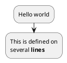

## Other simple action (defined as a list)

### Simple action list separated by -

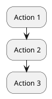

### Simple action list separated by *

#### With one level

```plantuml
@startuml
* Action 1
* Action 2
* Action 3
@enduml
```

#### With several levels

```plantuml
@startuml
<style>
element {MinimumWidth 150}
</style>
* Action 1
** Sub-Action 1.1
** Sub-Action 1.2
*** Sub-Action 1.2.1
*** Sub-Action 1.2.2
* Action 2
@enduml
```

## Start/Stop/End

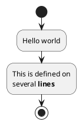

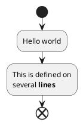

## Conditional [if, then, else, endif]

- if (...) then (...) ... [else (...) ...] endif

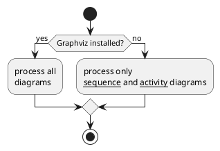

- if (...) is (...) then ... [else (...) ...] endif

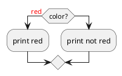

- if (...) equals (...) then ... [else (...) ...] endif

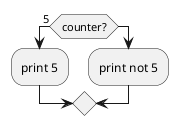

### Several tests (horizontal mode)

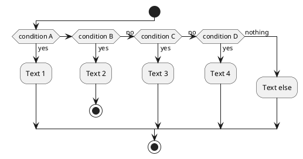

### Several tests (vertical mode)

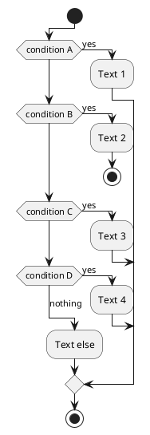
```
java -jar plantuml.jar -PuseVerticalIf=on
```

## Switch and case [switch, case, endswitch]

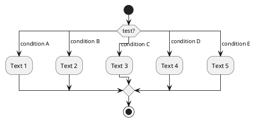

## Conditional with stop on an action [kill, detach]

```plantuml
@startuml
if (condition?) then
  :error;
  stop
endif
:action; <<#palegreen>>
@enduml
```

- kill

```plantuml
@startuml
if (condition?) then
  :error; <<#pink>>
  kill
endif
:action; <<#palegreen>>
@enduml
```

- detach

```plantuml
@startuml
if (condition?) then
  :error; <<#pink>>
  detach
endif
:action; <<#palegreen>>
@enduml
```

## Repeat loop

### Simple repeat loop

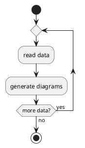

### Repeat loop with repeat action and backward action

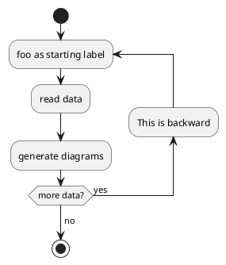

## Break on a repeat loop [break]

```plantuml
@startuml
start
repeat
  :Test something;
    if (Something went wrong?) then (no)
      :OK; <<#palegreen>>
      break
    endif
    ->NOK;
    :Alert "Error with long text";
repeat while (Something went wrong with long text?) is (yes) not (no)
->//merged step//;
:Alert "Success";
stop
@enduml
```

## Goto and Label Processing [label, goto]

- label <label_name>
- goto <label_name>

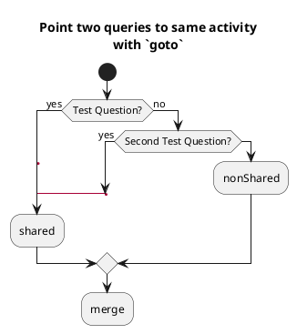

## While loop

### Simple while loop

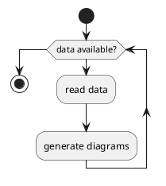

```plantuml
@startuml
while (check filesize ?) is (not empty)
  :read file;
endwhile (empty)
:close file;
@enduml
```

### While loop with backward action

```plantuml
@startuml
while (check filesize ?) is (not empty)
  :read file;
  backward:log;
endwhile (empty)
:close file;
@enduml
```

### Infinite while loop

```plantuml
@startuml
:Step 1;
if (condition1) then
  while (loop forever)
   :Step 2;
  endwhile
  -[hidden]->
  detach
else
  :end normally;
  stop
endif
@enduml
```

## Parallel processing [fork, fork again, end fork, end merge]

### Simple fork

```plantuml
@startuml
start
fork
  :action 1;
fork again
  :action 2;
end fork
stop
@enduml
```

### fork with end merge

```plantuml
@startuml
start
fork
  :action 1;
fork again
  :action 2;
end merge
stop
@enduml
```

```plantuml
@startuml
start
fork
  :action 1;
fork again
  :action 2;
fork again
  :action 3;
fork again
  :action 4;
end merge
stop
@enduml
```

```plantuml
@startuml
start
fork
  :action 1;
fork again
  :action 2;
  end
end merge
stop
@enduml
```

### Label on end fork (or UML joinspec):

```plantuml
@startuml
start
fork
  :action A;
fork again
  :action B;
end fork {or}
stop
@enduml
```

```plantuml
@startuml
start
fork
  :action A;
fork again
  :action B;
end fork {and}
stop
@enduml
```

### Other example

```plantuml
@startuml

start

if (multiprocessor?) then (yes)
  fork
    :Treatment 1;
  fork again
    :Treatment 2;
  end fork
else (monoproc)
  :Treatment 1;
  :Treatment 2;
endif

@enduml
```

## Split processing

### Split

```plantuml
@startuml
start
split
   :A;
split again
   :B;
split again
   :C;
split again
   :a;
   :b;
end split
:D;
end
@enduml
```

### Input split (multi-start)

```plantuml
@startuml
split
   -[hidden]->
   :A;
split again
   -[hidden]->
   :B;
split again
   -[hidden]->
   :C;
end split
:D;
@enduml
```

```plantuml
@startuml
split
   -[hidden]->
   :A;
split again
   -[hidden]->
   :a;
   :b;
split again
   -[hidden]->
   (Z)
end split
:D;
@enduml
```

### Output split (multi-end)

```plantuml
@startuml
start
split
   :A;
   kill
split again
   :B;
   detach
split again
   :C;
   kill
end split
@enduml
```

```plantuml
@startuml
start
split
   :A;
   kill
split again
   :b;
   :c;
   detach
split again
   (Z)
   detach
split again
   end
split again
   stop
end split
@enduml
```

## Notes

```plantuml
@startuml

start
:foo1;
floating note left: This is a note
:foo2;
note right
  This note is on several
  //lines// and can
  contain <b>HTML</b>
  ====
  * Calling the method ""foo()"" is prohibited
end note
stop

@enduml
```

```plantuml
@startuml
start
repeat :Enter data;
:Submit;
backward :Warning;
note right: Note
repeat while (Valid?) is (No) not (Yes)
stop
@enduml
```

```plantuml
@startuml
start
partition "**process** HelloWorld" {
    note
        This is my note
        ----
        //Creole test//
    end note
    :Ready;
    :HelloWorld(i); <<output>>
    :Hello-Sent;
}
@enduml
```

## Colors

```plantuml
@startuml

start
:starting progress;
:reading configuration files
These files should be edited at this point!; <<#HotPink>>
:ending of the process; <<#AAAAAA>>

@enduml
```

```plantuml
@startuml
start
partition #red/white testPartition {
        :testActivity; <<#blue\green>>
}
@enduml
```

## Lines without arrows

```plantuml
@startuml
skinparam ArrowHeadColor none
start
:Hello world;
:This is on defined on
several **lines**;
stop
@enduml
```

```plantuml
@startuml
skinparam ArrowHeadColor none
start
repeat :Enter data;
:Submit;
backward :Warning;
repeat while (Valid?) is (No) not (Yes)
stop
@enduml
```

## Arrows

```plantuml
@startuml
:foo1;
-> You can put text on arrows;
if (test) then
  -[#blue]->
  :foo2;
  -[#green,dashed]-> The text can
  also be on several lines
  and **very** long...;
  :foo3;
else
  -[#black,dotted]->
  :foo4;
endif
-[#gray,bold]->
:foo5;
@enduml
```

## Simple colored arrow [link]

```plantuml
@startuml
:a;
link #blue
:b;
@enduml
```

## Multiple colored arrow

```plantuml
@startuml
skinparam colorArrowSeparationSpace 1
start
-[#red;#green;#orange;#blue]->
if(a?)then(yes)
-[#red]->
:activity;
-[#red]->
if(c?)then(yes)
-[#maroon,dashed]->
else(no)
-[#red]->
if(b?)then(yes)
-[#maroon,dashed]->
else(no)
-[#blue,dashed;dotted]->
:do a;
-[#red]->
:do b;
-[#red]->
endif
-[#red;#maroon,dashed]->
endif
-[#red;#maroon,dashed]->
elseif(e?)then(yes)
-[#green]->
if(c?)then(yes)
-[#maroon,dashed]->
else(no)
-[#green]->
if(d?)then(yes)
-[#maroon,dashed]->
else(no)
-[#green]->
:do something; <<continuous>>
-[#green]->
endif
-[#green;#maroon,dashed]->
partition dummy {
:some function;
}
-[#green;#maroon,dashed]->
endif
-[#green;#maroon,dashed]->

elseif(f?)then(yes)
-[#orange]->
:activity; <<continuous>>
-[#orange]->
else(no)
-[#blue,dashed;dotted]->
endif
stop
@enduml
```

## Connector (or Circle)

```plantuml
@startuml
start
:Some activity;
(A)
detach
(A)
:Other activity;
@enduml
```

## Color on connector

```plantuml
@startuml
start
:The connector below
wishes he was blue;
#blue:(B)
:This next connector
feels that she would
be better off green;
#green:(G)
stop
@enduml
```

```plantuml
@startuml
<style>
circle {
  Backgroundcolor palegreen
  LineColor green
  LineThickness 2
}
</style>

(1)
:a;
(A)
@enduml
```

## Grouping or partition

### Group

```plantuml
@startuml
start
group Initialization {
    :read config file;
    :init internal variable;
}
group Running group {
    :wait for user interaction;
    :print information;
}

stop
@enduml
```

### Partition

```plantuml
@startuml
start
partition Initialization {
    :read config file;
    :init internal variable;
}
partition Running {
    :wait for user interaction;
    :print information;
}

stop
@enduml
```

```plantuml
@startuml
start
partition #lightGreen "Input Interface" {
    :read config file;
    :init internal variable;
}
partition Running {
    :wait for user interaction;
    :print information;
}
stop
@enduml
```

```plantuml
@startuml
start
partition "[[http://plantuml.com partition_name]]" {
    :read doc. on [[http://plantuml.com plantuml_website]];
    :test diagram;
}
end
@enduml
```

### Group, Partition, Package, Rectangle or Card

- group;
- partition;
- package;
- rectangle;
- card.

```plantuml
@startuml
start
group Group {
  :Activity;
}
floating note: Note on Group

partition Partition {
  :Activity;
}
floating note: Note on Partition

package Package {
  :Activity;
}
floating note: Note on Package 

rectangle Rectangle {
  :Activity;
}
floating note: Note on Rectangle 

card Card {
  :Activity;
}
floating note: Note on Card
end
@enduml
```

## Swimlanes

```plantuml
@startuml
|Swimlane1|
start
:foo1;
|#AntiqueWhite|Swimlane2|
:foo2;
:foo3;
|Swimlane1|
:foo4;
|Swimlane2|
:foo5;
stop
@enduml
```

```plantuml
@startuml
|#pink|Actor_For_red|
start
if (color?) is (red) then
:**action red**; <<#pink>>
:foo1;
else (not red)
|#lightgray|Actor_For_no_red|
:**action not red**; <<#lightgray>>
:foo2;
endif
|Next_Actor|
:foo3; <<#lightblue>>
:foo4;
|Final_Actor|
:foo5; <<#palegreen>>
stop
@enduml
```

- |[#<color>|]<swimlane_alias>| <swimlane_title>

```plantuml
@startuml
|#palegreen|f| fisherman
|c| cook
|#gold|e| eater
|f|
start
:go fish;
|c|
:fry fish;
|e|
:eat fish;
stop
@enduml
```

## Detach or kill [detach, kill]

- detach

```plantuml
@startuml
 :start;
 fork
   :foo1;
   :foo2;
 fork again
   :foo3;
   detach
 endfork
 if (foo4) then
   :foo5;
   detach
 endif
 :foo6;
 detach
 :foo7;
 stop
@enduml
```

- kill

```plantuml
@startuml
 :start;
 fork
   :foo1;
   :foo2;
 fork again
   :foo3;
   kill
 endfork
 if (foo4) then
   :foo5;
   kill
 endif
 :foo6;
 kill
 :foo7;
 stop
@enduml
```

## Emoji as action (with icon stereotype)

```plantuml
@startuml
while (<:cloud_with_rain:>)
  :<:umbrella:>; <<icon>>
endwhile
-<<icon>><:closed_umbrella:>
@enduml
```

## SDL (Specification and Description Language) (with SDL sterotype)

### Table of SDL Shape Name

| Name | Stereotype syntax | Deprecated syntax |
| Input | <<input>> | < |
| Output | <<output>> | > |
| Procedure | <<procedure>> | | |
| Load | <<load>> | \ |
| Save | <<save>> | / |
| Continuous | <<continuous>> | } |
| Task | <<task>> | ] |
| Object | <<object>> | ] |

### SDL using stereotype (Current official form)

```plantuml
@startuml
start
:SDL Shape;
:input; <<input>>
:output; <<output>>
:procedure; <<procedure>>
:load; <<load>>
:save; <<save>>
:continuous; <<continuous>>
:task; <<task>>
end
@enduml
```

```plantuml
@startuml
:Ready;
:next(o); <<procedure>>
:Receiving;
split
 :nak(i); <<input>>
 :ack(o); <<output>>
split again
 :ack(i); <<input>>
 :next(o)
 on several lines; <<procedure>>
 :i := i + 1; <<task>>
 :ack(o); <<output>>
split again
 :err(i); <<input>>
 :nak(o); <<output>>
split again
 :foo; <<save>>
split again
 :bar; <<load>>
split again
 :i > 5; <<continuous>>
stop
end split
:finish;
@enduml
```

## UML (Unified Modeling Language) Shape (with UML stereotype)

### Table of UML Shape Name

| Name | Stereotype syntax |
| ObjectNode | <<object>> |
| ObjectNodetyped by signal | <<objectSignal>>or<<object-signal>> |
| AcceptEventActionwithout TimeEvent trigger | <<acceptEvent>>or<<accept-event>> |
| AcceptEventActionwith TimeEvent trigger | <<timeEvent>>or<<time-event>> |
| SendSignalActionSendObjectActionwith signal type | <<sendSignal>>or<<send-signal>> |
| Trigger | <<trigger>> |

### UML Shape Example using Stereotype

```plantuml
@startuml
:action;
:object; <<object>>

:ObjectNode
typed by signal; <<objectSignal>>

:AcceptEventAction
without TimeEvent trigger; <<acceptEvent>>

:SendSignalAction; <<sendSignal>>

:SendObjectAction
with signal type; <<sendSignal>>

:Trigger; <<trigger>>

:\t\t\t\t\t\tAcceptEventAction
\t\t\t\t\t\twith TimeEvent trigger; <<timeEvent>>
:an action;
@enduml
```

## Complete example

```plantuml
@startuml

start
:ClickServlet.handleRequest();
:new page;
if (Page.onSecurityCheck) then (true)
  :Page.onInit();
  if (isForward?) then (no)
    :Process controls;
    if (continue processing?) then (no)
      stop
    endif

    if (isPost?) then (yes)
      :Page.onPost();
    else (no)
      :Page.onGet();
    endif
    :Page.onRender();
  endif
else (false)
endif

if (do redirect?) then (yes)
  :redirect process;
else
  if (do forward?) then (yes)
    :Forward request;
  else (no)
    :Render page template;
  endif
endif

stop

@enduml
```

## Condition Style

### Inside style (by default)

```plantuml
@startuml
skinparam conditionStyle inside
start
repeat
  :act1;
  :act2;
repeatwhile (<b>end)
:act3;
@enduml
```

```plantuml
@startuml
start
repeat
  :act1;
  :act2;
repeatwhile (<b>end)
:act3;
@enduml
```

### Diamond style

```plantuml
@startuml
skinparam conditionStyle diamond
start
repeat
  :act1;
  :act2;
repeatwhile (<b>end)
:act3;
@enduml
```

### InsideDiamond (or Foo1 ) style

```plantuml
@startuml
skinparam conditionStyle InsideDiamond
start
repeat
  :act1;
  :act2;
repeatwhile (<b>end)
:act3;
@enduml
```

```plantuml
@startuml
skinparam conditionStyle foo1
start
repeat
  :act1;
  :act2;
repeatwhile (<b>end)
:act3;
@enduml
```

## Condition End Style

### Diamond style (by default)

- With one branch

```plantuml
@startuml
skinparam ConditionEndStyle diamond
:A;
if (decision) then (yes)
    :B1;
else (no)
endif
:C;
@enduml
```

- With two branches ( B1 , B2 )

```plantuml
@startuml
skinparam ConditionEndStyle diamond
:A;
if (decision) then (yes)
    :B1;
else (no)
    :B2;
endif
:C;
@enduml
@enduml
```

### Horizontal line (hline) style

- With one branch

```plantuml
@startuml
skinparam ConditionEndStyle hline
:A;
if (decision) then (yes)
    :B1;
else (no)
endif
:C;
@enduml
```

- With two branches ( B1 , B2 )

```plantuml
@startuml
skinparam ConditionEndStyle hline
:A;
if (decision) then (yes)
    :B1;
else (no)
    :B2;
endif
:C;
@enduml
@enduml
```

## Using (global) style

### Without style (by default)

```plantuml
@startuml
start
:init;
-> test of color;
if (color?) is (<color:red>red) then
:print red;
else 
:print not red;
note right: no color
endif
partition End {
:end;
}
-> this is the end;
end
@enduml
```

### With style

```plantuml
@startuml
<style>
activityDiagram {
  BackgroundColor #33668E
  BorderColor #33668E
  FontColor #888
  FontName arial

  diamond {
    BackgroundColor #ccf
    LineColor #00FF00
    FontColor green
    FontName arial
    FontSize 15
  }
  arrow {
    FontColor gold
    FontName arial
    FontSize 15
  }
  partition {
    LineColor red
    FontColor green
    RoundCorner 10
    BackgroundColor PeachPuff
  }
  note {
    FontColor Blue
    LineColor Navy
    BackgroundColor #ccf
  }
}
document {
   BackgroundColor transparent
}
</style>
start
:init;
-> test of color;
if (color?) is (<color:red>red) then
:print red;
else 
:print not red;
note right: no color
endif
partition End {
:end;
}
-> this is the end;
end
@enduml
```

## Creole on Activity

```plantuml
@startuml
:Creole:
  wave: ~~wave~~
  bold: **bold**
  italics: //italics//
  monospaced: ""monospaced""
  stricken-out: --stricken-out--
  underlined: __underlined__
  not-underlined: ~__not underlined__
  wave-underlined: ~~wave-underlined~~;
:HTML Creole:
  bold: <b>bold
  italics: <i>italics
  monospaced: <font:monospaced>monospaced
  stroked: <s>stroked
  underlined: <u>underlined
  waved: <w>waved
  green-stroked: <s:green>stroked
  red-underlined: <u:red>underlined
  blue-waved: <w:#0000FF>waved
  Blue: <color:blue>Blue
  Orange: <back:orange>Orange background
  big: <size:20>big;
:Graphic:
  OpenIconic: account-login <&account-login> 
  Unicode: This is <U+221E> long
  Emoji: <:calendar:> Calendar
  Image:
  ;
@enduml
```
