# Class diagram

- Text in, diagram out. Declare classes, fields, and relationships in a few lines.
- Reads like code. + , - , # for visibility, : for types, () for methods.
- Annotate freely. Add notes, colors, and stereotypes without leaving the text.

## Declarative element

```plantuml
@startuml
hide empty members
abstract        abstract
abstract class  "abstract class"
annotation      annotation
circle          circle
()              circle_short_form
class           class
class           class_stereo  <<stereotype>>
dataclass       dataclass
diamond         diamond
<>              diamond_short_form
entity          entity
enum            enum
exception       exception
interface       interface
metaclass       metaclass
protocol        protocol
record          record
stereotype      stereotype
struct          struct
@enduml
```

## Relations between classes

| Type | Symbol | Purpose |
| Extension | <|-- | Specialization of a class in a hierarchy |
| Implementation | <|.. | Realization of an interface by a class |
| Composition | *-- | The part cannot exist without the whole |
| Aggregation | o-- | The part can exist independently of the whole |
| Dependency | --> | The object uses another object |
| Dependency | ..> | A weaker form of dependency |

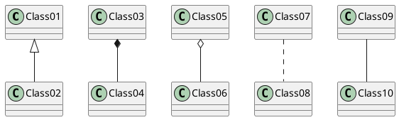

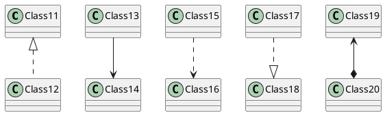

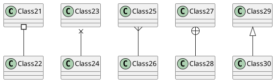

## Label on relations

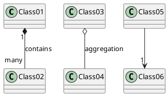

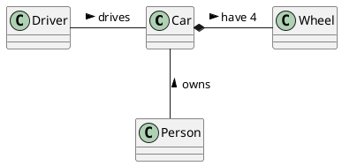

## Using non-letters in element names and relation labels

- Use the as keyword in the class definition to assign an alias
- Put quotes "" around the class name

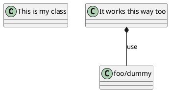

### Starting names with $

```plantuml
@startuml
class $C1
class $C2 $C2
class "$C2" as dollarC2
remove $C1
remove $C2
remove dollarC2
@enduml
```

## Adding methods

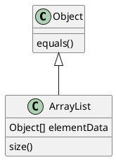

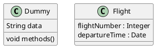

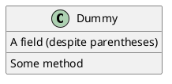

## Defining visibility

### Visibility for methods or fields

| Character | Icon for field | Icon for method | Visibility |
| - |  |  | private |
| # |  |  | protected |
| ~ |  |  | package private |
| + |  |  | public |

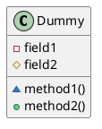

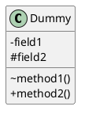

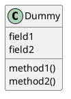

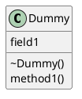

### Visibility for class

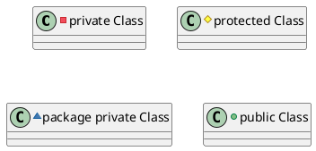

## Visibility on compositions and aggregations

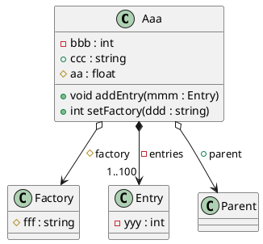

## Abstract and Static

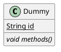

## Advanced class body

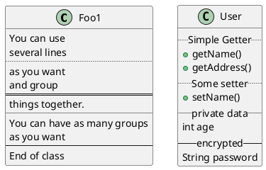

## Notes and stereotypes

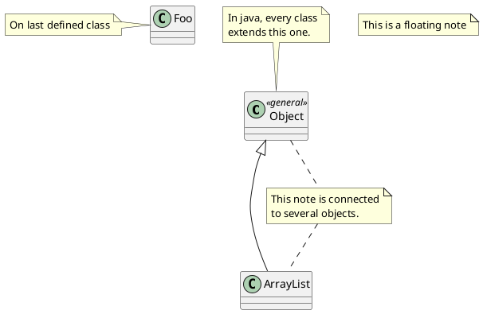

## More on notes

- <b>
- <u>
- <i>
- <s> , <del> , <strike>
- <font color="#AAAAAA"> or <font color="colorName">
- <color:#AAAAAA> or <color:colorName>
- <size:nn> to change font size
-  or  : the file must be accessible by the filesystem

```plantuml
@startuml

class Foo
note left: On last defined class

note top of Foo
  In java, <size:18>every</size> <u>class</u>
  <b>extends</b>
  <i>this</i> one.
end note

note as N1
  This note is <u>also</u>
  <b><color:royalBlue>on several</color>
  <s>words</s> lines
  And this is hosted by 
end note

@enduml
```

## Note on field (field, attribute, member) or method

### ⚠ Constraint

- This cannot be used with top or bottom (only left and right are implemented)
- This cannot be used with namespaceSeparator ::

### Note on field or method

```plantuml
@startuml
class A {
{static} int counter
+void {abstract} start(int timeout)
}
note right of A::counter
  This member is annotated
end note
note right of A::start
  This method is now explained in a UML note
end note
@enduml
```

### Note on method with the same name

```plantuml
@startuml
class A {
{static} int counter
+void {abstract} start(int timeoutms)
+void {abstract} start(Duration timeout)
}
note left of A::counter
  This member is annotated
end note
note right of A::"start(int timeoutms)"
  This method with int
end note
note right of A::"start(Duration timeout)"
  This method with Duration
end note
@enduml
```

## Note on links

```plantuml
@startuml

class Dummy
Dummy --> Foo : A link
note on link #red: note that is red

Dummy --> Foo2 : Another link
note right on link #blue
this is my note on right link
and in blue
end note

@enduml
```

## Abstract class and interface

```plantuml
@startuml

abstract class AbstractList
abstract AbstractCollection
interface List
interface Collection

List <|-- AbstractList
Collection <|-- AbstractCollection

Collection <|- List
AbstractCollection <|- AbstractList
AbstractList <|-- ArrayList

class ArrayList {
  Object[] elementData
  size()
}

enum TimeUnit {
  DAYS
  HOURS
  MINUTES
}

annotation SuppressWarnings

annotation Annotation {
  annotation with members
  String foo()
  String bar()
}


@enduml
```

## Hide attributes, methods...

- empty fields or empty attributes for empty fields,
- empty methods for empty methods,
- fields or attributes which will hide fields, even if they are described,
- methods which will hide methods, even if they are described,
- members which will hide fields and methods, even if they are described,
- circle for the circled character in front of class name,
- stereotype for the stereotype.

- class for all classes,
- interface for all interfaces,
- enum for all enums,
- <<foo1>> for classes which are stereotyped with foo1 ,
- an existing class name.

```plantuml
@startuml

class Dummy1 {
  +myMethods()
}

class Dummy2 {
  +hiddenMethod()
}

class Dummy3 <<Serializable>> {
String name
}

hide members
hide <<Serializable>> circle
show Dummy1 methods
show <<Serializable>> fields

@enduml
```

```plantuml
@startuml
hide private members
hide protected members
hide package members

class Foo {
  - private
  # protected
  ~ package
}
@enduml
```

## Hide classes

```plantuml
@startuml

class Foo1
class Foo2

Foo2 *-- Foo1

hide Foo2

@enduml
```

## Remove classes

```plantuml
@startuml

class Foo1
class Foo2

Foo2 *-- Foo1

remove Foo2

@enduml
```

## Hide, Remove or Restore tagged element or wildcard

```plantuml
@startuml
class C1 $tag13
enum E1
interface I1 $tag13
C1 -- I1
@enduml
```

- hide $tag13 components:

```plantuml
@startuml
class C1 $tag13
enum E1
interface I1 $tag13
C1 -- I1

hide $tag13
@enduml
```

- or remove $tag13 components:

```plantuml
@startuml
class C1 $tag13
enum E1
interface I1 $tag13
C1 -- I1

remove $tag13
@enduml
```

- or remove $tag13 and restore $tag1 components:

```plantuml
@startuml
class C1 $tag13 $tag1
enum E1
interface I1 $tag13
C1 -- I1

remove $tag13
restore $tag1
@enduml
```

- or remove * and restore $tag1 components:

```plantuml
@startuml
class C1 $tag13 $tag1
enum E1
interface I1 $tag13
C1 -- I1

remove *
restore $tag1
@enduml
```

## Hide or Remove unlinked class

```plantuml
@startuml
class C1
class C2
class C3
C1 -- C2
@enduml
```

- hide @unlinked classes:

```plantuml
@startuml
class C1
class C2
class C3
C1 -- C2

hide @unlinked
@enduml
```

- or remove @unlinked classes:

```plantuml
@startuml
class C1
class C2
class C3
C1 -- C2

remove @unlinked
@enduml
```

## Use generics

```plantuml
@startuml

class Foo<? extends Element> {
  int size()
}
Foo *- Element

@enduml
```

## Specific Spot

```plantuml
@startuml

class System << (S,#FF7700) Singleton >>
class Date << (D,orchid) >>
@enduml
```

## Packages

```plantuml
@startuml

package "Classic Collections" #DDDDDD {
  Object <|-- ArrayList
}

package com.plantuml {
  Object <|-- Demo1
  Demo1 *- Demo2
}

@enduml
```

## Packages style

```plantuml
@startuml
scale 750 width
package foo1 <<Node>> {
  class Class1
}

package foo2 <<Rectangle>> {
  class Class2
}

package foo3 <<Folder>> {
  class Class3
}

package foo4 <<Frame>> {
  class Class4
}

package foo5 <<Cloud>> {
  class Class5
}

package foo6 <<Database>> {
  class Class6
}

@enduml
```

```plantuml
@startuml

skinparam packageStyle rectangle

package foo1.foo2 {
}

package foo1.foo2.foo3 {
  class Object
}

foo1.foo2 +-- foo1.foo2.foo3

@enduml
```

## Namespaces

## Automatic package creation

```plantuml
@startuml

set separator ::
class X1::X2::foo {
  some info
}

@enduml
```

```plantuml
@startuml

set separator none
class X1.X2.foo {
  some info
}

@enduml
```

## Lollipop interface

- bar ()- foo
- bar ()-- foo
- foo -() bar

```plantuml
@startuml
class foo
bar ()- foo
@enduml
```

## Changing arrows orientation

```plantuml
@startuml
Room o- Student
Room *-- Chair
@enduml
```

```plantuml
@startuml
Student -o Room
Chair --* Room
@enduml
```

```plantuml
@startuml
foo -left-> dummyLeft
foo -right-> dummyRight
foo -up-> dummyUp
foo -down-> dummyDown
@enduml
```

```plantuml
@startuml
left to right direction
foo -left-> dummyLeft
foo -right-> dummyRight
foo -up-> dummyUp
foo -down-> dummyDown
@enduml
```

## Association classes

```plantuml
@startuml
class Student {
  Name
}
Student "0..*" - "1..*" Course
(Student, Course) .. Enrollment

class Enrollment {
  drop()
  cancel()
}
@enduml
```

```plantuml
@startuml
class Student {
  Name
}
Student "0..*" -- "1..*" Course
(Student, Course) . Enrollment

class Enrollment {
  drop()
  cancel()
}
@enduml
```

## Association on same class

```plantuml
@startuml
class Station {
    +name: string
}

class StationCrossing {
    +cost: TimeInterval
}

<> diamond

StationCrossing . diamond
diamond - "from 0..*" Station
diamond - "to 0..* " Station
@enduml
```

## Skinparam

- In the diagram definition, like any other commands,
- In an included file ,
- In a configuration file, provided in the command line or the ANT task .

```plantuml
@startuml

skinparam class {
BackgroundColor PaleGreen
ArrowColor SeaGreen
BorderColor SpringGreen
}
skinparam stereotypeCBackgroundColor YellowGreen

Class01 "1" *-- "many" Class02 : contains

Class03 o-- Class04 : aggregation

@enduml
```

## Skinned Stereotypes

```plantuml
@startuml

skinparam class {
BackgroundColor PaleGreen
ArrowColor SeaGreen
BorderColor SpringGreen
BackgroundColor<<Foo>> Wheat
BorderColor<<Foo>> Tomato
}
skinparam stereotypeCBackgroundColor YellowGreen
skinparam stereotypeCBackgroundColor<< Foo >> DimGray

class Class01 <<Foo>>
class Class03 <<Foo>>
Class01 "1" *-- "many" Class02 : contains

Class03 o-- Class04 : aggregation

@enduml
```

- BackgroundColor_<<Foo>> Wheat
- skinparam stereotypeCBackgroundColor_<<Foo>> DimGray

## Color gradient

- | ,
- / ,
- \ , or
- -

```plantuml
@startuml

skinparam backgroundcolor AntiqueWhite/Gold
skinparam classBackgroundColor Wheat|CornflowerBlue

class Foo #red-green
note left of Foo #blue\9932CC
  this is my
  note on this class
end note

package example #GreenYellow/LightGoldenRodYellow {
  class Dummy
}

@enduml
```

## Help on layout

```plantuml
@startuml

class Bar1
class Bar2
together {
  class Together1
  class Together2
  class Together3
}
Together1 - Together2
Together2 - Together3
Together2 -[hidden]--> Bar1
Bar1 -[hidden]> Bar2


@enduml
```

## Splitting large files

```plantuml
@startuml
' Split into 4 pages
page 2x2
skinparam pageMargin 10
skinparam pageExternalColor gray
skinparam pageBorderColor black

class BaseClass

namespace net.dummy #DDDDDD {
    .BaseClass <|-- Person
    Meeting o-- Person

    .BaseClass <|- Meeting

}

namespace net.foo {
  net.dummy.Person  <|- Person
  .BaseClass <|-- Person

  net.dummy.Meeting o-- Person
}

BaseClass <|-- net.unused.Person
@enduml
```

## Extends and implements

```plantuml
@startuml
class ArrayList implements List
class ArrayList extends AbstractList
@enduml
```

```plantuml
@startuml
class A extends B, C {
}
@enduml
```

## Bracketed relations (linking or arrow) style

### Line style

- without label

```plantuml
@startuml
title Bracketed line style without label
class foo
class bar
bar1 : [bold]  
bar2 : [dashed]
bar3 : [dotted]
bar4 : [hidden]
bar5 : [plain] 

foo --> bar
foo -[bold]-> bar1
foo -[dashed]-> bar2
foo -[dotted]-> bar3
foo -[hidden]-> bar4
foo -[plain]-> bar5
@enduml
```

- with label

```plantuml
@startuml
title Bracketed line style with label
class foo
class bar
bar1 : [bold]  
bar2 : [dashed]
bar3 : [dotted]
bar4 : [hidden]
bar5 : [plain] 

foo --> bar          : ∅
foo -[bold]-> bar1   : [bold]
foo -[dashed]-> bar2 : [dashed]
foo -[dotted]-> bar3 : [dotted]
foo -[hidden]-> bar4 : [hidden]
foo -[plain]-> bar5  : [plain]

@enduml
```

### Line color

```plantuml
@startuml
title Bracketed line color
class foo
class bar
bar1 : [#red]
bar2 : [#green]
bar3 : [#blue]

foo --> bar
foo -[#red]-> bar1     : [#red]
foo -[#green]-> bar2   : [#green]
foo -[#blue]-> bar3    : [#blue]
'foo -[#blue;#yellow;#green]-> bar4
@enduml
```

### Line thickness

```plantuml
@startuml
title Bracketed line thickness
class foo
class bar
bar1 : [thickness=1]
bar2 : [thickness=2]
bar3 : [thickness=4]
bar4 : [thickness=8]
bar5 : [thickness=16]

foo --> bar                 : ∅
foo -[thickness=1]-> bar1   : [1]
foo -[thickness=2]-> bar2   : [2]
foo -[thickness=4]-> bar3   : [4]
foo -[thickness=8]-> bar4   : [8]
foo -[thickness=16]-> bar5  : [16]

@enduml
```

### Mix

```plantuml
@startuml
title Bracketed line style mix
class foo
class bar
bar1 : [#red,thickness=1]
bar2 : [#red,dashed,thickness=2]
bar3 : [#green,dashed,thickness=4]
bar4 : [#blue,dotted,thickness=8]
bar5 : [#blue,plain,thickness=16]

foo --> bar                             : ∅
foo -[#red,thickness=1]-> bar1          : [#red,1]
foo -[#red,dashed,thickness=2]-> bar2   : [#red,dashed,2]
foo -[#green,dashed,thickness=4]-> bar3 : [#green,dashed,4]
foo -[#blue,dotted,thickness=8]-> bar4  : [blue,dotted,8]
foo -[#blue,plain,thickness=16]-> bar5  : [blue,plain,16]
@enduml
```

## Change relation (linking or arrow) color and style (inline style)

- #color;line.[bold|dashed|dotted];text:color

```plantuml
@startuml
class foo
foo --> bar : normal
foo --> bar1 #line:red;line.bold;text:red  : red bold
foo --> bar2 #green;line.dashed;text:green : green dashed
foo --> bar3 #blue;line.dotted;text:blue   : blue dotted
@enduml
```

## Change class color and style (inline style)

- #color ##[style]color

```plantuml
@startuml
abstract   abstract
annotation annotation #pink ##[bold]red
class      class      #palegreen ##[dashed]green
interface  interface  #aliceblue ##[dotted]blue
@enduml
```

- #[color|back:color];header:color;line:color;line.[bold|dashed|dotted];text:color

```plantuml
@startuml
abstract   abstract
annotation annotation #pink;line:red;line.bold;text:red
class      class      #palegreen;line:green;line.dashed;text:green
interface  interface  #aliceblue;line:blue;line.dotted;text:blue
@enduml
```

```plantuml
@startuml
class bar #line:green;back:lightblue
class bar2 #lightblue;line:green

class Foo1 #back:red;line:00FFFF
class FooDashed #line.dashed:blue
class FooDotted #line.dotted:blue
class FooBold #line.bold
class Demo1 #back:lightgreen|yellow;header:blue/red
@enduml
```

## Arrows from/to class members

```plantuml
@startuml
class Foo {
+ field1
+ field2
}

class Bar {
+ field3
+ field4
}

Foo::field1 --> Bar::field3 : foo
Foo::field2 --> Bar::field4 : bar
@enduml
```

```plantuml
@startuml
left to right direction

class User {
  id : INTEGER
  ..
  other_id : INTEGER
}

class Email {
  id : INTEGER
  ..
  user_id : INTEGER
  address : INTEGER
}

User::id *-- Email::user_id
@enduml
```

## Grouping inheritance arrow heads

### GroupInheritance 1 (no grouping)

```plantuml
@startuml
skinparam groupInheritance 1

A1 <|-- B1

A2 <|-- B2
A2 <|-- C2

A3 <|-- B3
A3 <|-- C3
A3 <|-- D3

A4 <|-- B4
A4 <|-- C4
A4 <|-- D4
A4 <|-- E4
@enduml
```

### GroupInheritance 2 (grouping from 2)

```plantuml
@startuml
skinparam groupInheritance 2

A1 <|-- B1

A2 <|-- B2
A2 <|-- C2

A3 <|-- B3
A3 <|-- C3
A3 <|-- D3

A4 <|-- B4
A4 <|-- C4
A4 <|-- D4
A4 <|-- E4
@enduml
```

### GroupInheritance 3 (grouping only from 3)

```plantuml
@startuml
skinparam groupInheritance 3

A1 <|-- B1

A2 <|-- B2
A2 <|-- C2

A3 <|-- B3
A3 <|-- C3
A3 <|-- D3

A4 <|-- B4
A4 <|-- C4
A4 <|-- D4
A4 <|-- E4
@enduml
```

### GroupInheritance 4 (grouping only from 4)

```plantuml
@startuml
skinparam groupInheritance 4

A1 <|-- B1

A2 <|-- B2
A2 <|-- C2

A3 <|-- B3
A3 <|-- C3
A3 <|-- D3

A4 <|-- B4
A4 <|-- C4
A4 <|-- D4
A4 <|-- E4
@enduml
```

## Display JSON Data on Class or Object diagram

### Simple example

```plantuml
@startuml
class Class
object Object
json JSON {
   "fruit":"Apple",
   "size":"Large",
   "color": ["Red", "Green"]
}
@enduml
```

## Packages and Namespaces Enhancement

```plantuml
@startuml
class A.B.C.D.Z {
}
@enduml
```

```plantuml
@startuml
set separator none
class A.B.C.D.Z {
}
@enduml
```

```plantuml
@startuml
!pragma useIntermediatePackages false
class A.B.C.D.Z {
}
@enduml
```

```plantuml
@startuml
set separator none
package A.B.C.D {
  class Z {
  }
}
@enduml
```

## Qualified associations

### Minimal example

```plantuml
@startuml
class class1
class class2

class1 [Qualifier] - class2
@enduml
```

### Another example

```plantuml
@startuml
    interface Map<K,V>
    class HashMap<Long,Customer>

    Map <|.. HashMap
    Shop [customerId: long] ---> "customer\n1" Customer
    HashMap [id: Long] -r-> "value" Customer
@enduml
```

## Change diagram orientation

- top to bottom direction (by default)
- left to right direction

### Top to bottom (by default)

#### With Graphviz (layout engine by default)

```plantuml
@startuml
class a
class b
package A {
  class a1
  class a2
  class a3
  class a4
  class a5
  package sub_a {
   class sa1
   class sa2
   class sa3
  }
}
  
package B {
  class b1
  class b2
  class b3
  class b4
  class b5
  package sub_b {
   class sb1
   class sb2
   class sb3
  }
}
@enduml
```

#### With Smetana (internal layout engine)

```plantuml
@startuml
!pragma layout smetana
class a
class b
package A {
  class a1
  class a2
  class a3
  class a4
  class a5
  package sub_a {
   class sa1
   class sa2
   class sa3
  }
}
  
package B {
  class b1
  class b2
  class b3
  class b4
  class b5
  package sub_b {
   class sb1
   class sb2
   class sb3
  }
}
@enduml
```

### Left to right

```plantuml
@startuml
left to right direction
class a
class b
package A {
  class a1
  class a2
  class a3
  class a4
  class a5
  package sub_a {
   class sa1
   class sa2
   class sa3
  }
}
  
package B {
  class b1
  class b2
  class b3
  class b4
  class b5
  package sub_b {
   class sb1
   class sb2
   class sb3
  }
}
@enduml
```

```plantuml
@startuml
!pragma layout smetana
left to right direction
class a
class b
package A {
  class a1
  class a2
  class a3
  class a4
  class a5
  package sub_a {
   class sa1
   class sa2
   class sa3
  }
}
  
package B {
  class b1
  class b2
  class b3
  class b4
  class b5
  package sub_b {
   class sb1
   class sb2
   class sb3
  }
}
@enduml
```

## Role label to associations

```plantuml
@startuml
class User
class Item
User "owner which is very long"/1 -- "0..n"/items Item
@enduml
```
