# Component Diagram

- Simplicity : With PlantUML, you can create component diagrams using simple and intuitive text-based descriptions, eliminating the need for complex drawing tools.
- Integration : PlantUML seamlessly integrates with various tools and platforms, making it a versatile choice for developers and architects.
- Collaboration : The PlantUML forum offers a platform for users to discuss, share, and seek assistance on their diagrams, fostering a collaborative community.

## Components

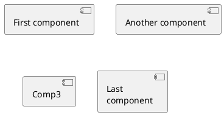

### Naming exceptions

```plantuml
@startuml
component [$C1]
component [$C2] $C2
component [$C2] as dollarC2
remove $C1
remove $C2
remove dollarC2
@enduml
```

## Interfaces

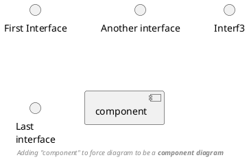

## Basic example

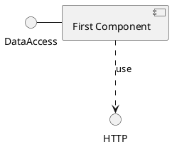

## Using notes

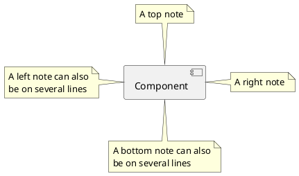

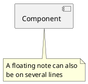

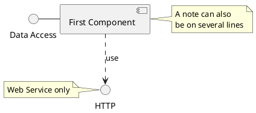

## Grouping Components

- package
- node
- folder
- frame
- cloud
- database

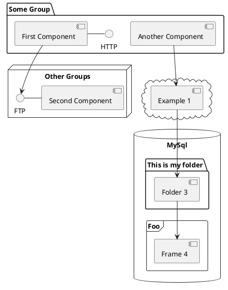

## Changing arrows direction

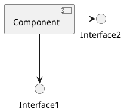

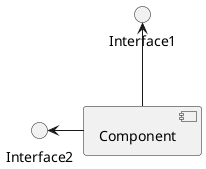

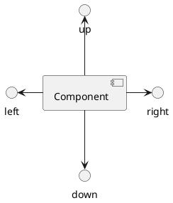

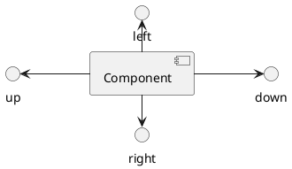

## Use UML2 notation

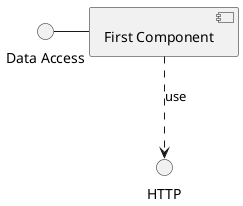

## Use UML1 notation


## Use rectangle notation (remove UML notation)

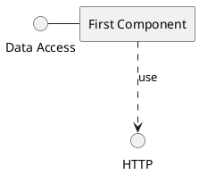

## Long description

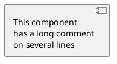

## Individual colors

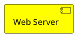

## Using Sprite in Stereotype

```plantuml
@startuml
sprite $businessProcess [16x16/16] {
FFFFFFFFFFFFFFFF
FFFFFFFFFFFFFFFF
FFFFFFFFFFFFFFFF
FFFFFFFFFFFFFFFF
FFFFFFFFFF0FFFFF
FFFFFFFFFF00FFFF
FF00000000000FFF
FF000000000000FF
FF00000000000FFF
FFFFFFFFFF00FFFF
FFFFFFFFFF0FFFFF
FFFFFFFFFFFFFFFF
FFFFFFFFFFFFFFFF
FFFFFFFFFFFFFFFF
FFFFFFFFFFFFFFFF
FFFFFFFFFFFFFFFF
}


rectangle " End to End\nbusiness process" <<$businessProcess>> {
 rectangle "inner process 1" <<$businessProcess>> as src
 rectangle "inner process 2" <<$businessProcess>> as tgt
 src -> tgt
}
@enduml
```

## Skinparam

- In the diagram definition, like any other commands;
- In an included file ;
- In a configuration file, provided in the command line or the Ant task .

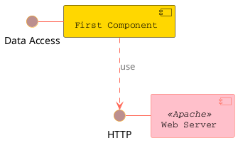

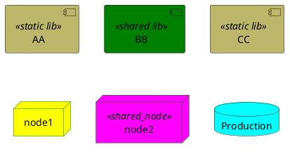

## Specific SkinParameter

### componentStyle

- By default (or with skinparam componentStyle uml2 ), you have an icon for component

```plantuml
@startuml
skinparam BackgroundColor transparent
skinparam componentStyle uml2
component A {
   component "A.1" {
}
   component A.44 {
      [A4.1]
}
   component "A.2"
   [A.3]
   component A.5 [
A.5] 
   component A.6 [
]
}
[a]->[b]
@enduml
```

- If you want to suppress it, and to have only the rectangle, you can use skinparam componentStyle rectangle

```plantuml
@startuml
skinparam BackgroundColor transparent
skinparam componentStyle rectangle
component A {
   component "A.1" {
}
   component A.44 {
      [A4.1]
}
   component "A.2"
   [A.3]
   component A.5 [
A.5] 
   component A.6 [
]
}
[a]->[b]
@enduml
```

## Hide or Remove unlinked component

```plantuml
@startuml
component C1
component C2
component C3
C1 -- C2
@enduml
```

- hide @unlinked components:

```plantuml
@startuml
component C1
component C2
component C3
C1 -- C2

hide @unlinked
@enduml
```

- or remove @unlinked components:

```plantuml
@startuml
component C1
component C2
component C3
C1 -- C2

remove @unlinked
@enduml
```

## Hide, Remove or Restore tagged component or wildcard

```plantuml
@startuml
component C1 $tag13
component C2
component C3 $tag13
C1 -- C2
@enduml
```

- hide $tag13 components:

```plantuml
@startuml
component C1 $tag13
component C2
component C3 $tag13
C1 -- C2

hide $tag13
@enduml
```

- or remove $tag13 components:

```plantuml
@startuml
component C1 $tag13
component C2
component C3 $tag13
C1 -- C2

remove $tag13
@enduml
```

- or remove $tag13 and restore $tag1 components:

```plantuml
@startuml
component C1 $tag13 $tag1
component C2
component C3 $tag13
C1 -- C2

remove $tag13
restore $tag1
@enduml
```

- or remove * and restore $tag1 components:

```plantuml
@startuml
component C1 $tag13 $tag1
component C2
component C3 $tag13
C1 -- C2

remove *
restore $tag1
@enduml
```

## Display JSON Data on Component diagram

### Simple example

```plantuml
@startuml
allowmixing

component Component
()        Interface

json JSON {
   "fruit":"Apple",
   "size":"Large",
   "color": ["Red", "Green"]
}
@enduml
```

## Port [port, portIn, portOut]

### Port

```plantuml
@startuml
[c]
component C {
  port p1
  port p2
  port p3
  component c1
}

c --> p1
c --> p2
c --> p3
p1 --> c1
p2 --> c1
@enduml
```

### PortIn

```plantuml
@startuml
[c]
component C {
  portin p1
  portin p2
  portin p3
  component c1
}

c --> p1
c --> p2
c --> p3
p1 --> c1
p2 --> c1
@enduml
```

### PortOut

```plantuml
@startuml
component C {
  portout p1
  portout p2
  portout p3
  component c1
}
[o]
p1 --> o
p2 --> o
p3 --> o
c1 --> p1
@enduml
```

### Mixing PortIn & PortOut

```plantuml
@startuml
[i]
component C {
  portin p1
  portin p2
  portin p3
  portout po1
  portout po2
  portout po3
  component c1
}
[o]

i --> p1
i --> p2
i --> p3
p1 --> c1
p2 --> c1
po1 --> o
po2 --> o
po3 --> o
c1 --> po1
@enduml
```
