# Salt (Wireframe)

Salt is a subproject of PlantUML that may help you to design graphical interface or Website Wireframe or Page Schematic or Screen Blueprint.

It is very useful in crafting graphical interfaces, schematics, and blueprints. It aids in aligning conceptual structures with visual design, emphasizing functionality over aesthetics. Wireframes, central to this process, are used across various disciplines.

Developers, designers, and user experience professionals employ them to visualize interface elements, navigational systems, and to facilitate collaboration. They vary in fidelity, from low-detail sketches to high-detail representations, crucial for prototyping and iterative design. This collaborative process integrates different expertise, from business analysis to user research, ensuring that the end design aligns with both business and user requirements.

## Basic widgets

You must use @startsalt keyword.

A window must start and end with brackets. You can then define:

Button using [ and ].
Radio button using ( and ).
Checkbox using [ and ].
User text area using ".
Droplist using ^.

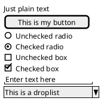

## Text area

Here is an attempt to create a text area:

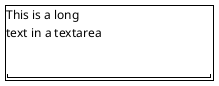

Note:

the dot (.) to fill up vertical space;
the last line of space ("     ") to make the area wider.

[Ref. QA-14765]

Then you can add scroll bar:

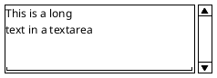

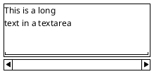

## Open, close droplist

You can open a droplist, by adding values enclosed by ^, as:

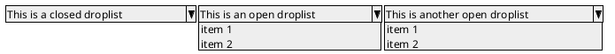

[Ref. QA-4184]

## Using grid [| and #, !, -, +]

A table is automatically created when you use an opening bracket {.
And you have to use | to separate columns.

For example:

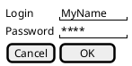

Just after the opening bracket, you can use a character to define if you want to draw lines or columns of the grid :

Symbol

Result

#

To display all vertical and horizontal lines

!

To display all vertical lines

-

To display all horizontal lines

+

To display external lines

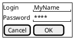

## Group box [^]

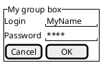

[Ref. QA-5840]

## Using separator [.., ==, ~~, --]

You can use several horizontal lines as separator.

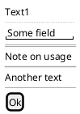

## Tree widget [T]

To have a Tree, you have to start with {T and to use + to denote hierarchy.

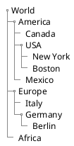

## Tree table [T]

You can combine trees with tables.

```plantuml
@startsalt
{
{T
+Region        | Population    | Age
+ World        | 7.13 billion  | 30
++ America     | 964 million   | 30
+++ Canada     | 35 million    | 30
+++ USA        | 319 million   | 30
++++ NYC       | 8 million     | 30
++++ Boston    | 617 thousand  | 30
+++ Mexico     | 117 million   | 30
++ Europe      | 601 million   | 30
+++ Italy      | 61 million    | 30
+++ Germany    | 82 million    | 30
++++ Berlin    | 3 million     | 30
++ Africa      | 1 billion     | 30
}
}
@endsalt
```

And add lines.

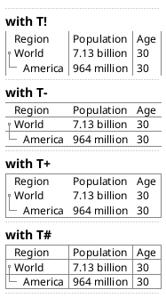

[Ref. QA-1265]

## Enclosing brackets [{, }]

You can define subelements by opening a new opening bracket.

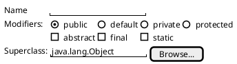

## Adding tabs [/]

You can add tabs using {/ notation. Note that you can use HTML code to have bold text.

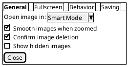

Tab could also be vertically oriented:

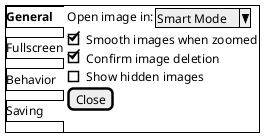

## Using menu [*]

You can add a menu by using {* notation.

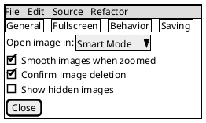

It is also possible to open a menu:

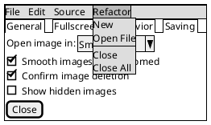

Like it is possible to open a droplist:

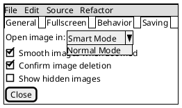

[Ref. QA-4184]

## Advanced table

You can use two special notations for table :

* to indicate that a cell with span with left
. to denotate an empty cell

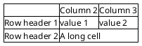

## Scroll Bars [S, SI, S-]

You can use {S notation for scroll bar like in following examples:

{S: for horizontal and vertical scrollbars

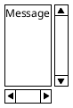

{SI : for vertical scrollbar only

```plantuml
@startsalt
{SI
Message
.
.
.
.
}
@endsalt
```

{S- : for horizontal scrollbar only

```plantuml
@startsalt
{S-
Message
.
.
.
.
}
@endsalt
```

## Colors

It is possible to change text color of widget.

```plantuml
@startsalt
{
<color:Blue>Just plain text
[This is my default button]
[<color:green>This is my green button]
[<color:#9a9a9a>This is my disabled button]
[]  <color:red>Unchecked box
[X] <color:green>Checked box
"Enter text here   "
^This is a droplist^
^<color:#9a9a9a>This is a disabled droplist^
^<color:red>This is a red droplist^
}
@endsalt
```

[Ref. QA-12177]

## Creole on Salt

You can use Creole or HTML Creole on salt:

```plantuml
@startsalt
{{^==Creole
This is **bold**
This is //italics//
This is ""monospaced""
This is --stricken-out--
This is __underlined__
This is ~~wave-underlined~~
--test Unicode and icons--
This is <U+221E> long
This is a <&code> icon
Use image : 
}|
{^<b>HTML Creole
This is <b>bold</b>
This is <i>italics</i>
This is <font:monospaced>monospaced</font>
This is <s>stroked</s>
This is <u>underlined</u>
This is <w>waved</w>
This is <s:green>stroked</s>
This is <u:red>underlined</u>
This is <w:#0000FF>waved</w>
-- other examples --
This is <color:blue>Blue</color>
This is <back:orange>Orange background</back>
This is <size:20>big</size>
}|
{^Creole line
You can have horizontal line
----
Or double line
====
Or strong line
____
Or dotted line
..My title..
Or dotted title
//and title... //
==Title==
Or double-line title
--Another title--
Or single-line title
Enjoy!
}|
{^Creole list item
**test list 1**
* Bullet list
* Second item
** Sub item
*** Sub sub item
* Third item
----
**test list 2**
# Numbered list
# Second item
## Sub item
## Another sub item
# Third item
}|
{^Mix on salt
==<color:Blue>Just plain text
[This is my default button]
[<b><color:green>This is my green button]
[ ---<color:#9a9a9a>This is my disabled button-- ]
[]  <size:20><color:red>Unchecked box
[X] <color:green>Checked box
"//Enter text here//   "
^This is a droplist^
^<color:#9a9a9a>This is a disabled droplist^
^<b><color:red>This is a red droplist^
}}
@endsalt
```

## Pseudo sprite [<<, >>]

Using << and >> you can define a pseudo-sprite or sprite-like drawing and reusing it latter.

```plantuml
@startsalt
{
[X] checkbox|[] checkbox
() radio | (X) radio
This is a text|[This is my button]|This is another text
"A field"|"Another long Field"|[A button]
<<folder
............
.XXXXX......
.X...X......
.XXXXXXXXXX.
.X........X.
.X........X.
.X........X.
.X........X.
.XXXXXXXXXX.
............
>>|<color:blue>other folder|<<folder>>
^Droplist^
}
@endsalt
```

[Ref. QA-5849]

## OpenIconic

OpenIconic is a very nice open source icon set. Those icons have been integrated into the creole parser, so you can use them out-of-the-box.
You can use the following syntax: <&ICON_NAME>.

```plantuml
@startsalt
{
Login<&person> | "MyName   "
Password<&key> | "****     "
[Cancel <&circle-x>] | [OK <&account-login>]
}
@endsalt
```

The complete list is available on OpenIconic Website, or you can use the following special diagram:

```plantuml
@startuml
listopeniconic
@enduml
```

## Add title, header, footer, caption or legend

```plantuml
@startsalt
title My title
header some header
footer some footer
caption This is caption
legend
The legend
end legend

{+
Login    | "MyName   "
Password | "****     "
[Cancel] | [  OK   ]
}

@endsalt
```

(See also: Common commands)

## Zoom, DPI

Whitout zoom (by default)

```plantuml
@startsalt
{
<&person> Login  | "MyName   "
<&key> Password  | "****     "
[<&circle-x> Cancel ] | [ <&account-login> OK   ]
}
@endsalt
```

Scale

You can use the scale command to zoom the generated image.

You can use either a number or a fraction to define the scale factor. You can also specify either width or height (in pixel). And you can also give both width and height: the image is scaled to fit inside the specified dimension.

```plantuml
@startsalt
scale 2
{
<&person> Login  | "MyName   "
<&key> Password  | "****     "
[<&circle-x> Cancel ] | [ <&account-login> OK   ]
}
@endsalt
```

(See also: Zoom on Common commands)

DPI
You can also use the skinparam dpicommand to zoom the generated image.

```plantuml
@startsalt
skinparam dpi 200
{
<&person> Login  | "MyName   "
<&key> Password  | "****     "
[<&circle-x> Cancel ] | [ <&account-login> OK   ]
}
@endsalt
```

## Include Salt "on activity diagram"

You can read the following explanation.

```plantuml
@startuml
(*) --> "
{{salt
{+
<b>an example
choose one option
()one
()two
[ok]
}
}}
" as choose

choose -right-> "
{{salt
{+
<b>please wait
operation in progress
<&clock>
[cancel]
}
}}
" as wait
wait -right-> "
{{salt
{+
<b>success
congratulations!
[ok]
}
}}
" as success

wait -down-> "
{{salt
{+
<b>error
failed, sorry
[ok]
}
}}
"
@enduml
```

It can also be combined with define macro.

```plantuml
@startuml
!unquoted procedure SALT($x)
"{{salt
%invoke_procedure("_"+$x)
}}" as $x
!endprocedure

!procedure _choose()
{+
<b>an example
choose one option
()one
()two
[ok]
}
!endprocedure

!procedure _wait()
{+
<b>please wait
operation in progress
<&clock>
[cancel]
}
!endprocedure

!procedure _success()
{+
<b>success
congratulations!
[ok]
}
!endprocedure

!procedure _error()
{+
<b>error
failed, sorry
[ok]
}
!endprocedure

(*) --> SALT(choose)
-right-> SALT(wait)
wait -right-> SALT(success)
wait -down-> SALT(error)
@enduml
```

Transition notes can be added with `note on link` — avoid `:label` on the arrow, which conflicts with `!unquoted procedure` expansion.

```plantuml
@startuml
!unquoted procedure SALT($x)
"{{salt
%invoke_procedure("_"+$x)
}}" as $x
!endprocedure

!procedure _choose()
{+
<b>an example
choose one option
()one
()two
[ok]
}
!endprocedure

!procedure _wait()
{+
<b>please wait
operation in progress
<&clock>
[cancel]
}
!endprocedure

!procedure _success()
{+
<b>success
congratulations!
[ok]
}
!endprocedure

!procedure _error()
{+
<b>error
failed, sorry
[ok]
}
!endprocedure

(*) --> SALT(choose)
-down-> SALT(wait)
note on link
{{salt
{+
User clicked
[OK]
}
}}
end note
-right-> SALT(success)
note on link
{{salt
{+
<&check> Operation\nfinished
}
}}
end note
-down-> SALT(error)
note on link
{{salt
{+
<&x> Operation\nfailed
}
}}
end note
@enduml
```

### Activity node titles with `==` separator

Use the salt `==` separator inside a procedure to add a bold title above the wireframe form. The title sits outside the saltrendered box (above the `==` line) but inside the activity node.

```plantuml
@startuml
!unquoted procedure SALT($x)
"{{salt
%invoke_procedure("_"+$x)
}}" as $x
!endprocedure

!procedure _step2()
{+
  <b>Step 2 - Enter Name
==
  {/ Upload File | Record from Mic }
..
  Speaker Name
  {
    "AutoTestSpeaker01       "
  }
.
  [Record]
}
!endprocedure

(*) --> SALT(step2)
@enduml
```

### Mix plain text with salt on `note on link`

Inside a `note on link` block you can write plain text before the `{{salt ... }}` block — both will render together on the transition label.

```plantuml
@startuml
!unquoted procedure SALT($x)
"{{salt
%invoke_procedure("_"+$x)
}}" as $x
!endprocedure

!procedure _step1()
{+
  <b>Step 1
==
  Speaker Name
  {
    "                         "
  }
.
  [Enroll]
}
!endprocedure

!procedure _step2()
{+
  <b>Step 2
==
  Speaker Name
  {
    "AutoTestSpeaker01       "
  }
.
  [Enroll]
}
!endprocedure

(*) --> SALT(step1)
-down-> SALT(step2)
note on link
  Type speaker name
  {{salt
  {+
  Speaker Name
  {
    "AutoTestSpeaker01"
  }
  }
  }}
end note
@enduml
```

### Salt buttons on `note on link`

Salt-rendered buttons (using `[` `]` brackets) work inside `note on link` for compact transition labels.

```plantuml
@startuml
!unquoted procedure SALT($x)
"{{salt
%invoke_procedure("_"+$x)
}}" as $x
!endprocedure

!procedure _choose()
{+
  <b>Step 1
==
  {/ Upload File | Record from Mic }
..
  Speaker Name
  {
    "                         "
  }
.
  [Record]
}
!endprocedure

!procedure _wait()
{+
  <b>Step 2
==
  Recording...
==
  [<color:red> Stop (0:05)]
}
!endprocedure

(*) --> SALT(choose)
-down-> SALT(wait)
note on link
  {{salt
  {+
  [<color:blue> Record]
  }
  }}
end note
@enduml
```

### Gotchas when mixing Salt with activity diagrams

Three common pitfalls when using `!unquoted procedure` + SALT macros in activity diagrams:

**1. Inline `:label` breaks on macro expansion.** When a SALT macro (`!unquoted procedure`) expands to `"... as name"` and the arrow has an inline `:label`, the parser sees `as name :label` and chokes. Always use `note on link` instead.

```plantuml
' This BROKEN snippet illustrates the issue:
' stepA --> SALT(stepB) : click "OK"
'                   ^^^^^^^^^^^^^^^^^ parser chokes on ":label" after "as name"
```

```plantuml
@startuml
!unquoted procedure SALT($x)
"{{salt
%invoke_procedure("_"+$x)
}}" as $x
!endprocedure
!procedure _stepA()
{+
  Step A
==
  [Go]
}
!endprocedure
!procedure _stepB()
{+
  Step B
==
  [OK]
}
!endprocedure

(*) --> SALT(stepA)
--> SALT(stepB)
note on link : click "OK"
@enduml
```

**2. Never re-expand a SALT macro for an existing activity.** Once an activity is created via `SALT(stepN)`, referencing it again as `SALT(stepN)` regenerates the full Salt block as a duplicate definition. Use the bare alias (e.g., just `stepN`) for all subsequent references — branch arrows, loop arrows, etc.

```plantuml
' This BROKEN snippet illustrates the issue:
' SALT(stepA) --> SALT(stepB)
' ^^^^^^^^^^ re-expands the macro, creating a duplicate activity definition
```

```plantuml
@startuml
!unquoted procedure SALT($x)
"{{salt
%invoke_procedure("_"+$x)
}}" as $x
!endprocedure
!procedure _stepA()
{+
  Step A
==
  [Record]
}
!endprocedure
!procedure _stepB()
{+
  Step B
==
  [Stop]
}
!endprocedure

(*) --> SALT(stepA)
--> SALT(stepB)

' CORRECT — use bare alias for loop arrow
stepB --> stepA
@enduml
```

**3. `*` is not a SALT tab feature.** The documented way to mark an active/selected tab is Creole bold (`<b>`). Prefixing a tab with `*` (e.g., `{/ * Tab1 | Tab2 }`) is a custom convention with undefined behavior — it may not render as expected.

```plantuml
@startsalt
{+
  <b>Active tab
==
  {/ <b>Upload | Record }
..
  Content for Upload tab
}
@endsalt
```

**4. State name `start` is reserved — silently drops salt content.** When the SALT macro creates a state via `SALT(start)`, the resulting activity diagram node name is `"start"`. Since `start` is the reserved keyword for the initial node `(*)` in PlantUML activity diagrams, the parser conflates the two: the node exists (transitions to/from it work) but no salt content is rendered — it's silently treated as an alias for the built-in start node.

**Fix**: never name a procedure `_start()`. Use `_form_empty()`, `_initial()`, or any non-reserved name.

```plantuml
' This BROKEN snippet illustrates the issue:
' !procedure _start()
' ...
' (*) --> SALT(start)   ' "start" is reserved — salt content silently dropped
```

```plantuml
' ✅ WORKS — renamed to avoid reserved keyword
@startuml
!unquoted procedure SALT($x)
"{{salt
%invoke_procedure("_"+$x)
}}" as $x
!endprocedure

!procedure _form_empty()
{+
  <b>Enroll Speaker
  ==
  [Record]
}
!endprocedure

(*) --> SALT(form_empty)
@enduml
```

## Include salt "on while condition of activity diagram"

You can include salt on while condition of activity diagram.

```plantuml
@startuml
start
while (\n{{salt\n{+\nPassword | "****     "\n[Cancel] | [  OK   ]}\n}}\n) is (Incorrect)
:log attempt;
:attempt_count++;
if (attempt_count > 4) then (yes)
:increase delay timer;
:wait for timer to expire;
else (no)
endif
endwhile (correct)
:log request;
:disable service;
@enduml
```

[Ref. QA-8547]

## Include salt "on repeat while condition of activity diagram"

You can include salt on 'repeat while' condition of activity diagram.

```plantuml
@startuml
start
repeat :read data;
:generate diagrams;
repeat while (\n{{salt\n{^"Next step"\n  Do you want to continue? \n[Yes]|[No]\n}\n}}\n)
stop
@enduml
```

[Ref. QA-14287]

## Include salt "on sequence diagram"

You can embed salt wireframes inside sequence diagram notes using the `{{salt` notation, similar to activity diagrams.

```plantuml
@startuml
actor User
participant "Web App" as App

User -> App: Open Login Page

note right of App
  {{salt
  {+
  <b>Login Form
  Username | "john_doe    "
  Password | "****        "
  [ Cancel ] | [   Login  ]
  }
  }}
end note

App --> User: Display UI
@enduml
```

### Gotchas when mixing Salt with sequence diagrams

**1. Brace nesting.** Inside `{{salt}}`, every `{` that begins a block (grid, tree, tab, menu, scroll) must have a matching `}` closer. If a text label accidentally starts with `{`, the salt parser interprets it as a nested block — causing a crash or broken layout.

```plantuml
' This BROKEN snippet illustrates the issue:
' note right of App
'   {{salt
'   {+
'   {  <b>Login Form           ' ← this "{" opens a nested grid!
'   Username | "john_doe    "
'   Password | "****        "
'   [ Cancel ] | [   Login  ]
'   }                          ' ← closes nested grid only — outer {+ still open
'   }}
' end note
```

To fix, either remove the stray `{` or add an extra `}`:

```plantuml
@startuml
actor User
participant "Web App" as App

User -> App: Open Login Page

note right of App
  {{salt
  {+
  <b>Login Form
  Username | "john_doe    "
  Password | "****        "
  [ Cancel ] | [   Login  ]
  }
  }}
end note

App --> User: Display UI
@enduml
```

**2. No `@startsalt` / `@endsalt` inside `{{salt}}`.** The `{{salt` wrapper automatically adds these directives. Including them explicitly causes duplicate `@startsalt` / `@endsalt` lines.

**3. Salt renders as an image inside the note.** The entire salt block is converted to an embedded raster or SVG image within the note, so it does not participate in the note's text flow or wrapping.

**4. The note body is parsed as Creole first.** The `{{salt ... }}` wrapper is detected at the Creole level. Any text that starts with `{` outside a valid `{{salt` block is just plain Creole text — it will not be interpreted as salt markup.

## Skinparam

You can use [only] some skinparam command to change the skin of the drawing.

Some example:

```plantuml
@startsalt
skinparam Backgroundcolor palegreen
{+
Login    | "MyName   "
Password | "****     "
[Cancel] | [  OK   ]
}
@endsalt
```

```plantuml
@startsalt
!option handwritten true
{+
Login    | "MyName   "
Password | "****     "
[Cancel] | [  OK   ]
}
@endsalt
```

FIXME 🚩
FYI, some other skinparam does not work with salt, as:

```plantuml
@startsalt
skinparam defaultFontName monospaced
{+
Login    | "MyName   "
Password | "****     "
[Cancel] | [  OK   ]
}
@endsalt
```

## Style

You can use [only] some style command to change the skin of the drawing.

Some example:

```plantuml
@startsalt
<style>
saltDiagram {
BackgroundColor palegreen
}
</style>
{+
Login    | "MyName   "
Password | "****     "
[Cancel] | [  OK   ]
}
@endsalt
```

FIXME 🚩
FYI, some other style does not work with salt, as:

```plantuml
@startsalt
<style>
saltDiagram {
Fontname Monospaced
FontSize 10
FontStyle italic
LineThickness 0.5
LineColor red
}
</style>
{+
Login    | "MyName   "
Password | "****     "
[Cancel] | [  OK   ]
}
@endsalt
```

[Ref. QA-13460]

## Real-world example: enrollment completion page

A common dashboard pattern — a scrollable list of expandable items, a progress/coverage meter, action buttons, and speaker metadata. This example combines tabs, group boxes (`{^"..."}`), scrolled lists (`{SI}`), separators (`==`, `..`), grid tables (`{+}`, `{-}`), and OpenIconic icons — all in a single page wireframe.

```plantuml
@startsalt
title ASV Dashboard — Enroll — Final State

header Enroll Speaker

{+
  <color:green><&check-circle> <b>Bob enrolled successfully
  ..
  ==<b>Voice Coverage
  {+
  Good — 3 samples collected
  ..
  {-
  <color:green>██████████████████████████████████████████████████████████████████
  }
  ..
  For best accuracy, record 3–5 samples in different environments.
  }
  ..
  ==<b>Recorded Samples
  {SI
  {^"Sample 1 (5s) <color:green><&check> Enrolled"
  [<&play> Play] | [<&trash> Discard]
  }
  ..
  {^"Sample 2 (5s) <color:green><&check> Enrolled"
  [<&play> Play] | [<&trash> Discard]
  }
  ..
  {^"Sample 3 (5s) <color:green><&check> Enrolled"
  [<&play> Play] | [<&trash> Discard]
  }
  }
  ..
  [<&microphone> Record Another Sample]
  ..
  ==<b>Voice Print
  {+
  Speaker ID:  <b>4f7a09..e2d1
  Created:     Jul 31, 2026
  Samples:     3
  }
  ..
  [<&people> Identify This Voice] | [<&search> Verify]
  ..
  [Enroll Another Speaker] | [<b>Go to Dashboard]
}
@endsalt
```

## Gotchas (empirically discovered)

### `{^"..."}` inside `{SI}` → `ElementFactoryPyramid` crash

PlantUML ≤ 1.2026.6 has a parser bug in `ElementFactoryPyramid.create` where combining `{^"..."}` group boxes inside `{SI}` scrolled lists triggers `IndexOutOfBoundsException`. The bug is sensitive to the surrounding grid context — placing `{SI}` as a **direct** child of `{+}` (no intermediate `{` wrapper) is particularly fragile.

**Workaround**: always nest `{SI}` inside a plain `{...}` grid when using `{^"..."}` items, and keep the overall `{+}` block structurally simple.

```plantuml
' ✅ WORKS — {SI} wrapped in plain { } grid
@startsalt
{+
  {
    {SI
    {^"Item 1 <color:green><&check> OK"
    [Action]
    }
    ..
    {^"Item 2 <color:green><&check> OK"
    [Action]
    }
    }
    ..
    [Save All] | [Cancel]
  }
}
@endsalt
```

```plantuml
' ❌ MAY CRASH (1.2026.6) — {SI} directly inside {+}
@startsalt
{+
  {SI
  {^"Item 1 <color:green><&check> OK"
  [Action]
  }
  ..
  {^"Item 2 <color:green><&check> OK"
  [Action]
  }
  }
  ..
  [Save All] | [Cancel]
}
@endsalt
```

Note: the crash is **nondeterministic** — structurally identical content may sometimes render and sometimes crash. Upgrading PlantUML to a newer version may resolve this.

### `{-` horizontal scroll with inline color markup

The `{-` widget (horizontal scrollbar only) can confuse the parser when its content line includes `<color:...>` markup spanning a long run of characters (e.g., a progress bar). **Workaround**: keep the line inside `{-` minimal; use multiple lines if needed.

```plantuml
' ✅ WORKS
@startsalt
{+ Progress: 80% }
@endsalt
```

### `[<&icon> label]` vs `[<&icon>]` in group box titles

Icon references (`<&icon>`) work reliably inside group box titles, button text, and grid cells. However, avoid placing `[` and `]` brackets **inside** a `{^"..."}` group box title — the `]` character can be misinterpreted as the end of the group box title delimiter.
