# Skinparam: IMPORTANT NOTICE

## Skinparam command
```
skinparam backgroundColor transparent
```

## Usage

- In the diagram definition, like any other commands,
- In an included file ,
- In a configuration file, provided in the command line or the ANT task .

## Nested
```
skinparam xxxxParam1 value1
skinparam xxxxParam2 value2
skinparam xxxxParam3 value3
skinparam xxxxParam4 value4
```
```
skinparam xxxx {
    Param1 value1
    Param2 value2
    Param3 value3
    Param4 value4
}
```

## Black and White

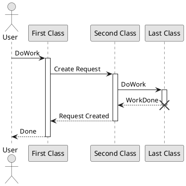

## Shadowing

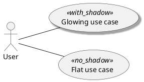

## Reverse colors

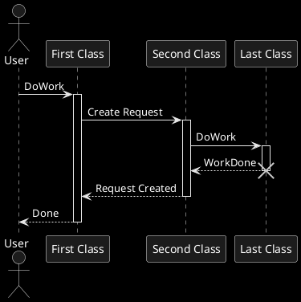

## Colors

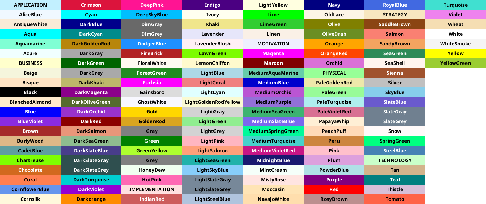

## Font color, name and size
```
skinparam classFontColor red
skinparam classFontSize 10
skinparam classFontName Aapex
```
```
skinparam defaultFontName Aapex
```
```
java -jar plantuml.jar -language
```

## Text Alignment

| Param name | Default value | Comment |
| sequenceMessageAlign | left | Used for messages in sequence diagrams |
| sequenceReferenceAlign | center | Used forref overin sequence diagrams |

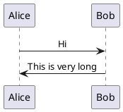

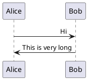

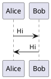

## Examples

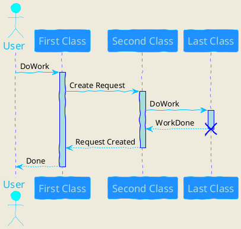

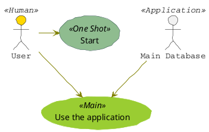

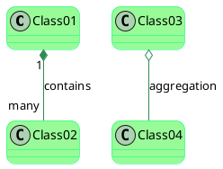

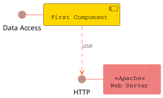

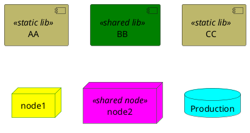
