# State Diagram

- Text-Based Language : Quickly define and visualize the states and transitions without the hassle of manual drawing.
- Efficiency and Consistency : Ensure streamlined diagram creation and easy version control.
- Versatility : Integrate with various documentation platforms and support multiple output formats.
- Open-Source & Community Support : Backed by a strong community that continuously contributes to its enhancements and offers invaluable resources.

## Simple State

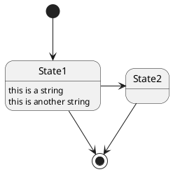

## Change state rendering

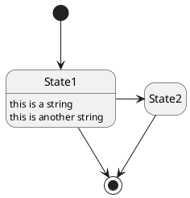

## Composite state

### Internal sub-state

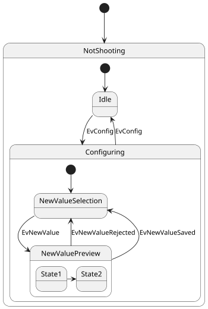

### Sub-state to sub-state

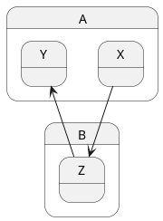


## Long name

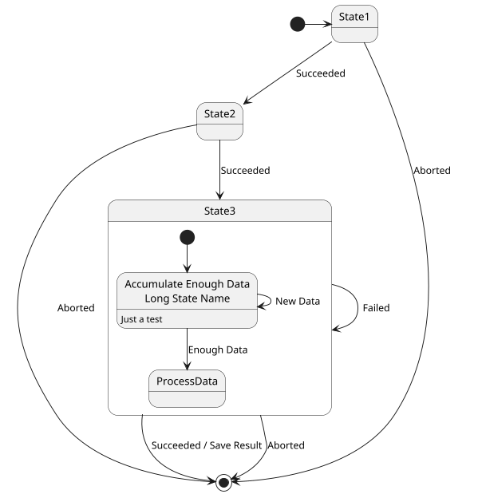

## History [[H], [H*]]

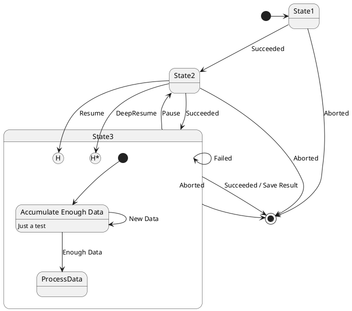

## Fork [fork, join]

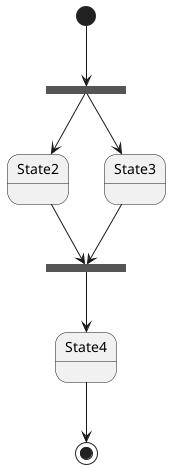

## Concurrent state [--, ||]

### Horizontal separator --

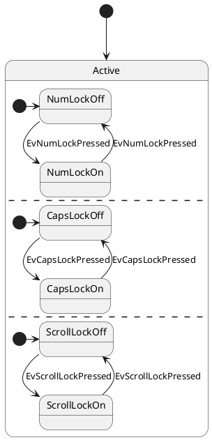

### Vertical separator ||

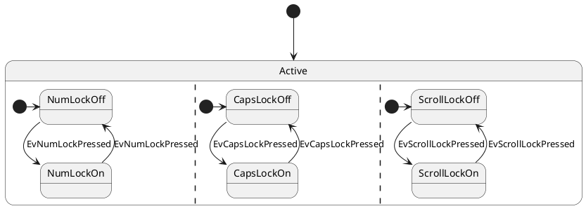

## Conditional [choice]

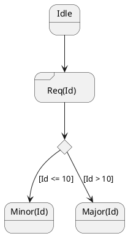

## Stereotypes full example [start, choice, fork, join, end, history, history*]

### Start, choice, fork, join, end

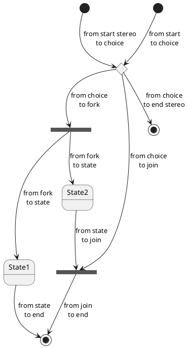

### History, history*

```plantuml
@startuml
state A {
   state s1 as "Start 1" <<start>>
   state s2 as "H 2" <<history>>
   state s3 as "H 3" <<history*>>
}
@enduml
```

### Minimal example with all stereotypes

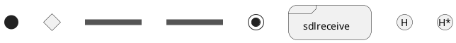

## Point [entryPoint, exitPoint]

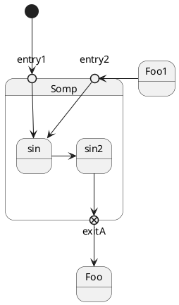

## Pin [inputPin, outputPin]

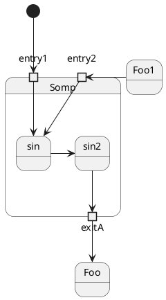

## Expansion [expansionInput, expansionOutput]

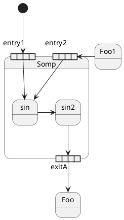

## Arrow direction

- -down-> or -->
- -right-> or -> (default arrow)
- -left->
- -up->

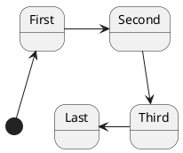

## Change line color and style

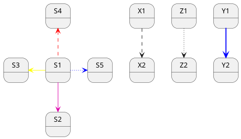

## Change head or tail of arrow line

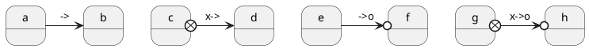

## Note

```plantuml
@startuml

[*] --> Active
Active --> Inactive

note left of Active : this is a short\nnote

note right of Inactive
  A note can also
  be defined on
  several lines
end note

@enduml
```

```plantuml
@startuml
state start <<start>>
start -> A
note left of start : this is a short note on start

state end <<end>>
A -> end

note right of end
 note
 on end
end note
@enduml
```

```plantuml
@startuml

state foo
note "This is a floating note" as N1

@enduml
```

## Note on link

```plantuml
@startuml
[*] -> State1
State1 --> State2
note on link 
  this is a state-transition note 
end note
@enduml
```

## More in notes

```plantuml
@startuml

[*] --> NotShooting

state "Not Shooting State" as NotShooting {
  state "Idle mode" as Idle
  state "Configuring mode" as Configuring
  [*] --> Idle
  Idle --> Configuring : EvConfig
  Configuring --> Idle : EvConfig
}

note right of NotShooting : This is a note on a composite state

@enduml
```

## Inline color

```plantuml
@startuml
state CurrentSite #pink {
    state HardwareSetup #lightblue {
       state Site #brown
        Site -[hidden]-> Controller
        Controller -[hidden]-> Devices
    }
    state PresentationSetup{
        Groups -[hidden]-> PlansAndGraphics
    }
    state Trends #FFFF77
    state Schedule #magenta
    state AlarmSupression
}
@enduml
```

## Skinparam

- In the diagram definition, like any other commands,
- In an included file ,
- In a configuration file, provided in the command line or the Ant task .

```plantuml
@startuml
skinparam backgroundColor LightYellow
skinparam state {
  StartColor MediumBlue
  EndColor Red
  BackgroundColor Peru
  BackgroundColor<<Warning>> Olive
  BorderColor Gray
  FontName Impact
}

[*] --> NotShooting

state "Not Shooting State" as NotShooting {
  state "Idle mode" as Idle <<Warning>>
  state "Configuring mode" as Configuring
  [*] --> Idle
  Idle --> Configuring : EvConfig
  Configuring --> Idle : EvConfig
}

NotShooting --> [*]
@enduml
```

### Test of all specific skinparam to State Diagrams

```plantuml
@startuml
skinparam State {
  AttributeFontColor blue
  AttributeFontName serif
  AttributeFontSize  9
  AttributeFontStyle italic
  BackgroundColor palegreen
  BorderColor violet
  EndColor gold
  FontColor red
  FontName Sansserif
  FontSize 15
  FontStyle bold
  StartColor silver
}

state A : a a a\na
state B : b b b\nb

[*] -> A  : start
A -> B : a2b
B -> [*] : end
@enduml
```

## Changing style

```plantuml
@startuml

<style>
stateDiagram {
  BackgroundColor Peru
  'LineColor Gray
  FontName Impact
  FontColor Red
  arrow {
    FontSize 13
    LineColor Blue
  }
}
</style>


[*] --> NotShooting

state "Not Shooting State" as NotShooting {
  state "Idle mode" as Idle <<Warning>>
  state "Configuring mode" as Configuring
  [*] --> Idle
  Idle --> Configuring : EvConfig
  Configuring --> Idle : EvConfig
}

NotShooting --> [*]
@enduml
```

```plantuml
@startuml
<style>
  diamond {
    BackgroundColor #palegreen
    LineColor #green
    LineThickness 2.5
}
</style>
state state1
state state2 
state choice1 <<choice>>
state end3    <<end>>

state1  --> choice1 : 1
choice1 --> state2  : 2
choice1 --> end3    : 3
@enduml
```

## Change state color and style (inline style)

- #color ##[style]color

```plantuml
@startuml
state FooGradient #red-green ##00FFFF
state FooDashed #red|green ##[dashed]blue {
}
state FooDotted ##[dotted]blue {
}
state FooBold ##[bold] {
}
state Foo1 ##[dotted]green {
state inner1 ##[dotted]yellow
}

state out ##[dotted]gold

state Foo2 ##[bold]green {
state inner2 ##[dotted]yellow
}
inner1 -> inner2
out -> inner2
@enduml
```

- #color;line:color;line.[bold|dashed|dotted];text:color

FIXME FIXME

```plantuml
@startuml
@startuml
state FooGradient #red-green;line:00FFFF
state FooDashed #red|green;line.dashed;line:blue {
}
state FooDotted #line.dotted;line:blue {
}
state FooBold #line.bold {
}
state Foo1 #line.dotted;line:green {
state inner1 #line.dotted;line:yellow
}

state out #line.dotted;line:gold

state Foo2 #line.bold;line:green {
state inner2 #line.dotted;line:yellow
}
inner1 -> inner2
out -> inner2
@enduml
@enduml
```

```plantuml
@startuml
state s1 : s1 description
state s2 #pink;line:red;line.bold;text:red : s2 description
state s3 #palegreen;line:green;line.dashed;text:green : s3 description
state s4 #aliceblue;line:blue;line.dotted;text:blue   : s4 description
@enduml
```

## Alias

```plantuml
@startuml
state alias1 
state "alias2"
state "long name" as alias3
state alias4 as "long name"

alias1 : ""state alias1""
alias2 : ""state "alias2"""
alias3 : ""state "long name" as alias3""
alias4 : ""state alias4 as "long name"""

alias1 -> alias2
alias2 -> alias3
alias3 -> alias4
@enduml
```

```plantuml
@startuml
state alias1 : ""state alias1""
state "alias2" : ""state "alias2"""
state "long name" as alias3 : ""state "long name" as alias3""
state alias4 as "long name" : ""state alias4 as "long name"""

alias1 -> alias2
alias2 -> alias3
alias3 -> alias4
@enduml
```

## Display JSON Data on State diagram

### Simple example

```plantuml
@startuml
state "A" as stateA
state "C" as stateC {
 state B
}

json jsonJ {
   "fruit":"Apple",
   "size":"Large",
   "color": ["Red", "Green"]
}
@enduml
```

## State description

```plantuml
@startuml
hide empty description 

state s0

state "This is the State 1" as s1 {
  s1: State description
  state s2
  state s3: long descr.
  state s4
  s4: long descr.
}

[*] -> s0
s0 --> s2

s2 -> s3
s3 -> s4
@enduml
```

## Style for Nested State Body

```plantuml
@startuml
<style>
.foo {
  state,stateBody {
    BackGroundColor lightblue;
  }
}
</style>

state MainState <<foo>> {
  state SubA
}
@enduml
```

## Mainframe and frame

### Mainframe

```plantuml
@startuml
mainframe mainframe
state a

state b
a --> b
b--> [*]
@enduml
```

### Frame

```plantuml
@startuml
frame frame {
state a
}
state b
a --> b
b--> [*]
@enduml
```

## Specific SkinParameter

### By default

```plantuml
@startuml
[*] --> State1
State1 --> State2 : next step
State2 --> State3 : next step
State3 --> [*]
@enduml
```

```plantuml
@startuml
[*] --> Opened

Opened --> Closed : close
Opened <-- Closed : open

Closed --> Locked : lock
Closed <-- Locked : unlock
@enduml
```

### Edge Label Style

```plantuml
@startuml
skinparam stateDiagramEdgeLabelStyle node
skinparam ranksep 20

[*] --> State1
State1 --> State2 : next step
State2 --> State3 : next step
State3 --> [*]
@enduml
```

```plantuml
@startuml
skinparam stateDiagramEdgeLabelStyle node
skinparam ranksep 20

[*] --> Opened

Opened --> Closed : close
Opened <-- Closed : open

Closed --> Locked : lock
Closed <-- Locked : unlock
@enduml
```

### Mix label defintion

```plantuml
@startuml
skinparam ranksep 30
[*] --> State1
State1 --> State2 : next step
State2 -[node]-> State3 : next step\n(on the middle of the arrow)
State3 --> [*]
@enduml
```
