# CSS Styles in PlantUML

## Getting Started

### Basic syntax and how to apply styles

```plantuml
@startuml
<style>
  /* Global style applied to all elements */
  element {
    BackGroundColor: #AAA;
  }

  /* Specific styles for a sequence diagram */
  sequenceDiagram {
    participant {
      FontColor: green;
      FontSize: 26;
      FontStyle: italic;
      LineColor: #E00;
    }
    arrow {
      FontColor: red;
      LineColor: blue;
    }
  }
</style>

participant Alice
participant Bob

Alice -> Bob : hello

@enduml
```

- The element selector applies a background color to all diagram elements.
- The sequenceDiagram block targets sequence diagrams specifically, allowing for more refined styling within that context.
- Within the sequenceDiagram block, the participant and arrow selectors define styles for participants and arrows respectively.

### Global vs. element-specific styles

- Definition : Rules applied to the element selector affect every part of your diagram.
- Usage : Use global styles to set defaults, such as background colors, that should be consistent throughout your entire diagram.

- Definition : These styles are applied only to specified parts of the diagram, such as sequenceDiagram , participant , or arrow .
- Usage : This approach is useful when you need to customize only certain components of your diagram. For instance, if you want to highlight participants in a sequence diagram differently from other elements, you can define rules under the participant selector.

## Detailed property reference

### Typography

| Property | Description |
| FontName | Sets the font family for text elements. |
| FontColor | Sets the color of the text. |
| FontSize | Specifies the size of the text. |
| FontStyle | Defines the text style (e.g., bold, italic, normal). |

### Color and background

| Property | Description |
| BackGroundColor | Sets the background color of an element. |
| HyperLinkColor | Sets the color used for hyperlinks. |

### Borders and corners

| Property | Description |
| RoundCorner | Sets the radius for rounding the corners of elements. |
| DiagonalCorner | Applies a diagonal cut effect to element corners. |
| LineColor | Specifies the color of lines or borders. |
| LineThickness | Sets the thickness of lines or borders. |
| LineStyle | Defines the line style (solid, dashed, dotted, etc.). |

### Spacing and sizing

| Property | Description |
| Padding | Sets the internal spacing within an element. |
| Margin | Defines the external spacing around an element. |
| MaximumWidth | Specifies the maximum width an element can occupy. |

### Additional visuals and effects

| Property | Description |
| Shadowing | Adds a shadow effect by specifying a numeric value for the shadow distance. |
| HyperlinkUnderlineStyle | Specifies the underline style for hyperlinks. |
| HyperlinkUnderlineThickness | Specifies the thickness of the hyperlink underline. |
| HorizontalAlignment | Aligns content horizontally (left, center, or right). |

## Advanced Examples

### Example 1: sequence – combining multiple styles

```plantuml
@startuml
<style>
  /* Global style for all elements */
  element {
    BackGroundColor: #f5f5f5;
  }

  /* Specific styles for sequence diagrams */
  sequenceDiagram {
    participant {
      FontColor: darkblue;
      FontSize: 24;
      FontStyle: bold;
    }
    arrow {
      LineColor: #008000;
      FontColor: #006400;
    }
  }
</style>

participant Alice
participant Bob

Alice -> Bob : Combined Styles Example

@enduml
```

### Example 2: sequence – using selectors for custom styles

```plantuml
@startuml
<style>
  sequenceDiagram {
    .primary {
      FontColor: darkred;
      FontSize: 16;
      FontStyle: bold;
      BackGroundColor: #ffe6e6;
    }
    .secondary {
      FontColor: gray;
      FontSize: 14;
      FontStyle: italic;
      BackGroundColor: #f0f0f0;
    }
    arrow {
      LineColor: #ff6600;
      FontColor: #0000ff;
    }
  }
</style>

participant "Alice (Primary)" as Alice <<primary>>
participant "Bob (Secondary)" as Bob <<secondary>>

Alice -> Bob : Message

@enduml
```

### Example 3: classes – custom class style

```plantuml
@startuml
<style>
classDiagram {
    RoundCorner 15
    .mystyle {
        RoundCorner 5
        BackgroundColor cyan
        FontStyle Bold
        FontColor red
    }
}
</style>
class Alice <<<mystyle>>>
@enduml
```

- All classes have a default round corner of 15.
- The custom class .mystyle further customizes the appearance of the class Alice .

### Example 4: classes – multiple custom class styles

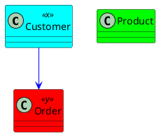

- The default background color for classes is bright green ( #00ff00 ).
- The custom selectors .x and .y override the background colors to cyan and red respectively.

### Example 5: classes – visibility icon styling

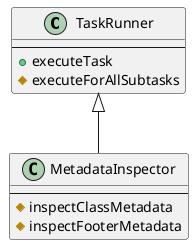

- The visibilityIcon style targets protected members, setting both their line and background colors to DarkGoldenRod.
- This helps visually distinguish protected elements in the diagram.

### Example 6: objects – global and specific styling

```plantuml
@startuml
<style>
root {
  FontColor Red
  BackgroundColor palegreen
}
objectDiagram {
  object {
      FontColor blue
      BackgroundColor yellow
  }
}
</style>

object PaymentService
object Customer {
  name = "John Doe"
  id = 456
}

PaymentService -> Customer
@enduml
```

- The root style applies a red font color and a pale green background to the diagram’s root elements.
- The style defined in objectDiagram targets only the objects.

### Example 7: mindmap – basic node styling

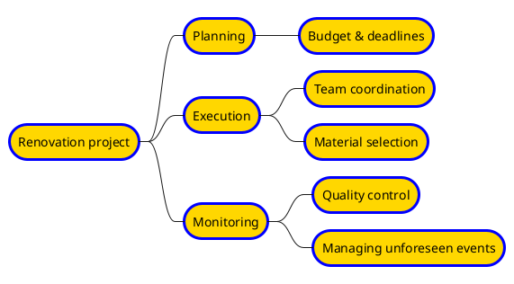

- All nodes are styled with padding, centered text, blue borders (thickness 3.0), a gold background, and rounded corners (radius 40).

### Example 8: mindmap – detailed node styling with width constraints

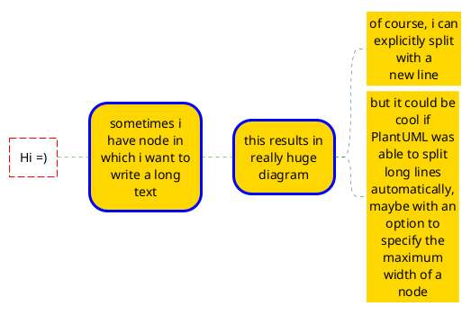

- The detailed styling controls spacing and maximum width to prevent overly extended diagrams.

### Example 9: wbs – depth-based styling

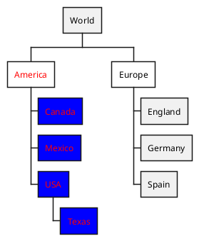

- The styling varies according to the node's depth and assigned class, allowing for clear hierarchical visualization.

### Example 10: json – styling a json diagram

```plantuml
@startjson
<style>
jsonDiagram {
  node {
    FontName Helvetica
    FontColor Coral
    FontSize 12
    FontStyle bold
    BackGroundColor Khaki
    LineColor lightblue
  }
  arrow {
    BackGroundColor lightblue
    LineColor green
  }
}
</style>
{
    "quiz": {
        "question": "2+2?",
        "options": ["3", "4", "5"],
        "answer": "4"
    }
}
@endjson
```

- The node style sets the font to Helvetica, Coral text with bold style at size 12, a Khaki background, and a light blue border.
- Arrows are styled with a light blue background and green line.

### Example 11: arrows – customizing with class selectors

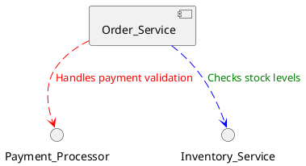

- The default arrow style is set to green.
- The .critical class changes arrows to red, while the .supporting class changes them to blue.

### Example 12: timing – class-based color customization

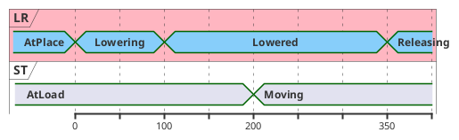

- The .bluecolor class gives the element a blue background, combined here with a red font color.

### Example 13: timing – timeline customization

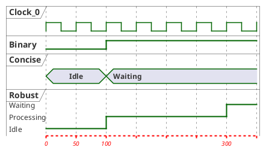

- The timeline is styled with red italic text (size 10) and a pink background, with red lines drawn in a specific style and thickness for improved clarity.

### Example 14: gantt – task status styling

```plantuml
@startgantt
<style>
ganttDiagram {
  task {
    BackGroundColor GreenYellow
    LineColor Green 
    unstarted {
      BackGroundColor Fuchsia 
    }
  }
  undone {
    BackGroundColor red
  }
}
</style>

[Prototype Design] lasts 7 days
[Functional Testing] lasts 4 days
[Performance Testing] lasts 4 days

[Functional Testing] starts at [Prototype Design]'s end
[Performance Testing] starts at [Prototype Design]'s end

[Functional Testing] is 0% complete
[Performance Testing] is 80% complete
@endgantt
```

- Different background colors help quickly identify the status of each task in the timeline.

## Conclusion
