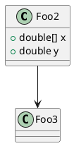
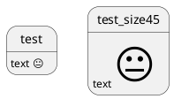
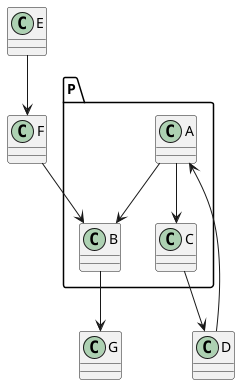
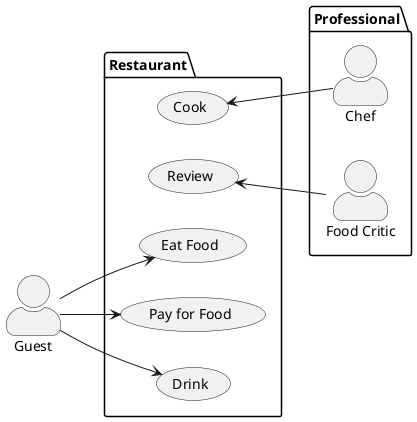
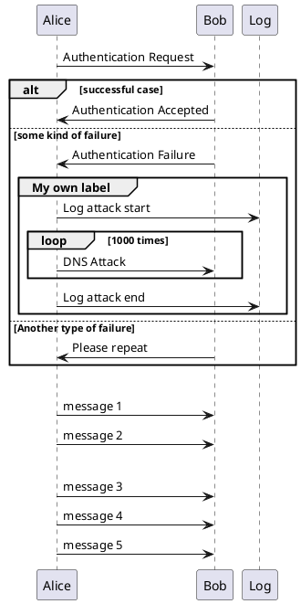

# Scalable Vector Graphics

PlantUML Advanced usage SVG Support

### Command Line

### Ant Task
```
<target name="main">
  <plantuml dir="./src" format="svg" />
</target>
```

### Java

## Specific Skin Parameters for SVG

### svgLinkTarget

- _blank : Opens the link in a new window or tab
- _parent : Opens the link in the parent frame
- _self : Opens the link in the same frame where it was clicked (default setting)
- _top : Opens the link in the full body of the window

### pathHoverColor


[Reference: QA-5453 ]

### svgDimensionStyle

```puml
@startuml
skinparam svgDimensionStyle false

component a {
}
component b {
}
a -(0- b
@enduml
```


[Reference QA-7334 ]

## svgSize Pragma

### Using the svgSize Pragma Directive

- !pragma svgSize <U+hhhhh> XX
- !pragma svgSize <U+hhhhh> I

#### Example Usage


### Command-Line Options

- Enclose the argument in quotes, especially when it contains spaces.
- Use this option multiple times in a single command, if necessary.

#### Example
```
java -jar plantuml.jar "-PsvgSize=<U+1F610> XX" "-PsvgSize=<U+1F611> I" -Tsvg <file.puml>
```

### References

- Forum QA-12550
- GitHub Issue 582

## Interactive SVG

Interactive SVG is enabled with `!pragma svgInteractive true` inside the `@startuml ... @enduml` block (the value is a convention — any non-empty string works). PlantUML embeds a JavaScript bundle and CSS stylesheet directly into the SVG output, chosen by diagram type. No post-processing or external files are needed.

- QA-13350

### On Class, Object, UseCase or Deployment diagram

On these diagram types, interactions operate on elements connected by arrows/associations (internal `g.entity` and `g.link` elements):

- **Hover** (mouseover): the hovered element and its direct neighbors stay at full opacity; everything else dims. Moving the mouse away restores the diagram.
- **Click**: same as hover but *locked* — the selection stays highlighted after the mouse moves away. Click the same element again to clear.
- **Double-click**: highlights the *transitive closure* — the clicked element **and every other element reachable from it through any number of links** (the entire connected graph). Double-click again to clear.
- Pressing **`Escape`** clears the click selection without affecting the current hover highlight (hover and click are independent states).





### On Sequence diagram

- **Participant filter**: click a participant name or lifeline to highlight its messages in green (everything else dims). Click additional participants to filter by multiple lifelines — only messages touching all of them are highlighted. Click a selected participant again to remove it from the filter; when the set is empty the diagram is fully restored. If no message matches the selection, participants turn red instead.
- **Floating header**: a pin button (📌) appears in the participant header row. Click it to pin the header to the top of the viewport while scrolling. The pinned state persists in `localStorage` across page loads (requires HTTP hosting — `file://` storage is unreliable).



### All diagram types — links and tooltips (native SVG, no JS needed)

- **Links**: `[[url label]]` on a participant, class, use case, message, or any other element wraps it in `<a href="url">` — clickable in the browser. Use skinparam `svgLinkTarget` to control the target (`_blank`, `_parent`, `_self`, `_top`).
- **Tooltips**: `[[url{tooltip} label]]` emits a `<title>tooltip</title>` inside the link — native browser hover tooltip.

## Option for SVG [ svgTitle , svgDesc ]

```plantuml
@startuml
!option svgTitle "This is the title"
!option svgDesc "This is the description"

alice -> bob: hello
@enduml
```
