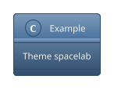
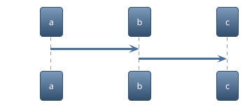
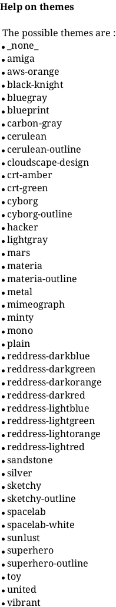
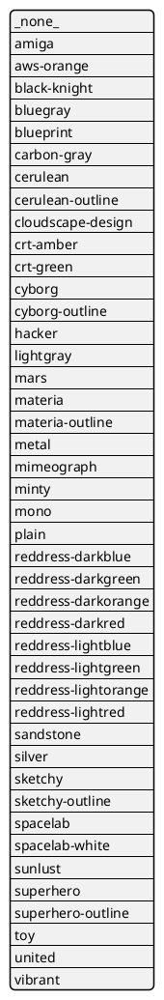
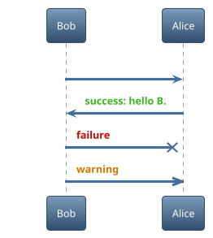

# Themes





## List of available themes

- Gallery of all official PlantUML themes .
- Examples of some Puml Themes made by Brett Schwarz on the Theme Gallery .





## Coloring message with some procedures included on some theme

- $success("<msg>")
- $failure("<msg>")
- $warning("<msg>")



## Local themes
```
!theme foo from /path/to/themes/folder
```

## Themes from the Internet
```
!theme amiga from https://raw.githubusercontent.com/plantuml/plantuml/tree/master/src/main/resources/themes
```
