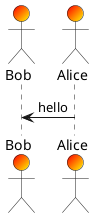
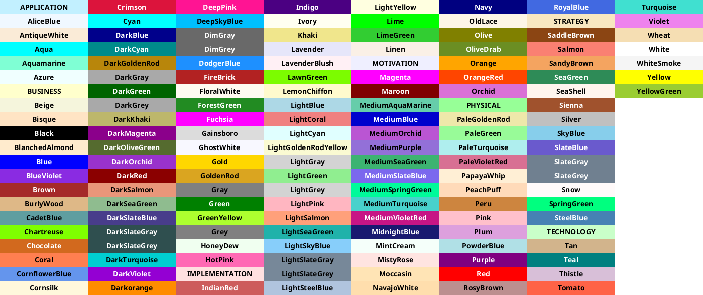
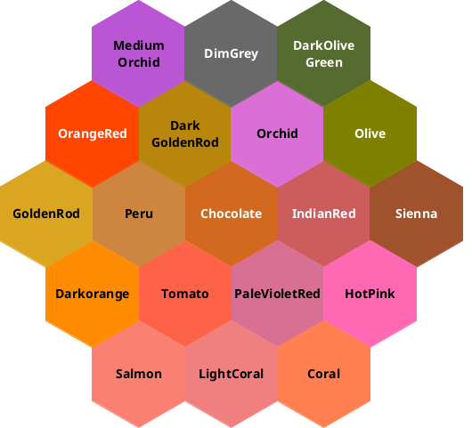
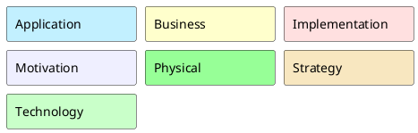
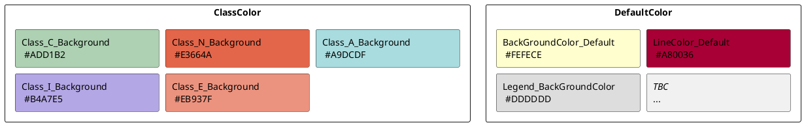

# Colors

- with its standard name or CSS name
- using HEX value (6 digits) : #RRGGBB
- using HEX value (8 digits) with alpha compositing or RGBA color model : #RRGGBBaa
- using short HEX value (3 digits) : #RGB (so #ABC means #AABBCC )
- using very short HEX value (1 digits): #x which is a shortcut for #xxxxxx (so you get some gray)

```plantuml
@startgantt
[Activity1] lasts 5 days
[Activity2] lasts 5 days
[Activity1] is colored in White/Red
[Activity2] is colored in Silver/SeaGreen
[Activity1] -> [Activity2]
@endgantt
```

## Color gradient

- | ,
- / ,
- \ , or
- -

## Automatic Font Color

### How It Works:

- The #? prefix defines a conditional color choice.
- Two colors follow, separated by a colon.
- The engine selects one based on the background:

```plantuml
@startuml
<style>
document {
  BackGroundColor darkblue
}
root {
  FontColor #?black:white
  LineColor white
}
</style>
alice -> bob : hello
@enduml
```

## Color with preprocessing

| Name | Description | Example | Return |
| %darken | Return a darken color of a given color with some ratio | %darken("red", 20) | #CC0000 |
| %is_dark | Check if a color is a dark one | %is_dark("#000000") | true |
| %is_light | Check if a color is a light one | %is_light("#000000") | false |
| %lighten | Return a lighten color of a given color with some ratio | %lighten("red", 20) | #CC3333 |
| %reverse_color | Reverse a color using RGB | %reverse_color("#FF7700") | #0088FF |
| %reverse_hsluv_color | Reverse a colorusing HSLuv | %reverse_hsluv_color("#FF7700") | #602800 |

## View colors in PlantUML

## Archimate colors

- Application
- Business
- Implementation
- Motivation
- Physical
- Strategy
- Technology

## PlantUML colors

