# Format definition

#### Simple link

- [[http://plantuml.com]]
- [[]] (empty link)

#### Link with optional label

#### Link with optional tooltip

#### Only tooltip

#### Only tooltip and label

#### URL authentication

## Links contained curly bracket

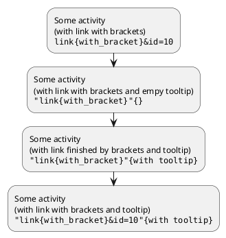

## Links in sequence diagram

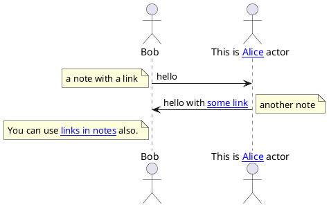

## Links in class diagram

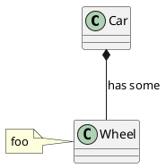

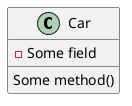

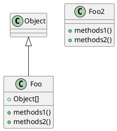

## Links in activity diagram

### On activity label

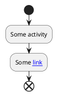

### On partition

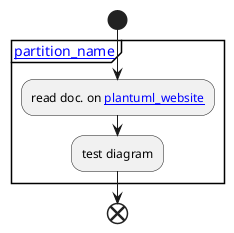

## Link in State diagram

- local link on a word
- or link on the entire state shape

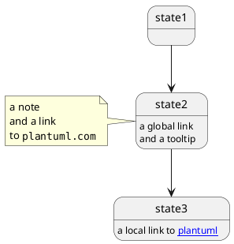

## Links in Network diagram (nwdiag)

```plantuml
@startnwdiag
network Network {
  Server [description="A [[http://plantuml.com link]] on nwdiag"];
}
@endnwdiag
```

## Links in JSON/YAML diagram

### JSON

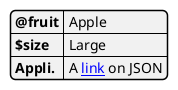

### YAML

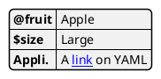

## Links in notes

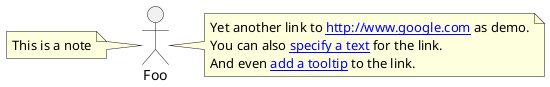

## Links with explicit URL directive

### On sequence diagram

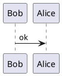

### On class diagram

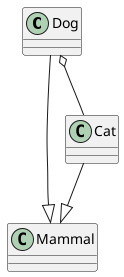

### On usecase diagram

```plantuml
@startuml
actor Mamal
usecase Dog

url of Mamal is [[http://www.google.com]]
url of Dog is [[http://www.yahoo.com{This is Dog}]]
@enduml
```

### On component or deployment diagram

```plantuml
@startuml
node Mamal
component Dog

url of Mamal is [[http://www.google.com]]
url of Dog is [[http://www.yahoo.com{This is Dog}]]
@enduml
```

## Links in arrow (or Hyperlinks in link or connection)

### Class diagram

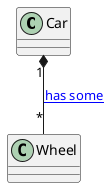

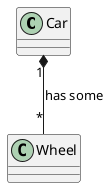

### Component or Deployment diagram

FIXME FIXME

```plantuml
@startuml
node Car 
Car *-- Wheel [[http://plantuml.com/deployment-diagram]] : has some
@enduml
```

### State diagram

FIXME FIXME

```plantuml
@startuml
state Car
state CarWithWheel
Car -> CarWithWheel [[http://plantuml.com/state-diagram]] : Add wheel to car
@enduml
```

## Specific SkinParameter for Link

### hyperlinkColor

```plantuml
@startuml
:hyperlinkColor setting, by default;
:[[http://plantuml.com]];
@enduml
```

```plantuml
@startuml
skinparam hyperlinkColor red
:hyperlinkColor setting;
:[[http://plantuml.com]];
@enduml
```

### hyperlinkUnderline

```plantuml
@startuml
skinparam hyperlinkUnderline false
:hyperlinkColor setting;
:[[http://plantuml.com]];
@enduml
```

```plantuml
@startuml
skinparam hyperlinkUnderline 1
:hyperlinkColor setting;
:[[http://plantuml.com]];
@enduml
```

```plantuml
@startuml
skinparam hyperlinkUnderline 5
:hyperlinkColor setting;
:[[http://plantuml.com]];
@enduml
```

### topurl

```plantuml
@startmindmap

skinparam topurl https://plantuml.com/

* [[index PlantUML website]]
** [[sequence-diagram Sequence]]
** [[mindmap-diagram MindMap]]
** [[wbs-diagram WBS]]
** ...
@endmindmap
```

## Other SkinParameter for Link

- Specific SkinParameter for SVG

## Using (global) style

### Without style (by default)

```plantuml
@startuml
title test on HyperlinkColor [[test link]]

 class test <<normal>> {
  * aaa
  + [[normal model]]
  - bb
 }
 
  class test_with_stereo AS "[[http://www.plantuml.com test]]" <<red>> {
  * aaa
  + [[red model]]
  - bb
 }
@enduml
```

### With style

```plantuml
@startuml
<style>
.red {
  HyperlinkColor #FF0000
}
</style>

title test on HyperlinkColor [[test link]]

 class test <<normal>> {
  * aaa
  + [[normal model]]
  - bb
 }
 
  class test_with_stereo AS "[[http://www.plantuml.com test]]" <<red>> {
  * aaa
  + [[red model]]
  - bb
 }
@enduml
```
