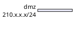
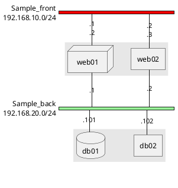
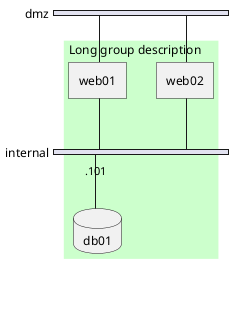
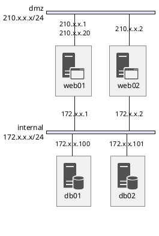
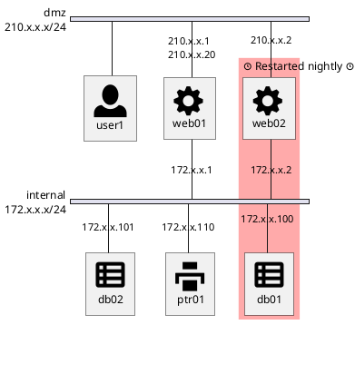
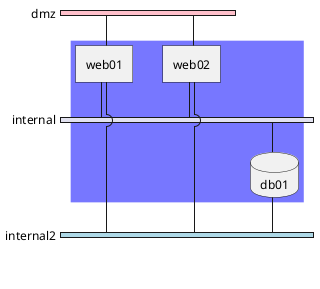
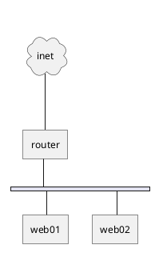
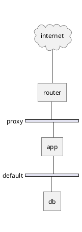
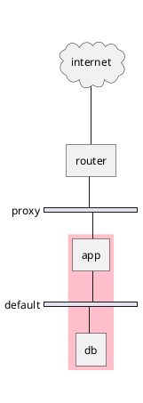
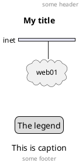

# Network Diagram with nwdiag

## Simple diagram

### Define a network



```plantuml
@startnwdiag
network dmz {
  address = "210.x.x.x/24"
}
@endnwdiag
```

### Define some elements or servers on a network

```plantuml
@startnwdiag
  network dmz {
      address = "210.x.x.x/24"

      web01 [address = "210.x.x.1"];
      web02 [address = "210.x.x.2"];
  }
@endnwdiag
```

### Full example

```plantuml
@startnwdiag
  network dmz {
      address = "210.x.x.x/24"

      web01 [address = "210.x.x.1"];
      web02 [address = "210.x.x.2"];
  }
  network internal {
      address = "172.x.x.x/24";

      web01 [address = "172.x.x.1"];
      web02 [address = "172.x.x.2"];
      db01;
      db02;
  }
@endnwdiag
```

## Define multiple addresses

```plantuml
@startnwdiag
  network dmz {
      address = "210.x.x.x/24"

      // set multiple addresses (using comma)
      web01 [address = "210.x.x.1, 210.x.x.20"];
      web02 [address = "210.x.x.2"];
  }
  network internal {
      address = "172.x.x.x/24";

      web01 [address = "172.x.x.1"];
      web02 [address = "172.x.x.2"];
      db01;
      db02;
  }
@endnwdiag
```

## Grouping nodes

### Define group inside network definitions

```plantuml
@startnwdiag
  network Sample_front {
    address = "192.168.10.0/24";

    // define group
    group web {
      web01 [address = ".1"];
      web02 [address = ".2"];
    }
  }
  network Sample_back {
    address = "192.168.20.0/24";
    web01 [address = ".1"];
    web02 [address = ".2"];
    db01 [address = ".101"];
    db02 [address = ".102"];

    // define network using defined nodes
    group db {
      db01;
      db02;
    }
  }
@endnwdiag
```

### Define group outside of network definitions

```plantuml
@startnwdiag
  // define group outside of network definitions
  group {
    color = "#FFAAAA";

    web01;
    web02;
    db01;
  }

  network dmz {
    web01;
    web02;
  }
  network internal {
    web01;
    web02;
    db01;
    db02;
  }
@endnwdiag
```

### Define several groups on same network

#### Example with 2 group

```plantuml
@startnwdiag
  group {
    color = "#FFaaaa";
    web01;
    db01;
  }
  group {
    color = "#aaaaFF";
    web02;
    db02;
  }
  network dmz {
      address = "210.x.x.x/24"

      web01 [address = "210.x.x.1"];
      web02 [address = "210.x.x.2"];
  }
  network internal {
      address = "172.x.x.x/24";

      web01 [address = "172.x.x.1"];
      web02 [address = "172.x.x.2"];
      db01 ;
      db02 ;
  }
@endnwdiag
```

#### Example with 3 groups

```plantuml
@startnwdiag
  group {
    color = "#FFaaaa";
    web01;
    db01;
  }
  group {
    color = "#aaFFaa";
    web02;
    db02;
  }
  group {
    color = "#aaaaFF";
    web03;
    db03;
  }

  network dmz {
      web01;
      web02;
      web03;
  }
  network internal {
      web01;
      db01 ;
      web02;
      db02 ;
      web03;
      db03;
  }
@endnwdiag
```

## Extended Syntax (for network or group)

### Network

- addresses (separated by comma , ) ;
- color ;
- description;
- shape .



### Group

- color ;
- description.



## Using Sprites



## Using OpenIconic



## Same nodes on more than two networks



## Peer networks



## Peer networks and group

### Without group



### Group on first



### Group on second


### Group on third


## Add title, caption, header, footer or legend on network diagram



## With or without shadow

### With shadow (by default)

```plantuml
@startnwdiag
nwdiag {
  network nw {
    server;
    internet;
  }
  internet [shape = cloud];
}
@endnwdiag
```

### Without shadow

```plantuml
@startnwdiag
<style>
root {
 shadowing 0
}
</style>
nwdiag {
  network nw {
    server;
    internet;
  }
  internet [shape = cloud];
}
@endnwdiag
```

## Change width of the networks

### First example

- without

```plantuml
@startnwdiag
nwdiag {
  network NETWORK_BASE {
   dev_A [address = "dev_A" ]
   dev_B [address = "dev_B" ]
  }
  network IntNET1 {
   dev_B [address = "dev_B1" ]
   dev_M [address = "dev_M1" ]
  }
  network IntNET2 {
   dev_B [address = "dev_B2" ]
   dev_M [address = "dev_M2" ]
 }
}
@endnwdiag
```

- only the first

```plantuml
@startnwdiag
nwdiag {
  network NETWORK_BASE {
   width = full
   dev_A [address = "dev_A" ]
   dev_B [address = "dev_B" ]
  }
  network IntNET1 {
   dev_B [address = "dev_B1" ]
   dev_M [address = "dev_M1" ]
  }
  network IntNET2 {
   dev_B [address = "dev_B2" ]
   dev_M [address = "dev_M2" ]
 }
}
@endnwdiag
```

- the first and the second

```plantuml
@startnwdiag
nwdiag {
  network NETWORK_BASE {
   width = full
   dev_A [address = "dev_A" ]
   dev_B [address = "dev_B" ]
  }
  network IntNET1 {
   width = full
   dev_B [address = "dev_B1" ]
   dev_M [address = "dev_M1" ]
  }
  network IntNET2 {
   dev_B [address = "dev_B2" ]
   dev_M [address = "dev_M2" ]
 }
}
@endnwdiag
```

- all the network (with same full width)

```plantuml
@startnwdiag
nwdiag {
  network NETWORK_BASE {
   width = full
   dev_A [address = "dev_A" ]
   dev_B [address = "dev_B" ]
  }
  network IntNET1 {
   width = full
   dev_B [address = "dev_B1" ]
   dev_M [address = "dev_M1" ]
  }
  network IntNET2 {
   width = full
   dev_B [address = "dev_B2" ]
   dev_M [address = "dev_M2" ]
 }
}
@endnwdiag
```

### Second example

- without

```plantuml
@startnwdiag
nwdiag {
  e1
  network n1 {
    e1
    e2
    e3
  }

  network n2 {
    e3
    e4
    e5
  }

  network n3 {
    e2
    e6
  }
}
@endnwdiag
```

- only the first

```plantuml
@startnwdiag
nwdiag {
  e1
  network n1 {
    width = full
    e1
    e2
    e3
  }

  network n2 {
    e3
    e4
    e5
  }

  network n3 {
    e2
    e6
  }
}
@endnwdiag
```

- the first and the second

```plantuml
@startnwdiag
nwdiag {
  e1
  network n1 {
    width = full
    e1
    e2
    e3
  }

  network n2 {
    width = full
    e3
    e4
    e5
  }

  network n3 {
    e2
    e6
  }
}
@endnwdiag
```

- all the network (with same full width)

```plantuml
@startnwdiag
nwdiag {
  e1
  network n1 {
    width = full
    e1
    e2
    e3
  }

  network n2 {
    width = full
    e3
    e4
    e5
  }

  network n3 {
    width = full
    e2
    e6
  }
}
@endnwdiag
```

## Other internal networks

- Without address or type

```plantuml
@startnwdiag
nwdiag {
  network LAN1 {
     a [address = "a1"];
  }
  network LAN2 {
     a [address = "a2"];
     switch;
  }
  switch -- equip;
  equip -- printer;
}
@endnwdiag
```

- With address or type

```plantuml
@startnwdiag
nwdiag {
  network LAN1 {
     a [address = "a1"];
  }
  network LAN2 {
     a [address = "a2"];
     switch [address = "s2"];
  }
  switch -- equip;
  equip [address = "e3"];
  equip -- printer;
  printer [address = "USB"];
}
@endnwdiag
```

## Using (global) style

### Without style (by default)

```plantuml
@startnwdiag
nwdiag {
  network DMZ {
      address = "y.x.x.x/24"
      web01 [address = "y.x.x.1"];
      web02 [address = "y.x.x.2"];
  }

   network Internal {
    web01;
    web02;
    db01 [address = "w.w.w.z", shape = database];
  } 

    group {
    description = "long group label";
    web01;
    web02;
    db01;
  }
}
@endnwdiag
```

### With style

```plantuml
@startnwdiag
<style>
nwdiagDiagram {
  network {
    BackGroundColor green
    LineColor red
    LineThickness 1.0
    FontSize 18
    FontColor navy
  }
  server {
    BackGroundColor pink
    LineColor yellow
    LineThickness 1.0
    ' FontXXX only for description or label
    FontSize 18
    FontColor #blue
  }
  arrow {
    ' FontXXX only for address 
    FontSize 17
    FontColor #red
    FontName Monospaced
    LineColor black
  }
  group {
    BackGroundColor cadetblue
    LineColor black
    LineThickness 2.0
    FontSize 11
    FontStyle bold
    Margin 5
    Padding 5
  }
}
</style>
nwdiag {
  network DMZ {
      address = "y.x.x.x/24"
      web01 [address = "y.x.x.1"];
      web02 [address = "y.x.x.2"];
  }

   network Internal {
    web01;
    web02;
    db01 [address = "w.w.w.z", shape = database];
  } 

    group {
    description = "long group label";
    web01;
    web02;
    db01;
  }
}
@endnwdiag
```

## Appendix: Test of all shapes on Network diagram (nwdiag)

```plantuml
@startnwdiag
nwdiag {
  network Network {
    Actor       [shape = actor]       
    Agent       [shape = agent]       
    Artifact    [shape = artifact]    
    Boundary    [shape = boundary]    
    Card        [shape = card]        
    Cloud       [shape = cloud]       
    Collections [shape = collections] 
    Component   [shape = component]   
  }
}
@endnwdiag
```

```plantuml
@startnwdiag
nwdiag {
  network Network {
    Control     [shape = control]     
    Database    [shape = database]    
    Entity      [shape = entity]      
    File        [shape = file]        
    Folder      [shape = folder]      
    Frame       [shape = frame]       
    Hexagon     [shape = hexagon]     
    Interface   [shape = interface]   
  }
}
@endnwdiag
```

```plantuml
@startnwdiag
nwdiag {
  network Network {
    Label       [shape = label]       
    Node        [shape = node]        
    Package     [shape = package]     
    Person      [shape = person]      
    Queue       [shape = queue]       
    Stack       [shape = stack]       
    Rectangle   [shape = rectangle]   
    Storage     [shape = storage]     
    Usecase     [shape = usecase]     
  }
}
@endnwdiag
```

FIXME

1. Overlap of label for folder
2. Hexagon shape is missing

```plantuml
@startnwdiag
nwdiag {
network Network {
Folder [shape = folder]
Hexagon [shape = hexagon]
}
}
@endnwdiag
```

```plantuml
@startnwdiag
nwdiag {
network Network {
Folder [shape = folder, description = "Test, long long label\nTest, long long label"]
Hexagon [shape = hexagon, description = "Test, long long label\nTest, long long label"]
}
}
@endnwdiag
```

FIXME
