# Object Diagram

## Definition of objects

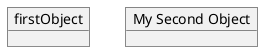

## Relations between objects

| Type | Symbol | Purpose |
| Extension | <|-- | Specialization of a class in a hierarchy |
| Implementation | <|.. | Realization of an interface by a class |
| Composition | *-- | The part cannot exist without the whole |
| Aggregation | o-- | The part can exist independently of the whole |
| Dependency | --> | The object uses another object |
| Dependency | ..> | A weaker form of dependency |

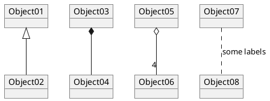

## Associations objects

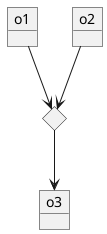

## Adding fields

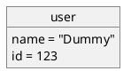

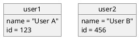

## Common features with class diagrams

- Hide attributes, methods...
- Defines notes
- Use packages
- Skin the output

## Map table or associative array

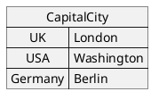

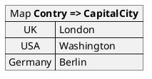

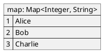

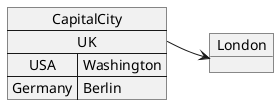

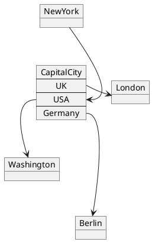

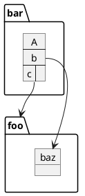

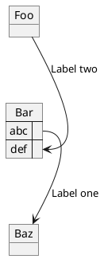

## Program (or project) evaluation and review technique (PERT) with map

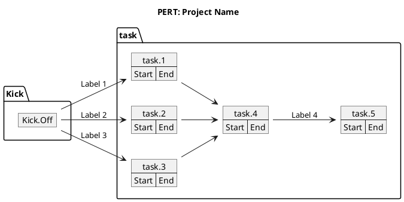

## Display JSON Data on Class or Object diagram

### Simple example

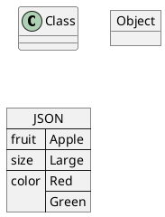
