# Preprocessing

## Variable definition [=, ?=]

- Integer number (int) ;
- String (str) - these must be surrounded by single quote or double quote;
- JSON (JSON) - either JSON Array or JSON Object or JSON value created by %str2json .

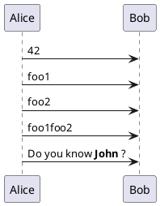

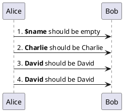

## Boolean expression

### Boolean representation [0 is false]

- Integer 0 means false
- and any non-null number (as 1 ) or any string (as "1" , or even "0" ) means true .

### Boolean operation and operator [&&, ||, ()]

- parenthesis () ;
- and operator && ;
- or operator || .

### Boolean builtin functions [%false(), %true(), %not(<exp>), %boolval(<exp>)]

- %false()
- %true()
- %not(<exp>)
- %boolval(<exp>)

## Conditions [!if, !else, !elseif, !endif]

- You can use expression in condition.
- else and elseif are also implemented

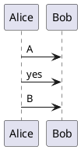

## While loop [!while, !endwhile]

### While loop (on Activity diagram)

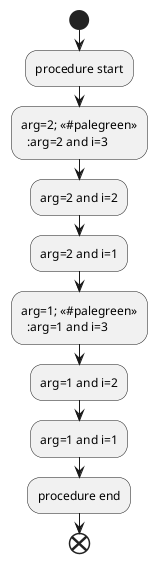

### While loop (on Mindmap diagram)

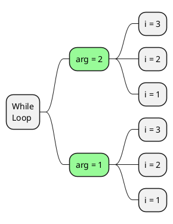

### While loop (on Component/Deployment diagram)

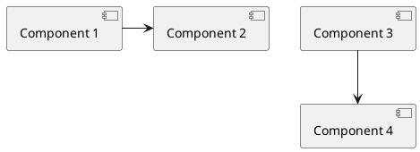

## Procedure [!procedure, !endprocedure]

- Procedure names should start with a $
- Argument names should start with a $
- Procedures can call other procedures

```plantuml
@startuml
!procedure $msg($source, $destination)
  $source --> $destination
!endprocedure

!procedure $init_class($name)
  class $name {
    $addCommonMethod()
  }
!endprocedure


!procedure $addCommonMethod()
  toString()
  hashCode()
!endprocedure


$init_class("foo1")
$init_class("foo2")
$msg("foo1", "foo2")
@enduml
```

## Return function [!function, !endfunction]

- directly in variable definition or in diagram text
- from other return functions
- from procedures

- Function name should start with a $
- Argument names should start with a $

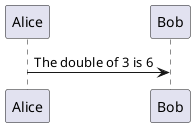

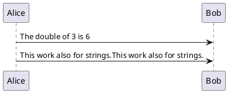

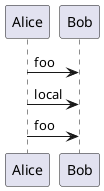

## Default argument value

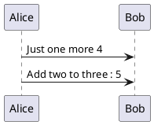

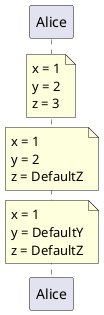

## Unquoted procedure or function [!unquoted]

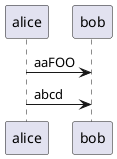

## Keywords arguments

```plantuml
@startuml

!unquoted procedure $element($alias, $description="", $label="", $technology="", $size=12, $colour="green")
rectangle $alias as "
<color:$colour><<$alias>></color>
==$label==
//<size:$size>[$technology]</size>//

  $description"
!endprocedure

$element(myalias, "This description is %newline()on several lines", $size=10, $technology="Java")
@enduml
```

## Including files or URL [!include, !include_many, !include_once]

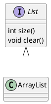
```
interface List
List : int size()
List : void clear()
```

## Including Subpart [!startsub, !endsub, !includesub]
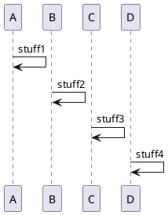

```puml
@startuml

title this contains only B and D
!includesub file1.puml!BASIC
@enduml
```
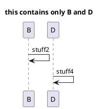

## Builtin functions [%]

| Name | Description | Example | Return |
| %boolval | Convert a value(String, Integer, JSON value)to boolean value | %boolval("true") | 1 |
| %breakline | Return a newline in the PlantUML source code. See more documention on thenewline page | %breakline() | a newline in the PlantUML source code |
| %call_user_func | Invoke a return function by its name with given arguments. | %call_user_func("bold", "Hello") | Depends on the called function |
| %chr | Return a character from a give Unicode value | %chr(65) | A |
| %darken | Return a darken color of a given color with some ratio | %darken("red", 20) | #CC0000 |
| %date | Retrieve current date. You can provide an optionalformat for the date | %date("yyyy.MM.dd' at 'HH:mm") | current date |
|  | You can provide another optional time (on epoch format) | %date("YYYY-MM-dd", %now() + 1*24*3600) | tomorrow date |
| %dec2hex | Return the hexadecimal string (String) of a decimal value (Int) | %dec2hex(12) | c |
| %dirpath | Retrieve current dirpath | %dirpath() | current path |
| %feature | Check if some feature is available in the current PlantUML running version | %feature("theme") | true |
| %false | Return alwaysfalse | %false() | false |
| %file_exists | Check if a file exists on the local filesystem | %file_exists("c:/foo/dummy.txt") | trueif the file exists |
| %filename | Retrieve current filename | %filename() | current filename |
| %function_exists | Check if a function exists | %function_exists("$some_function") | trueif the function has been defined |
| %get_all_theme | Retreive a JSON Array of all PlantUMLtheme | %get_all_theme() | ["_none_", "amiga", ..., "vibrant"] |
| %get_all_stdlib | Retreive a JSON Array of all PlantUMLstdlibnames | %get_all_stdlib() | ["archimate", "aws", ..., "tupadr3"] |
| %get_all_stdlib | Retreive a JSON Object of all PlantUMLstdlibinformation | %get_all_stdlib(detailed) | a JSON Object with stdlib information |
| %get_variable_value | Retrieve some variable value | %get_variable_value("$my_variable") | the value of the variable |
| %getenv | Retrieve environment variable value | %getenv("OS") | the value ofOSvariable |
| %hex2dec | Return the decimal value (Int) of a hexadecimal string (String) | %hex2dec("d")or%hex2dec(d) | 13 |
| %hsl_color | Return the RGBa color from a HSL color%hsl_color(h, s, l)or%hsl_color(h, s, l, a) | %hsl_color(120, 100, 50) | #00FF00 |
| %intval | Convert a String to Int | %intval("42") | 42 |
| %invoke_procedure | Dynamically invoke a procedure by its name, passing optional arguments to the called procedure. | %invoke_procedure("$go", "hello from Bob...") | Depends on the invoked procedure |
| %is_dark | Check if a color is a dark one | %is_dark("#000000") | true |
| %is_light | Check if a color is a light one | %is_light("#000000") | false |
| %lighten | Return a lighten color of a given color with some ratio | %lighten("red", 20) | #CC3333 |
| %load_json | Load JSON data from local file or external URL | %load_json("http://localhost:7778/management/health") | JSON data |
| %lower | Return a lowercase string | %lower("Hello") | helloin that example |
| %mod | Return the remainder of division of two integers (modulo division) | %mod(10, 3) | 1 |
| %n | Return a newline in rendered text, shortcut to%newline. See more documention on thenewline page | %n() | a newline |
| %newline | Return a newline in rendered text, similar to%n. See more documention on thenewline page | %newline() | a newline |
| %not | Return the logical negation of an expression | %not(2+2==4) | falsein that example |
| %now | Return the current epoch time | %now() | 1685547132in that example (when updating the doc.) |
| %ord | Return a Unicode value from a given character | %ord("A") | 65 |
| %lighten | Return a lighten color of a given color with some ratio | %lighten("red", 20) | #CC3333 |
| %random() | Return randomly the integer0or1 | %random() | 0or1 |
| %random(n) | Return randomly an interger between0andn - 1 | %random(5) | 3 |
| %random(min, max) | Return randomly an interger betweenminandmax - 1 | %random(7, 15) | 13 |
| %reverse_color | Reverse a color using RGB | %reverse_color("#FF7700") | #0088FF |
| %reverse_hsluv_color | Reverse a colorusing HSLuv | %reverse_hsluv_color("#FF7700") | #602800 |
| %set_variable_value | Set a global variable | %set_variable_value("$my_variable", "some_value") | an empty string |
| %size | Return the size of any string or JSON structure | %size("foo") | 3in the example |
| %splitstr | Split a string into an array based on a specified delimiter. | %splitstr("abc~def~ghi", "~") | ["abc", "def", "ghi"] |
| %splitstr_regex | Split a string into an array based on a specified REGEX. | %splitstr_regex("AbcDefGhi", "(?=[A-Z])") | ["Abc", "Def", "Ghi"] |
| %string | Convert an expression to String | %string(1 + 2) | 3in the example |
| %strlen | Calculate the length of a String | %strlen("foo") | 3in the example |
| %strpos | Search a substring in a string | %strpos("abcdef", "ef") | 4 (position ofef) |
| %substr | Extract a substring. Takes 2 or 3 arguments | %substr("abcdef", 3, 2) | "de"in the example |
| %true | Return alwaystrue | %true() | true |
| %upper | Return an uppercase string | %upper("Hello") | HELLOin that example |
| %variable_exists | Check if a variable exists | %variable_exists("$my_variable") | trueif the variable has been defined exists |
| %version | Return PlantUML current version | %version() | 1.2020.8for example |

## Logging [!log]

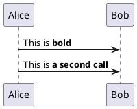

## Memory dump [!dump_memory]

```plantuml
@startuml
!function $inc($string)
!$val = %intval($string)
!log value is $val
!dump_memory
!return $val+1
!endfunction

Alice -> Bob : 4 $inc("3")
!unused = "foo"
!dump_memory EOF
@enduml
```

## Assertion [!assert]

```plantuml
@startuml
Alice -> Bob : Hello
!assert %strpos("abcdef", "cd")==3 : "This always fails"
@enduml
```

## Building custom library [!import, !include]
```puml
@startuml

!import /path/to/customLibrary.zip
' This just adds "customLibrary.zip" in the search path

!include myFolder/myFile.iuml
' Assuming that myFolder/myFile.iuml is located somewhere
' either inside "customLibrary.zip" or on the local filesystem

...
```

## Search path
```
java -Dplantuml.include.path="c:/mydir" -jar plantuml.jar atest1.txt
```

## Argument concatenation [##]

```plantuml
@startuml
!unquoted procedure COMP_TEXTGENCOMP(name)
[name] << Comp >>
interface Ifc << IfcType >> AS name##Ifc
name##Ifc - [name]
!endprocedure
COMP_TEXTGENCOMP(dummy)
@enduml
```

## Dynamic invocation [ %invoke_procedure() , %call_user_func() ]

```plantuml
@startuml
!procedure $go()
  Bob -> Alice : hello
!endprocedure

!$wrapper = "$go"

%invoke_procedure($wrapper)
@enduml
```

```plantuml
@startuml
!procedure $go($txt)
  Bob -> Alice : $txt
!endprocedure

%invoke_procedure("$go", "hello from Bob...")
@enduml
```

```plantuml
@startuml
!function bold($text)
!return "<b>"+ $text +"</b>"
!endfunction

Alice -> Bob : %call_user_func("bold", "Hello") there
@enduml
```

## Evaluation of addition depending of data types [+]

```plantuml
@startuml
title
<#LightBlue>|= |=  $a |=  $b |=  <U+0025>string($a + $b)|
<#LightGray>| type | str | str | str (concatenation) |
| example |= "a" |= "b" |= %string("a" + "b") |
<#LightGray>| type | str | int | str (concatenation) |
| ex.|= "a" |=  2  |= %string("a" + 2)   |
<#LightGray>| type | str | int | str (concatenation) |
| ex.|=  1  |= "b" |= %string(1 + "b")   |
<#LightGray>| type | bool | str | str (concatenation) |
| ex.|= <U+0025>true() |= "b" |= %string(%true() + "b") |
<#LightGray>| type | str | bool | str (concatenation) |
| ex.|= "a" |= <U+0025>false() |= %string("a" + %false()) |
<#LightGray>| type |  int  |  int | int (addition of int) |
| ex.|=  1  |=  2  |= %string(1 + 2)     |
<#LightGray>| type |  bool  |  int | int (addition) |
| ex.|= <U+0025>true() |= 2 |= %string(%true() + 2) |
<#LightGray>| type |  int  |  bool | int (addition) |
| ex.|=  1  |= <U+0025>false() |= %string(1 + %false()) |
<#LightGray>| type |  int  |  int | int (addition) |
| ex.|=  1  |=  <U+0025>intval("2")  |= %string(1 + %intval("2")) |
end title
@enduml
```

## Preprocessing JSON

- JSON Variable definition
- Access to JSON data
- Loop over JSON array

## Including theme [!theme]

```plantuml
@startuml
!theme spacelab
class Example {
  Theme spacelab
}
@enduml
```

## Migration notes

- You should not use !define and !definelong anymore. Use !function , !procedure or variable definition instead.
- !include now allows multiple inclusions : you don't have to use !include_many anymore
- !include now accepts a URL, so you don't need !includeurl
- Some features (like %date% ) have been replaced by builtin functions (for example %date() )
- When calling a legacy !definelong macro with no arguments, you do have to use parenthesis. You have to use my_own_definelong() because my_own_definelong without parenthesis is not recognized by the new preprocessor.

## %splitstr builtin function

```plantuml
@startmindmap
!$list = %splitstr("abc~def~ghi", "~")

* root
!foreach $item in $list
  ** $item
!endfor
@endmindmap
```

```plantuml
@startmindmap
* root
!foreach $item in ["abc", "def", "ghi"]
  ** $item
!endfor
@endmindmap
```

## %splitstr_regex builtin function

```plantuml
@startmindmap
!$list = %splitstr_regex("AbcDefGhi", "(?=[A-Z])")

* root
!foreach $item in $list
  ** $item
!endfor
@endmindmap
```

```plantuml
@startmindmap
* root
!foreach $item in ["Abc", "Def", "Ghi"]
  ** $item
!endfor
@endmindmap
```

## %get_all_theme builtin function

```plantuml
@startjson
%get_all_theme()
@endjson
```

## %get_all_stdlib builtin function

### Compact version (only standard library name)

```plantuml
@startjson
%get_all_stdlib()
@endjson
```

### Detailed version (with version and source)

```plantuml
@startjson
%get_all_stdlib(detailed)
@endjson
```

## %random builtin function

| Nb param. | Input | Output |
| 0 | %random() | returns0or1 |
| 1 | %random(n) | returns an interger between0andn - 1 |
| 2 | %random(min, max) | returns an interger betweenminandmax - 1 |

```plantuml
@startcreole
| Nb param. | Input | Output |
| 0 | <U+0025>random()      | %random()     |
| 1 | <U+0025>random(5)     | %random(5)    |
| 2 | <U+0025>random(7, 15) | %random(7, 15) |
@endcreole
```

## %boolval builtin function

```plantuml
@startcreole
<#ccc>|= Input                               |= Output |
| <U+0025>boolval(1)                         | %boolval(1) |
| <U+0025>boolval(0)                         | %boolval(0) |
| <U+0025>boolval(<U+0025>true())            | %boolval(%true()) |
| <U+0025>boolval(<U+0025>false())           | %boolval(%false()) |
| <U+0025>boolval(true)                      | %boolval(true) |
| <U+0025>boolval(false)                     | %boolval(false) |
| <U+0025>boolval(TRUE)                      | %boolval(TRUE) |
| <U+0025>boolval(FALSE)                     | %boolval(FALSE) |
| <U+0025>boolval("true")                    | %boolval("true") |
| <U+0025>boolval("false")                   | %boolval("false") |
| <U+0025>boolval(<U+0025>str2json("true"))  | %boolval(%str2json("true")) |
| <U+0025>boolval(<U+0025>str2json("false")) | %boolval(%str2json("false")) |
@endcreole
```

## Escape function

| Escape function | Output |
| %dollar() | $ |
| %percent() | % |
| %backslash() | \ |
