# Visualizing Regex with PlantUML

## Introduction to Regex and Visualization Challenges

## Why PlantUML for Regex?

### Simplifying Complexity with Visualization

- Demystifying Regex Syntax: The visual representation breaks down the regex into comprehensible components, making it easier to understand each part of the expression.
- Enhancing Pattern Recognition: Visual diagrams allow users to identify repeating patterns and structures in regex, which might be missed in the textual form.
- Debugging and Optimization: By laying out the regex structure visually, PlantUML can aid in spotting redundancies and errors, facilitating more efficient pattern design.

### An Invaluable Tool for Learning and Collaboration

- For learners, visual diagrams serve as educational aids, simplifying the learning curve associated with regex syntax.
- In collaborative environments, visual representations can bridge the gap in understanding, ensuring that team members are on the same page regarding the logic and function of a regex pattern.

## Fundamentals of Regular Expressions

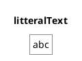

## Character Classes and Sequences

### Shorthand Character Classes

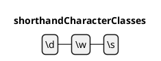

### Literal Character Sequences

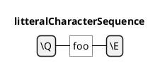

### Character Ranges

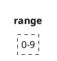

### Any Character

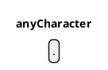

### Special Escapes

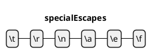

## Descriptive Name and Language

### Without Descriptive Name (by default)

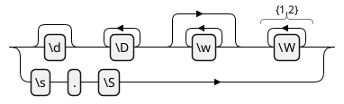

### With Descriptive Name

#### English (en)


#### Deutsch (de)


#### Japanese (ja)


### Octal and Unicode Escapes

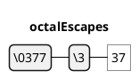

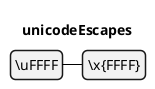

## Repetitions and Alternation

### Repetitions

#### Optional Repetition

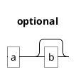

#### Required Repetition

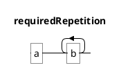

#### Zero or More Repetitions

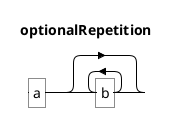

#### Specified Range of Repetitions

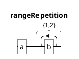

#### Minimum Number of Repetitions

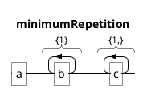

#### Repetition Equivalence

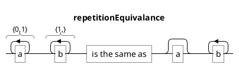

### Alternation

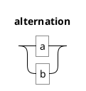

## Unicode

### Unicode Categories

- Letters ( \p{L} ) : Matches any letter from any language.
- Lowercase Letters ( \p{Ll} ) : Specifically matches lowercase letters.

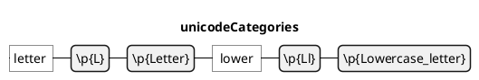

### Unicode Scripts

```plantuml
@startregex
title unicodeScripts
latin \p{Latin}
@endregex
```

### Unicode Blocks

```plantuml
@startregex
title unicodeBlocks
\p{InGeometric_Shapes}
@endregex
```
