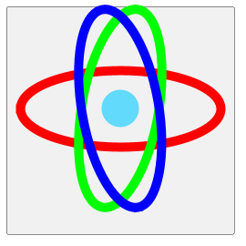

# Defining and using sprites

```plantuml
@startuml
sprite $foo1 {
  FFFFFFFFFFFFFFF
  F0123456789ABCF
  F0123456789ABCF
  F0123456789ABCF
  F0123456789ABCF
  F0123456789ABCF
  F0123456789ABCF
  F0123456789ABCF
  F0123456789ABCF
  FFFFFFFFFFFFFFF
}
Alice -> Bob : Testing <$foo1>
@enduml
```

```plantuml
@startuml
sprite $foo1 {
  FFFFFFFFFFFFFFF
  F0123456789ABCF
  F0123456789ABCF
  F0123456789ABCF
  F0123456789ABCF
  F0123456789ABCF
  F0123456789ABCF
  F0123456789ABCF
  F0123456789ABCF
  FFFFFFFFFFFFFFF
}
Alice -> Bob : Testing <$foo1{scale=3}>
@enduml
```





## Inline SVG sprite

```plantuml
@startuml
sprite foo1 <svg width="8" height="8" viewBox="0 0 8 8">
<path d="M1 0l-1 1 1.5 1.5-1.5 1.5h4v-4l-1.5 1.5-1.5-1.5zm3 4v4l1.5-1.5 1.5 1.5 1-1-1.5-1.5 1.5-1.5h-4z" />
</svg>

Alice->Bob : <$foo1*3>
@enduml
```

```plantuml
@startuml
sprite foo1 <svg viewBox="0 0 36 36">
<path fill="#77B255" d="M36 32c0 2.209-1.791 4-4 4H4c-2.209 0-4-1.791-4-4V4c0-2.209 1.791-4 4-4h28c2.209 0 4 1.791 4 4v28z"/>
<path fill="#FFF" d="M21.529 18.006l8.238-8.238c.977-.976.977-2.559 0-3.535-.977-.977-2.559-.977-3.535 0l-8.238 8.238-8.238-8.238c-.976-.977-2.56-.977-3.535 0-.977.976-.977 2.559 0 3.535l8.238 8.238-8.258 8.258c-.977.977-.977 2.559 0 3.535.488.488 1.128.732 1.768.732s1.28-.244 1.768-.732l8.258-8.259 8.238 8.238c.488.488 1.128.732 1.768.732s1.279-.244 1.768-.732c.977-.977.977-2.559 0-3.535l-8.24-8.237z"/>
</svg>

Alice->Bob : <$foo1>

@enduml
```








## Changing colors

```plantuml
@startuml
sprite $foo1 {
  FFFFFFFFFFFFFFF
  F0123456789ABCF
  F0123456789ABCF
  F0123456789ABCF
  F0123456789ABCF
  F0123456789ABCF
  F0123456789ABCF
  F0123456789ABCF
  F0123456789ABCF
  FFFFFFFFFFFFFFF
}
Alice -> Bob : Testing <$foo1,scale=3.4,color=orange>
@enduml
```



## Encoding Sprite
```
java -jar plantuml.jar -encodesprite 16z foo.png
```

## Importing Sprite

## Examples

```plantuml
@startuml
 sprite $bug [15x15/16z] PKzR2i0m2BFMi15p__FEjQEqB1z27aeqCqixa8S4OT7C53cKpsHpaYPDJY_12MHM-BLRyywPhrrlw3qumqNThmXgd1TOterAZmOW8sgiJafogofWRwtV3nCF
 sprite $printer [15x15/8z] NOtH3W0W208HxFz_kMAhj7lHWpa1XC716sz0Pq4MVPEWfBHIuxP3L6kbTcizR8tAhzaqFvXwvFfPEqm0
 sprite $disk {
   444445566677881
   436000000009991
   43600000000ACA1
   53700000001A7A1
   53700000012B8A1
   53800000123B8A1
   63800001233C9A1
   634999AABBC99B1
   744566778899AB1
   7456AAAAA99AAB1
   8566AFC228AABB1
   8567AC8118BBBB1
   867BD4433BBBBB1
   39AAAAABBBBBBC1
}

 title Use of sprites (<$printer>, <$bug>...)

 class Example {
 Can have some bug : <$bug>
 Click on <$disk> to save
 }

 note left : The printer <$printer> is available

@enduml
```




## StdLib

- Browse the Github folders of PlantUML StdLib
- Browse the source repos of StdLib collections that interest you. Eg if you are interested in logos you can find that it came from gilbarbara-plantuml-sprites , and quickly find its

- Study the in-depth Hitchhiker’s Guide to PlantUML , eg sections Standard Library Sprites and PlantUML Stdlib Overview

## Listing Sprites

- Used on its own, it just shows ArchiMate sprites
- If you include some sprite libraries in your diagram, the command shows all these sprites, as explained in View all the icons with listsprites .

```plantuml
@startuml
!define osaPuml https://raw.githubusercontent.com/Crashedmind/PlantUML-opensecurityarchitecture2-icons/master
!include osaPuml/Common.puml
!include osaPuml/User/all.puml
!include osaPuml/Hardware/all.puml
!include osaPuml/Misc/all.puml
!include osaPuml/Server/all.puml
!include osaPuml/Site/all.puml

listsprites

' From The Hitchhiker’s Guide to PlantUML
@enduml
```
