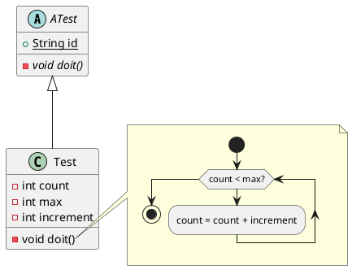
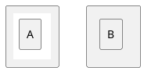
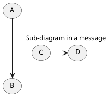

# Sub-diagram

- begin with {{
- end with }} .

## Basic example







## Inheritage of handwritten skinparam

```plantuml
@startuml
!option handwritten true
	component a {
	}
	note left of a
		handwritten is OK
	end note
	
	note right of a
		{{
			a->b:test
			note right
				handwritten is inherited
			end note
		}}
	end note
@enduml
```

## Collection of all ref. of sub-diagram:

- QA-2427
- QA-6947
- QA-9341
- QA-10967
- QA-11476
- QA-11895
- QA-12609
- QA-12722
- QA-12820
- QA-12821
- QA-15433
- [QA-]()
- ...
