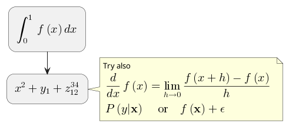
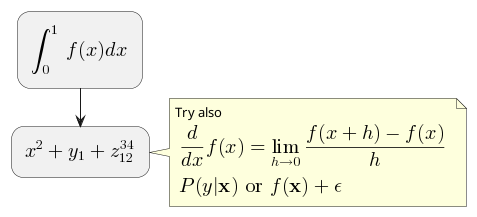
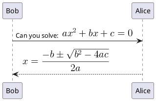
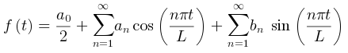
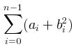

# Maths

## Standalone diagram

## How is this working?

- AsciiMath that converts AsciiMath notation to LaTeX expression;
- JLatexMath that displays mathematical formulas written in LaTeX. JLaTeXMath is the best Java library to display LaTeX code.
