# Entity Relationship Diagrams (Chen's notation)

## Minimal Example

### Vertical (by default)

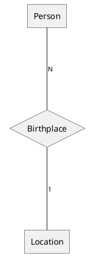

### Horizontal

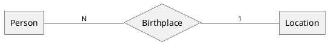

## Entities and attributes

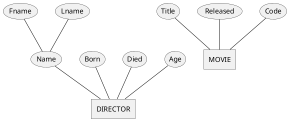

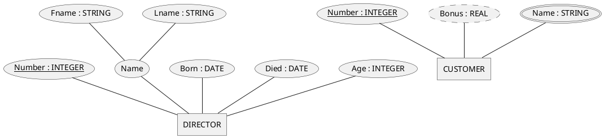

## Relationships

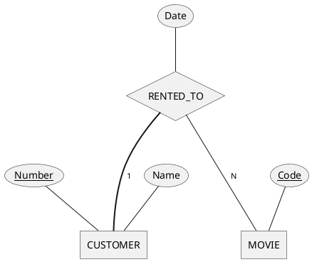

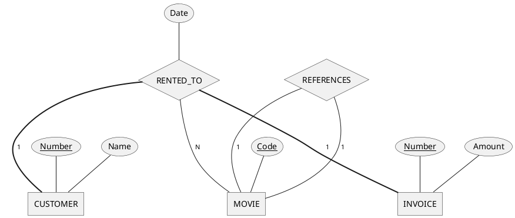

### Structural constraints

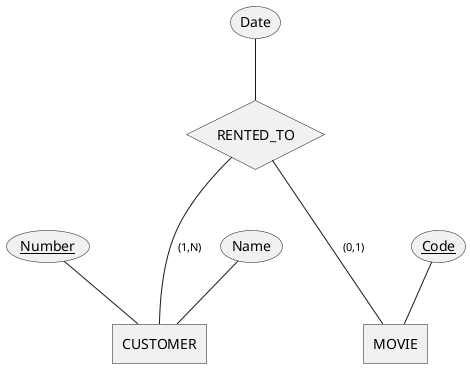

## Identifying relationships

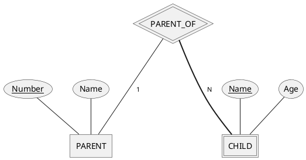

## Aliases

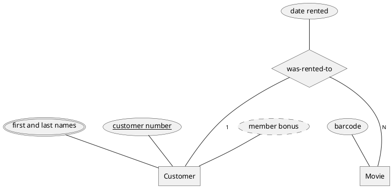

## Subclasses and categories

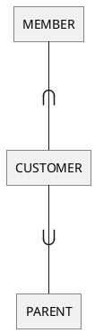

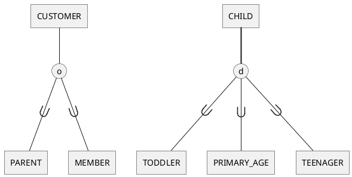

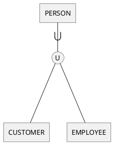

## Complex Example

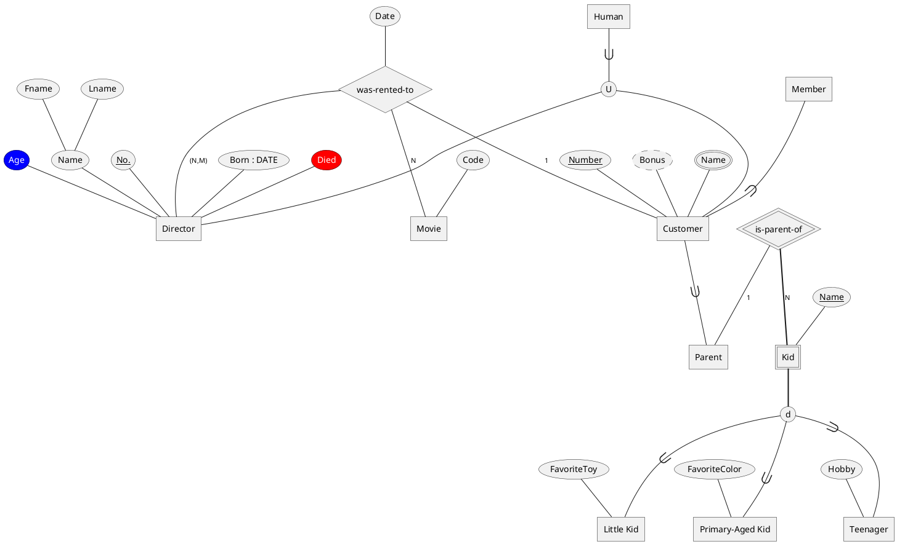
