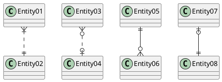
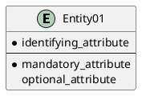
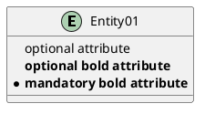
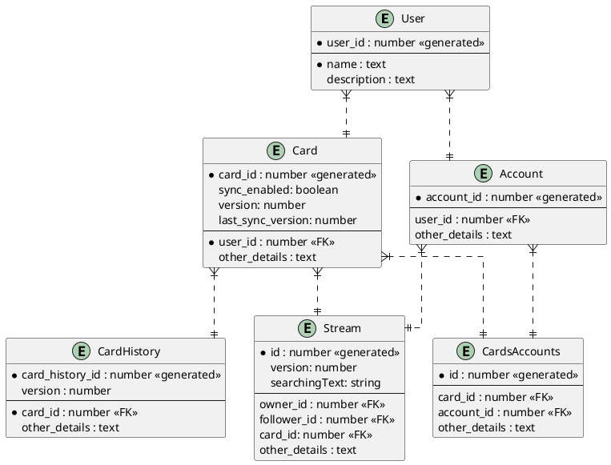

# Information Engineering Diagrams

- Additional relations for the Information Engineering notation;
- An entity alias that maps to the class diagram class ;
- An additional visibility modifier * to identify mandatory attributes.

## Information Engineering Relations

| Type | Symbol |
| Zero or One | |o-- |
| Exactly One | ||-- |
| Zero or Many | }o-- |
| One or Many | }|-- |

## Entities

## Complete Example

