# Display JSON Data

- begin with @startjson keyword
- end with @endjson keyword.

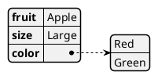

## Complex example

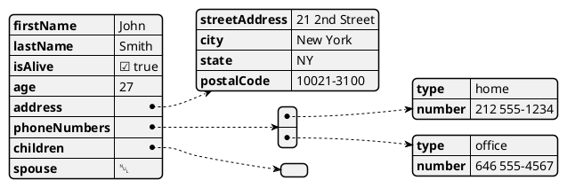

## Highlight parts

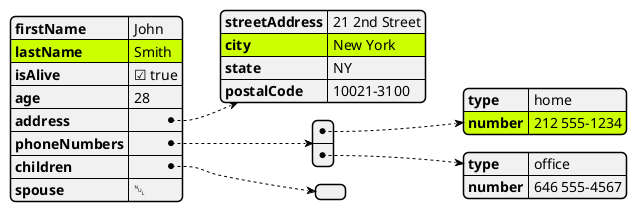

## Using different styles for highlight

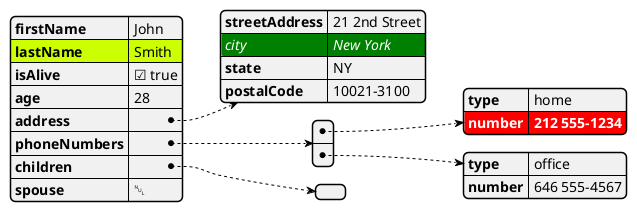

## JSON basic element

### Synthesis of all JSON basic element

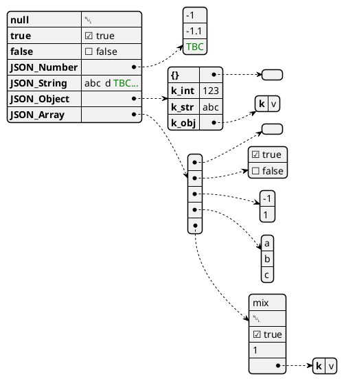

## JSON array or table

### Array type

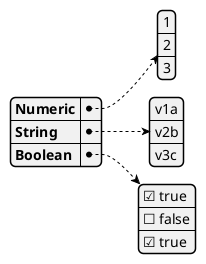

### Minimal array or table

#### Number array

```plantuml
@startjson
[1, 2, 3]
@endjson
```

#### String array

```plantuml
@startjson
["1a", "2b", "3c"]
@endjson
```

#### Boolean array

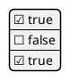

## JSON numbers

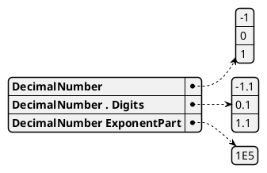

## JSON strings

### JSON Unicode

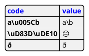

### JSON two-character escape sequence

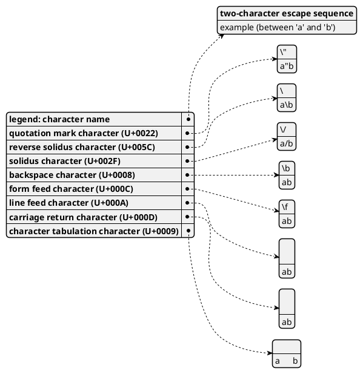

FIXME FIXME

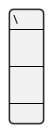

## Minimal JSON examples


```plantuml
@startjson
42
@endjson
```

```plantuml
@startjson
true
@endjson
```

## Empty table or list

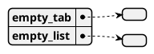

## Using (global) style

### Without style (by default)

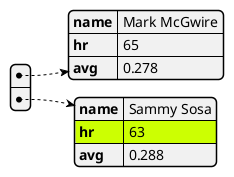

### With style

```plantuml
@startjson
<style>
jsonDiagram {
  node {
    BackGroundColor Khaki
    LineColor lightblue
    FontName Helvetica
    FontColor red
    FontSize 18
    FontStyle bold
    RoundCorner 0
    LineThickness 2
    LineStyle 10-5
    separator {
      LineThickness 0.5
      LineColor black
      LineStyle 1-5
    }
  }
  arrow {
    BackGroundColor lightblue
    LineColor green
    LineThickness 2
    LineStyle 2-5
  }
  highlight {
    BackGroundColor red
    FontColor white
    FontStyle italic
  }
}
</style>
#highlight "1" / "hr"
[
  {
    "name": "Mark McGwire",
    "hr":   65,
    "avg":  0.278
  },
  {
    "name": "Sammy Sosa",
    "hr":   63,
    "avg":  0.288
  }
]
@endjson
```

## Display JSON Data on Class or Object diagram

### Simple example

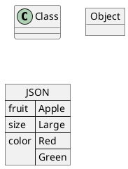

### Complex example: with all JSON basic element

```plantuml
@startuml
json "<b>JSON basic element" as J {
"null": null,
"true": true,
"false": false,
"JSON_Number": [-1, -1.1, "<color:green>TBC"],
"JSON_String": "a\nb\rc\td <color:green>TBC...",
"JSON_Object": {
  "{}": {},
  "k_int": 123,
  "k_str": "abc",
  "k_obj": {"k": "v"}
},
"JSON_Array" : [
  [],
  [true, false],
  [-1, 1],
  ["a", "b", "c"],
  ["mix", null, true, 1, {"k": "v"}]
]
}
@enduml
```

## Display JSON Data on Deployment (Usecase, Component, Deployment) diagram

```plantuml
@startuml
allowmixing

component Component
actor     Actor
usecase   Usecase
()        Interface
node      Node
cloud     Cloud

json JSON {
   "fruit":"Apple",
   "size":"Large",
   "color": ["Red", "Green"]
}
@enduml
```

```plantuml
@startuml
allowmixing

agent Agent
stack {
  json "JSON_file.json" as J {
    "fruit":"Apple",
    "size":"Large",
    "color": ["Red", "Green"]
  }
}
database Database

Agent -> J
J -> Database
@enduml
```

## Display JSON Data on State diagram

```plantuml
@startuml
state "A" as stateA
state "C" as stateC {
 state B
}

json J {
   "fruit":"Apple",
   "size":"Large",
   "color": ["Red", "Green"]
}
@enduml
```

## Creole on JSON

```plantuml
@startjson
{
"Creole":
  {
  "wave": "~~wave~~",
  "bold": "**bold**",
  "italics": "//italics//",
  "stricken-out": "--stricken-out--",
  "underlined": "__underlined__",
  "not-underlined": "~__not underlined__",
  "wave-underlined": "~~wave-underlined~~"
  },
"HTML Creole":
  {
  "bold": "<b>bold",
  "italics": "<i>italics",
  "monospaced": "<font:monospaced>monospaced",
  "stroked": "<s>stroked",
  "underlined": "<u>underlined",
  "waved": "<w>waved",
  "green-stroked": "<s:green>stroked",
  "red-underlined": "<u:red>underlined",
  "blue-waved": "<w:#0000FF>waved",
  "Blue": "<color:blue>Blue",
  "Orange": "<back:orange>Orange background",
  "big": "<size:20>big"
  },
"Graphic":
  {
  "OpenIconic": "account-login <&account-login>", 
  "Unicode": "This is <U+221E> long",
  "Emoji": "<:calendar:> Calendar",
  "Image": ""
  }
}
@endjson
```
