# Use case diagram

- Text in, diagram out. Define actors, use cases, and links in a few lines.
- Easy to refactor. Rename an actor or move a use case by editing one line.
- Fits in your repo. Diagrams live next to the code they document, in version control.

## Usecases

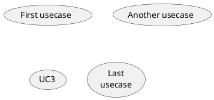

## Actors

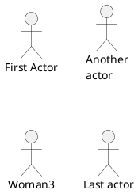

## Change Actor style

- an awesome man with the skinparam actorStyle awesome command;
- a hollow man with the skinparam actorStyle hollow command.

### Stick man (by default)

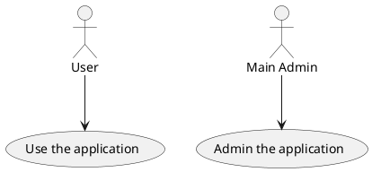

### Awesome man

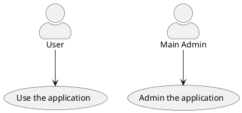

### Hollow man

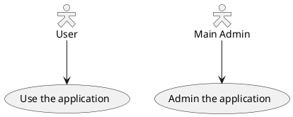

## Usecases description

- -- (dashes)
- .. (periods)
- == (equals)
- __ (underscores)

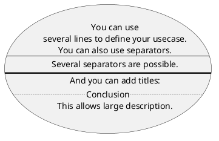

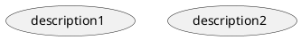

## Use package

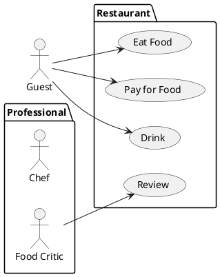

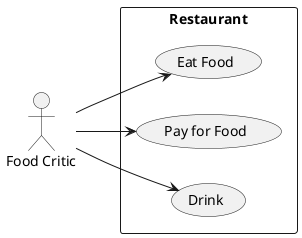

## Basic example

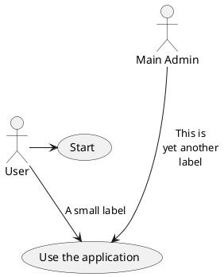

## Extension

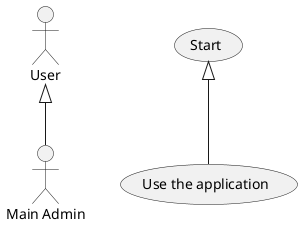

## Using notes

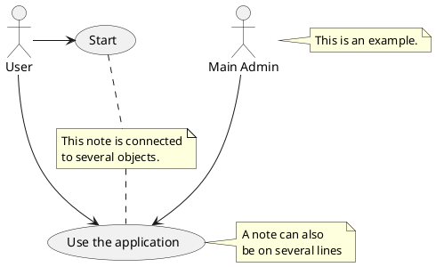

## Stereotypes

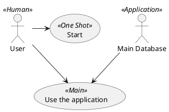

## Changing arrows direction

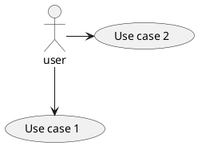

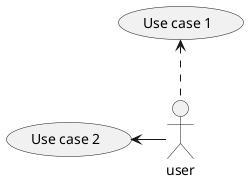

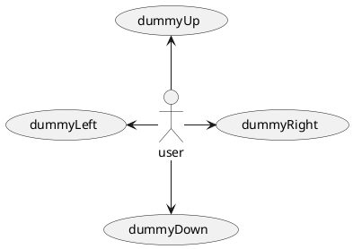

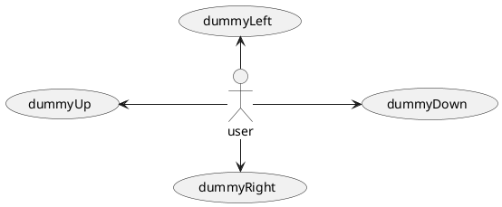

## Splitting diagrams

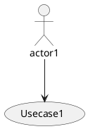

## Left to right direction

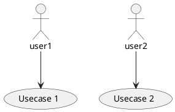

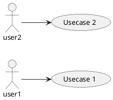

## Skinparam

- In the diagram definition, like any other commands,
- In an included file ,
- In a configuration file, provided in the command line or the ANT task .

```plantuml
@startuml
!option handwritten true

skinparam usecase {
BackgroundColor DarkSeaGreen
BorderColor DarkSlateGray

BackgroundColor<< Main >> YellowGreen
BorderColor<< Main >> YellowGreen

ArrowColor Olive
ActorBorderColor black
ActorFontName Courier

ActorBackgroundColor<< Human >> Gold
}

User << Human >>
:Main Database: as MySql << Application >>
(Start) << One Shot >>
(Use the application) as (Use) << Main >>

User -> (Start)
User --> (Use)

MySql --> (Use)

@enduml
```

## Complete example

```plantuml
@startuml
left to right direction
skinparam packageStyle rectangle
actor customer
actor clerk
rectangle checkout {
  customer -- (checkout)
  (checkout) .> (payment) : include
  (help) .> (checkout) : extends
  (checkout) -- clerk
}
@enduml
```

## Business Use Case

### Business Usecase

```plantuml
@startuml

(First usecase)/
(Another usecase)/ as (UC2)
usecase/ UC3
usecase/ (Last\nusecase) as UC4

@enduml
```

### Business Actor

```plantuml
@startuml

:First Actor:/
:Another\nactor:/ as Man2
actor/ Woman3
actor/ :Last actor: as Person1

@enduml
```

## Change arrow color and style (inline style)

- #color;line.[bold|dashed|dotted];text:color

```plantuml
@startuml
actor foo
foo --> (bar) : normal
foo --> (bar1) #line:red;line.bold;text:red  : red bold
foo --> (bar2) #green;line.dashed;text:green : green dashed 
foo --> (bar3) #blue;line.dotted;text:blue   : blue dotted
@enduml
```

## Change element color and style (inline style)

- #[color|back:color];line:color;line.[bold|dashed|dotted];text:color

```plantuml
@startuml
actor a
actor b #pink;line:red;line.bold;text:red
usecase c #palegreen;line:green;line.dashed;text:green
usecase d #aliceblue;line:blue;line.dotted;text:blue
@enduml
```

## Display JSON Data on Usecase diagram

### Simple example

```plantuml
@startuml
allowmixing

actor     Actor
usecase   Usecase

json JSON {
   "fruit":"Apple",
   "size":"Large",
   "color": ["Red", "Green"]
}
@enduml
```
