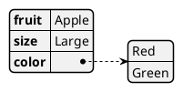
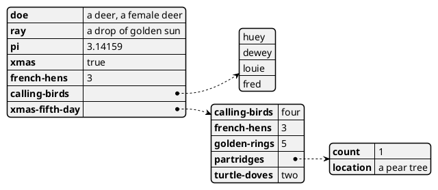
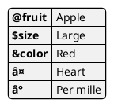
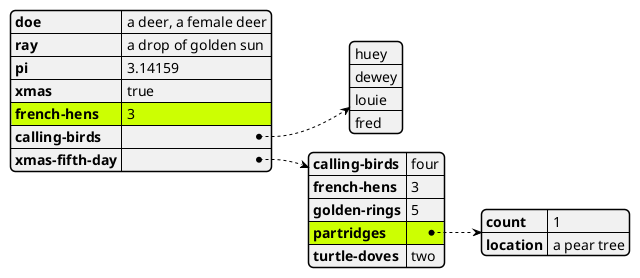
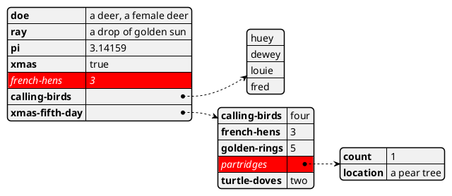
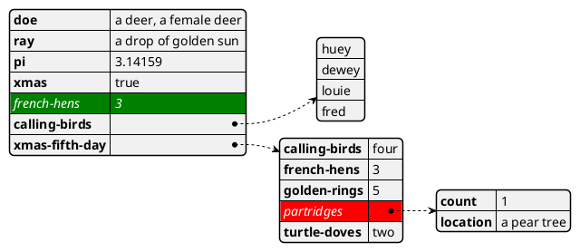
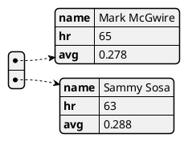
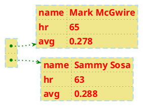
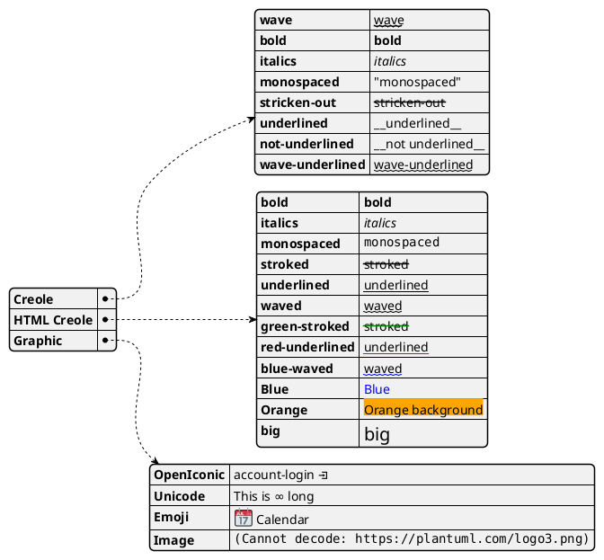

# Display YAML Data

- begin with @startyaml keyword
- end with @endyaml keyword.

## Complex example

## Specific key (with symbols or unicode)

## Highlight parts

### Normal style

### Customised style

## Using different styles for highlight

## Using (global) style

### Without style (by default)

### With style

## Creole on YAML

