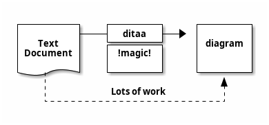
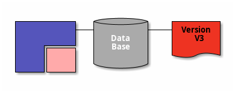
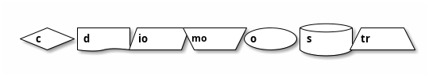

# Ditaa

PlantUML Advanced usage Ditaa diagram    Â

## Generalisation (of @start/@end tag)

## Option supported by PlantUML

- -E or --no-separation to remove separator
- -S or --no-shadows to remove shadow
- scale=<XYZ> to scale up or down the diagram

### Without option

### Remove separator

### Remove shadow or scale diagram

```plantuml
@startditaa < --no-shadows, scale=0.7
+---------+  /--------\   +-------+
| cBLU    +--+cAAA    +---+Version|
|         |  |  Data  |   |   V3  |
|    +----+  |  Base  |   |cRED{d}|
|    |cPNK|  |     {s}|   +-------+
|    |    |  \---+----/
+----+----+    
@endditaa
```

## Tags

| Tag | Description |
| {c} | Choice or Decision |
| {d} | Document - Symbol representing a document |
| {io} | Input/Output - Symbol representing input/output |
| {mo} | Manual operation |
| {o} | Ellipse |
| {s} | Storage - Symbol representing a form of storage, like a database or a hard disk. |
| {tr} | Trapezoid |

## More documentation

- ditaa.sourceforge.net
- github.com/stathissideris/ditaa
