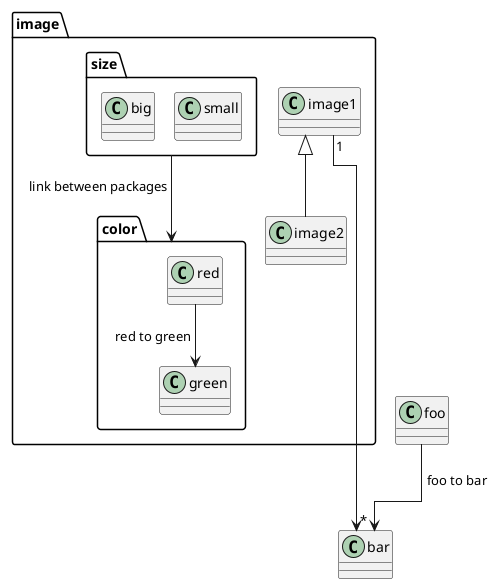

# Eclipse Layout Kernel

PlantUML Advanced usage Eclipse Layout Kernel    Â

## Requirement

### From V1.2021.5 to V1.2024.6

### Since V1.2024.6

## Usage


```
java -jar plantuml.jar -Playout=elk
```

[Ref. GH-582 ]

## Alternative layout engines
