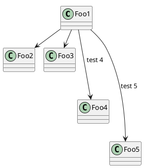

# Context of the Smetana project

PlantUML Advanced usage Smetana Version    Â

- PlantUML has to create a new process for each diagram, (and communication with this new process could be source of bugs).
- Users have to install DOT on their system, in addition of Java.
- PlantUML is not fully portable.

## Using Smetana


```
java -jar plantuml.jar -Playout=smetana
```

[Ref. issue-582 ]

## Alternative layout engines
