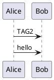
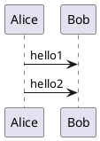

# How and where diagrams can be written

PlantUML Advanced usage How and where diagrams can be written    Â

- PlantUML file ( .pu or .puml )
- Text files ( .txt ),
- HTML files ( .html or .htm ),
- Java sources files ( .java ),
- C/C++ source files ( .c , .h , .cpp , .hpp or .hh )
- LaTeX sources files ( .tex ),
- APT files ( .apt )
- Word files ( .doc )
- URL

## File naming
```
@startuml image
Alice->Bob: Authentication Request
Bob-->Alice: Authentication Response
@enduml
```

## Include with identifier [include]
```
@startuml(id=TAG1)
Alice->Bob : TAG1
@enduml

@startuml(id=TAG2)
Alice->Bob : TAG2
@enduml
```
```
@startuml
!include file.pu!TAG2
Alice->Bob : hello
@enduml
```



## Include with definition identifier (on the same file) [includedef]




## Adding options for other tools
```
@startuml{filename.png, This is my other caption text, width=16cm, option_for_other_tools=value}

@enduml
```

## Adding output format when using pipe mode
```
@@@format png
```

or
```
@@@format svg
```

or
```
@@@format UTXT
```

## Put PlantUML directives on programming source code [ @pause , @unpause and @append ]

- @pause
- @unpause
- @append
```
/// My FSM looks like this:
/// @startuml myfsm
/// title My Finite-state machine
/// @pause

enum {
   // @append state AA
   STATE_AA,
   // @append state BB
   STATE_BB,
};

struct fsm my_fsm = {
    // @append [*] -> AA: Event 1
    { STATE_ENRTY, EVENT_1, STATE_AA },

    // @append AA -> BB: Event 3
    { STATE_AA, EVENT_3, STATE_BB },

    // and so on with a bunch of transitions...
};
/// @unpause
/// @enduml
```
