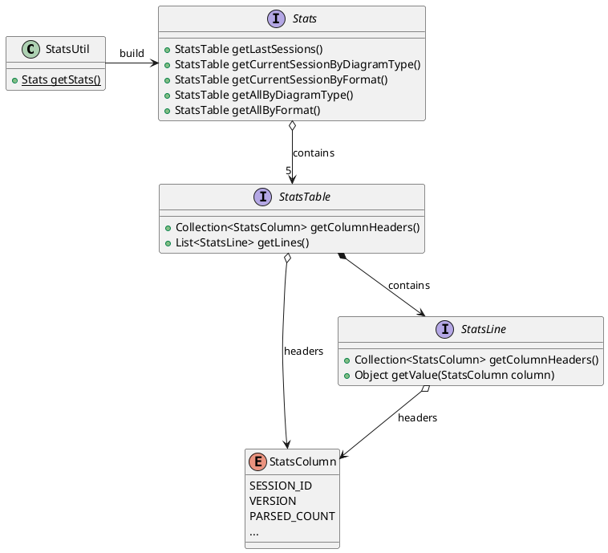

# Enable statistics

PlantUML Advanced usage Statistics Report    Â

- Use -enablestats flag in the command line
- Use enablestats="true" setting with the ANT task
- Globally set the environment variable PLANTUML_STATS to true
- Call OptionFlags.getInstance().setEnableStats(true) from your Java code

## Statistics Report

## Java Integration API

