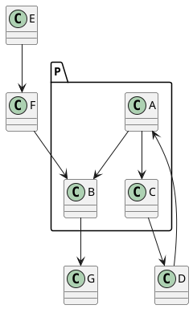
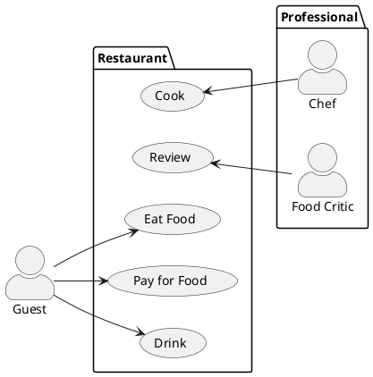
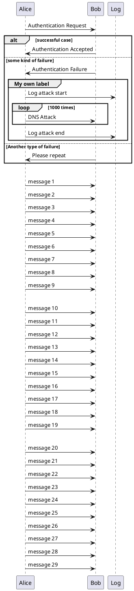

# Scalable Vector Graphics

PlantUML Advanced usage SVG Support    Â

### Command Line

### Ant Task
```
<target name="main">
  <plantuml dir="./src" format="svg" />
</target>
```

### Java

## Specific Skin Parameters for SVG

### svgLinkTarget

- _blank : Opens the link in a new window or tab
- _parent : Opens the link in the parent frame
- _self : Opens the link in the same frame where it was clicked (default setting)
- _top : Opens the link in the full body of the window

### pathHoverColor
```
@startuml
skinparam pathHoverColor green
class Foo2 [[http://www.yahoo.com/Foo2]] {
  +double[] x
  +double y
}
Foo2 --> Foo3
@enduml
```

[Reference: QA-5453 ]

### svgDimensionStyle
```
@startuml
skinparam svgDimensionStyle false

component a {
}
component b {
}
a -(0- b
@enduml
```

[Reference QA-7334 ]

## svgSize Pragma

### Using the svgSize Pragma Directive

- !pragma svgSize <U+hhhhh> XX
- !pragma svgSize <U+hhhhh> I

#### Example Usage
```
@startuml
!pragma svgSize <U+1F610> XX

test: text <U+1F610>
test_size45: text <size:45><U+1F610>
@enduml
```

### Command-Line Options

- Enclose the argument in quotes, especially when it contains spaces.
- Use this option multiple times in a single command, if necessary.

#### Example
```
java -jar plantuml.jar "-PsvgSize=<U+1F610> XX" "-PsvgSize=<U+1F611> I" -Tsvg <file.puml>
```

### References

- Forum QA-12550
- GitHub Issue 582

## Interactive SVG

- When you click on a diagram element, all other elements that are not connected to it, are dimmed out.
- When you click the same element twice, all elements are restored to their original visibility.

- QA-13350

### On Class, Object, UseCase or Deployment diagram





### On Sequence diagram



## Option for SVG [ svgTitle , svgDesc ]

```plantuml
@startuml
!option svgTitle "This is the title"
!option svgDesc "This is the description"

alice -> bob: hello
@enduml
```
