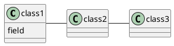

# XML Metadata Interchange (XMI)

PlantUML Advanced usage XMI Support    Â

- On StarUML , you have to use testStarUML.xml
- On ArgoUML , you have to use testArgoUML.xml

- -xmi : only classes are exported, without any relationship. This is very basic but should work with on many tools
- -xmi:argo : to be read by ArgoUML
- -xmi:star : to be read by StarUML

- -txmi:argo : to be read by ArgoUML
- -txmi or -txmi:star : to be read by StarUML
