# Common Commands in PlantUML

### Global Elements

- Comments: Add remarks or explanatory notes in your diagram script to convey additional information or to leave reminders for further modifications.
- Notes: Incorporate supplementary information directly onto your diagram to aid in understanding or to highlight important aspects.
- Size Control: Adjust the dimensions of various elements to suit your preferences, ensuring a balanced and well-proportioned diagram.
- Title and Captions: Define a fitting title and add captions to elucidate the context or to annotate specific parts of your diagram.

### Creole Syntax Description

- Text Formatting: Customize the appearance of your text with various styles and alignments.
- Lists: Create ordered or unordered lists to present information neatly.
- Links: Integrate hyperlinks to facilitate quick navigation to relevant resources.

### Style Control Command

- Define Styles: Set uniform styles for elements to maintain a cohesive visual theme.
- Customize Colors: Choose specific colors for various elements to enhance visual appeal and to create distinct classifications.

## Comments

### Simple comment
```
@startuml
'Line comments use a single apostrophe
@enduml
```

### Block comment
```
@startuml
/'
many lines comments
here
'/
@enduml
```

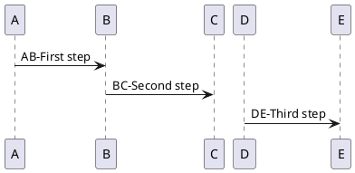

### Full example

```plantuml
@startuml
skinparam activity {
    ' this is a comment
    BackgroundColor White
    BorderColor Black /' this is a comment '/
    BorderColor Red  ' this is not a comment and this line is ignored
}

start
:foo1;
@enduml
```

## Zoom or Scale

- scale 1.5
- scale 2/3
- scale 200 width
- scale 200 height
- scale 200*100
- scale max 300*200
- scale max 1024 width
- scale max 800 height

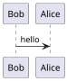

## Title

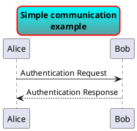

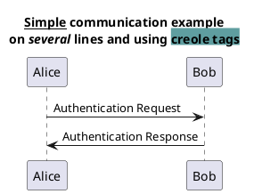

## Caption

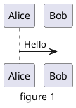

## Footer and header

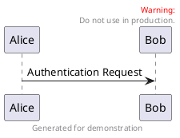

## Legend the diagram

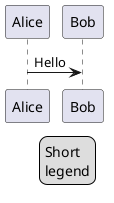

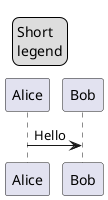

## Appendix: Examples on all diagram

### Activity

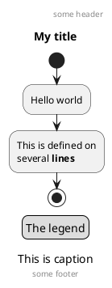

### Archimate

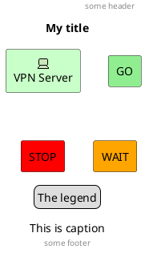

### Class

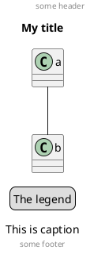

### Component, Deployment, Use-Case

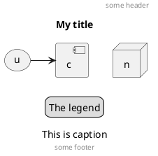

### Gantt project planning

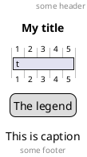

DONE

### Object

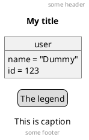

### MindMap

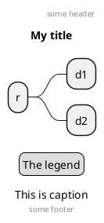

### Network (nwdiag)

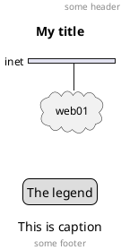

### Sequence

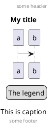

### State

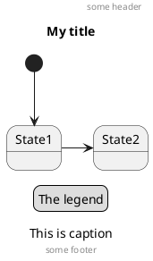

### Timing

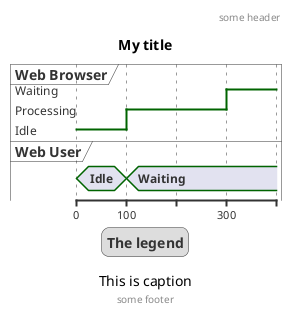

### Work Breakdown Structure (WBS)

```plantuml
@startwbs
header some header

footer some footer

title My title

caption This is caption

legend
The legend
end legend

* r
** d1
** d2

@endwbs
```

DONE

### Wireframe (SALT)

```plantuml
@startsalt
header some header

footer some footer

title My title

caption This is caption

legend
The legend
end legend

{+
  Login    | "MyName   "
  Password | "****     "
  [Cancel] | [  OK   ]
}
@endsalt
```

DONE

## Appendix: Examples on all diagram with style

DONE

- all is only good for Sequence diagram
- title , caption and legend are good for all diagrams except for salt diagram

FIXME

- Now (test on 1.2020.18-19) header , footer are not good for all other diagrams except only for Sequence diagram .

FIXME
```
<style>
title {
  HorizontalAlignment right
  FontSize 24
  FontColor blue
}

header {
  HorizontalAlignment center
  FontSize 26
  FontColor purple
}

footer {
  HorizontalAlignment left
  FontSize 28
  FontColor red
}

legend {
  FontSize 30
  BackGroundColor yellow
  Margin 30
  Padding 50
}

caption {
  FontSize 32
}
</style>
```

```plantuml
@startuml
<style>
title {
  HorizontalAlignment right
  FontSize 24
  FontColor blue
}

header {
  HorizontalAlignment center
  FontSize 26
  FontColor purple
}

footer {
  HorizontalAlignment left
  FontSize 28
  FontColor red
}

legend {
  FontSize 30
  BackGroundColor yellow
  Margin 30
  Padding 50
}

caption {
  FontSize 32
}
</style>
header some header

footer some footer

title My title

caption This is caption

legend
The legend
end legend

start
:Hello world;
:This is defined on
several **lines**;
stop

@enduml
```

```plantuml
@startuml
<style>
title {
  HorizontalAlignment right
  FontSize 24
  FontColor blue
}

header {
  HorizontalAlignment center
  FontSize 26
  FontColor purple
}

footer {
  HorizontalAlignment left
  FontSize 28
  FontColor red
}

legend {
  FontSize 30
  BackGroundColor yellow
  Margin 30
  Padding 50
}

caption {
  FontSize 32
}
</style>
header some header

footer some footer

title My title

caption This is caption

legend
The legend
end legend

archimate #Technology "VPN Server" as vpnServerA <<technology-device>>

rectangle GO #lightgreen
rectangle STOP #red
rectangle WAIT #orange

@enduml
```

```plantuml
@startuml
<style>
title {
  HorizontalAlignment right
  FontSize 24
  FontColor blue
}

header {
  HorizontalAlignment center
  FontSize 26
  FontColor purple
}

footer {
  HorizontalAlignment left
  FontSize 28
  FontColor red
}

legend {
  FontSize 30
  BackGroundColor yellow
  Margin 30
  Padding 50
}

caption {
  FontSize 32
}
</style>
header some header

footer some footer

title My title

caption This is caption

legend
The legend
end legend

a -- b 

@enduml
```

```plantuml
@startuml
<style>
title {
  HorizontalAlignment right
  FontSize 24
  FontColor blue
}

header {
  HorizontalAlignment center
  FontSize 26
  FontColor purple
}

footer {
  HorizontalAlignment left
  FontSize 28
  FontColor red
}

legend {
  FontSize 30
  BackGroundColor yellow
  Margin 30
  Padding 50
}

caption {
  FontSize 32
}
</style>
header some header

footer some footer

title My title

caption This is caption

legend
The legend
end legend

node n
(u) -> [c]

@enduml
```

```plantuml
@startgantt
<style>
title {
  HorizontalAlignment right
  FontSize 24
  FontColor blue
}

header {
  HorizontalAlignment center
  FontSize 26
  FontColor purple
}

footer {
  HorizontalAlignment left
  FontSize 28
  FontColor red
}

legend {
  FontSize 30
  BackGroundColor yellow
  Margin 30
  Padding 50
}

caption {
  FontSize 32
}
</style>
header some header

footer some footer

title My title

caption This is caption

legend
The legend
end legend


[t] lasts 5 days

@endgantt
```

```plantuml
@startuml
<style>
title {
  HorizontalAlignment right
  FontSize 24
  FontColor blue
}

header {
  HorizontalAlignment center
  FontSize 26
  FontColor purple
}

footer {
  HorizontalAlignment left
  FontSize 28
  FontColor red
}

legend {
  FontSize 30
  BackGroundColor yellow
  Margin 30
  Padding 50
}

caption {
  FontSize 32
}
</style>
header some header

footer some footer

title My title

caption This is caption

legend
The legend
end legend

object user {
  name = "Dummy"
  id = 123
}

@enduml
```

```plantuml
@startmindmap
<style>
title {
  HorizontalAlignment right
  FontSize 24
  FontColor blue
}

header {
  HorizontalAlignment center
  FontSize 26
  FontColor purple
}

footer {
  HorizontalAlignment left
  FontSize 28
  FontColor red
}

legend {
  FontSize 30
  BackGroundColor yellow
  Margin 30
  Padding 50
}

caption {
  FontSize 32
}
</style>
header some header

footer some footer

title My title

caption This is caption

legend
The legend
end legend

* r
** d1
** d2

@endmindmap
```

```plantuml
@startnwdiag
<style>
title {
  HorizontalAlignment right
  FontSize 24
  FontColor blue
}

header {
  HorizontalAlignment center
  FontSize 26
  FontColor purple
}

footer {
  HorizontalAlignment left
  FontSize 28
  FontColor red
}

legend {
  FontSize 30
  BackGroundColor yellow
  Margin 30
  Padding 50
}

caption {
  FontSize 32
}
</style>
header some header

footer some footer

title My title

caption This is caption

legend
The legend
end legend

nwdiag {
  network inet {
      web01 [shape = cloud]
  }
}

@endnwdiag
```

```plantuml
@startuml
<style>
title {
  HorizontalAlignment right
  FontSize 24
  FontColor blue
}

header {
  HorizontalAlignment center
  FontSize 26
  FontColor purple
}

footer {
  HorizontalAlignment left
  FontSize 28
  FontColor red
}

legend {
  FontSize 30
  BackGroundColor yellow
  Margin 30
  Padding 50
}

caption {
  FontSize 32
}
</style>
header some header

footer some footer

title My title

caption This is caption

legend
The legend
end legend

a->b
@enduml
```

```plantuml
@startuml
<style>
title {
  HorizontalAlignment right
  FontSize 24
  FontColor blue
}

header {
  HorizontalAlignment center
  FontSize 26
  FontColor purple
}

footer {
  HorizontalAlignment left
  FontSize 28
  FontColor red
}

legend {
  FontSize 30
  BackGroundColor yellow
  Margin 30
  Padding 50
}

caption {
  FontSize 32
}
</style>
header some header

footer some footer

title My title

caption This is caption

legend
The legend
end legend

[*] --> State1
State1 -> State2

@enduml
```

```plantuml
@startuml
<style>
title {
  HorizontalAlignment right
  FontSize 24
  FontColor blue
}

header {
  HorizontalAlignment center
  FontSize 26
  FontColor purple
}

footer {
  HorizontalAlignment left
  FontSize 28
  FontColor red
}

legend {
  FontSize 30
  BackGroundColor yellow
  Margin 30
  Padding 50
}

caption {
  FontSize 32
}
</style>
header some header

footer some footer

title My title

caption This is caption

legend
The legend
end legend

robust "Web Browser" as WB
concise "Web User" as WU

@0
WU is Idle
WB is Idle

@100
WU is Waiting
WB is Processing

@300
WB is Waiting

@enduml
```

```plantuml
@startwbs
<style>
title {
  HorizontalAlignment right
  FontSize 24
  FontColor blue
}

header {
  HorizontalAlignment center
  FontSize 26
  FontColor purple
}

footer {
  HorizontalAlignment left
  FontSize 28
  FontColor red
}

legend {
  FontSize 30
  BackGroundColor yellow
  Margin 30
  Padding 50
}

caption {
  FontSize 32
}
</style>
header some header

footer some footer

title My title

caption This is caption

legend
The legend
end legend

* r
** d1
** d2

@endwbs
```

FIXME FIXME

```plantuml
@startsalt
<style>
title {
  HorizontalAlignment right
  FontSize 24
  FontColor blue
}

header {
  HorizontalAlignment center
  FontSize 26
  FontColor purple
}

footer {
  HorizontalAlignment left
  FontSize 28
  FontColor red
}

legend {
  FontSize 30
  BackGroundColor yellow
  Margin 30
  Padding 50
}

caption {
  FontSize 32
}
</style>
@startsalt
header some header

footer some footer

title My title

caption This is caption

legend
The legend
end legend

{+
  Login    | "MyName   "
  Password | "****     "
  [Cancel] | [  OK   ]
}
@endsalt
```

## Mainframe

```plantuml
@startuml
mainframe This is a **mainframe**
Alice->Bob : Hello
@enduml
```

## Appendix: Examples of Mainframe on all diagram

```plantuml
@startuml
mainframe This is a **mainframe**

start
:Hello world;
:This is defined on
several **lines**;
stop
@enduml
```

```plantuml
@startuml
mainframe This is a **mainframe**

archimate #Technology "VPN Server" as vpnServerA <<technology-device>>
rectangle GO #lightgreen
rectangle STOP #red
rectangle WAIT #orange
@enduml
```

FIXME FIXME

```plantuml
@startuml
mainframe This is a **mainframe**

a -- b 
@enduml
```

FIXME FIXME

```plantuml
@startuml
mainframe This is a **mainframe**

node n
(u) -> [c]
@enduml
```

FIXME FIXME

```plantuml
@startgantt
mainframe This is a **mainframe**

[t] lasts 5 days
@endgantt
```

FIXME FIXME

```plantuml
@startuml
mainframe This is a **mainframe**

object user {
  name = "Dummy"
  id = 123
}
@enduml
```

FIXME FIXME

```plantuml
@startmindmap
mainframe This is a **mainframe**

* r
** d1
** d2
@endmindmap
```

```plantuml
@startnwdiag
mainframe This is a **mainframe**

nwdiag {
  network inet {
      web01 [shape = cloud]
  }
}
@endnwdiag
```

FIXME FIXME

```plantuml
@startuml
mainframe This is a **mainframe**

a->b
@enduml
```

```plantuml
@startuml
mainframe This is a **mainframe**

[*] --> State1
State1 -> State2
@enduml
```

FIXME FIXME

```plantuml
@startuml
mainframe This is a **mainframe**

robust "Web Browser" as WB
concise "Web User" as WU
@0
WU is Idle
WB is Idle
@100
WU is Waiting
WB is Processing
@300
WB is Waiting
@enduml
```

```plantuml
@startwbs
mainframe This is a **mainframe**
* r
** d1
** d2
@endwbs
```

```plantuml
@startsalt
mainframe This is a **mainframe**
{+
  Login    | "MyName   "
  Password | "****     "
  [Cancel] | [  OK   ]
}
@endsalt
```

## Appendix: Examples of title, header, footer, caption, legend and mainframe on all diagram

```plantuml
@startuml
mainframe This is a **mainframe**
header some header

footer some footer

title My title

caption This is caption

legend
The legend
end legend

start
:Hello world;
:This is defined on
several **lines**;
stop

@enduml
```

```plantuml
@startuml
mainframe This is a **mainframe**
header some header

footer some footer

title My title

caption This is caption

legend
The legend
end legend

archimate #Technology "VPN Server" as vpnServerA <<technology-device>>

rectangle GO #lightgreen
rectangle STOP #red
rectangle WAIT #orange

@enduml
```

```plantuml
@startuml
mainframe This is a **mainframe**
header some header

footer some footer

title My title

caption This is caption

legend
The legend
end legend

a -- b 

@enduml
```

```plantuml
@startuml
mainframe This is a **mainframe**
header some header

footer some footer

title My title

caption This is caption

legend
The legend
end legend

node n
(u) -> [c]

@enduml
```

```plantuml
@startgantt
mainframe This is a **mainframe**
header some header

footer some footer

title My title

caption This is caption

legend
The legend
end legend


[t] lasts 5 days

@endgantt
```

```plantuml
@startuml
mainframe This is a **mainframe**
header some header

footer some footer

title My title

caption This is caption

legend
The legend
end legend

object user {
  name = "Dummy"
  id = 123
}

@enduml
```

```plantuml
@startmindmap
mainframe This is a **mainframe**
header some header

footer some footer

title My title

caption This is caption

legend
The legend
end legend

* r
** d1
** d2

@endmindmap
```

```plantuml
@startnwdiag
mainframe This is a **mainframe**
header some header

footer some footer

title My title

caption This is caption

legend
The legend
end legend

nwdiag {
  network inet {
      web01 [shape = cloud]
  }
}

@endnwdiag
```

```plantuml
@startuml
mainframe This is a **mainframe**
header some header

footer some footer

title My title

caption This is caption

legend
The legend
end legend

a->b
@enduml
```

```plantuml
@startuml
mainframe This is a **mainframe**
header some header

footer some footer

title My title

caption This is caption

legend
The legend
end legend

[*] --> State1
State1 -> State2

@enduml
```

```plantuml
@startuml
mainframe This is a **mainframe**
header some header

footer some footer

title My title

caption This is caption

legend
The legend
end legend

robust "Web Browser" as WB
concise "Web User" as WU

@0
WU is Idle
WB is Idle

@100
WU is Waiting
WB is Processing

@300
WB is Waiting

@enduml
```

```plantuml
@startwbs
mainframe This is a **mainframe**
header some header

footer some footer

title My title

caption This is caption

legend
The legend
end legend

* r
** d1
** d2

@endwbs
```

```plantuml
@startsalt
mainframe This is a **mainframe**
header some header

footer some footer

title My title

caption This is caption

legend
The legend
end legend

{+
  Login    | "MyName   "
  Password | "****     "
  [Cancel] | [  OK   ]
}
@endsalt
```
