# Creole

## Emphasized text

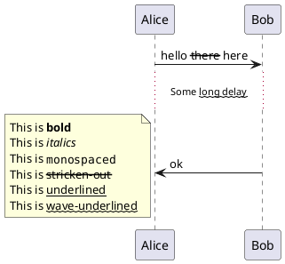

## Lists

FIXME

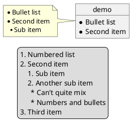

## Escape character

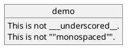

## Headings

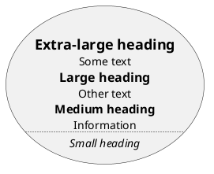

## Emoji

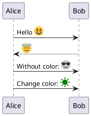
```
@startuml
emoji <block>
@enduml
```

- Unicode block 26 : 83 emoji
- Unicode block 27 : 33 emoji
- Unicode block 1F3 : 246 emoji
- Unicode block 1F4 : 255 emoji
- Unicode block 1F5 : 136 emoji
- Unicode block 1F6 : 181 emoji
- Unicode block 1F9 : 240 emoji

### Unicode block 26

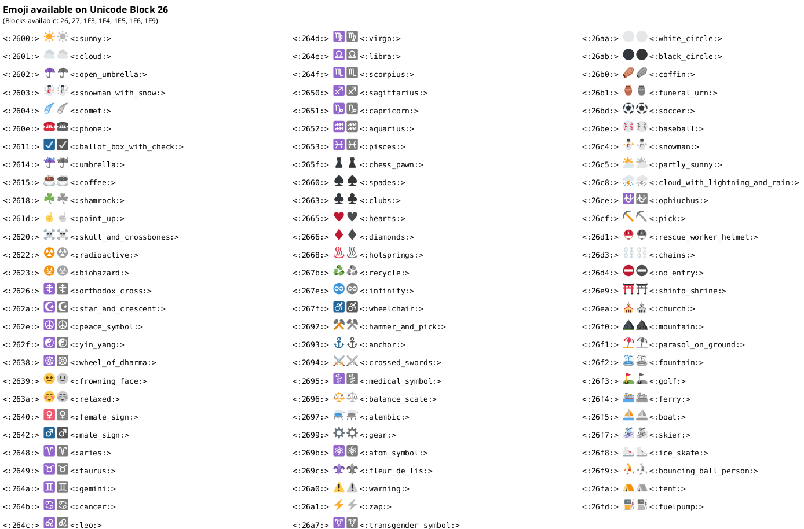

## Horizontal lines

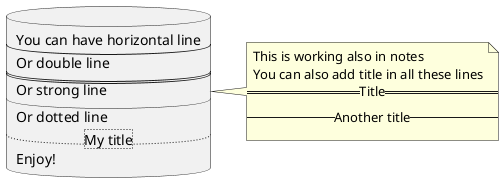

## Links

- [[http://plantuml.com]]
- [[http://plantuml.com This label is printed]]
- [[http://plantuml.com{Optional tooltip} This label is printed]]

## Code

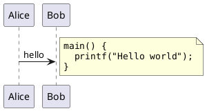

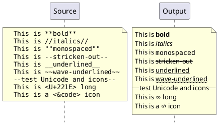

## Table

### Create a table

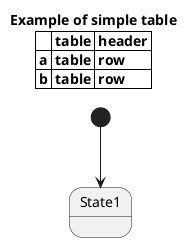

### Align fields using Table

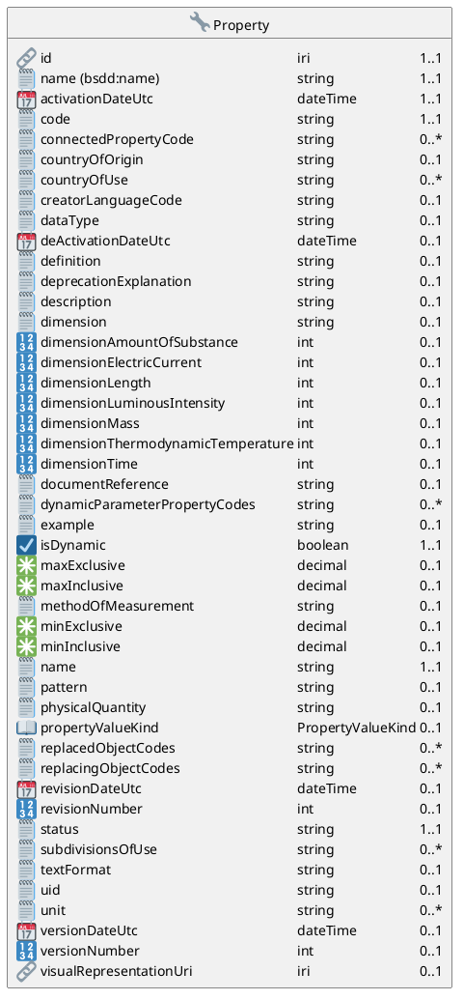

### Add color on rows or cells

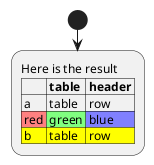

### Add color on border and text

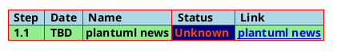

### No border or same color as the background

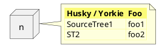

### Bold header or not

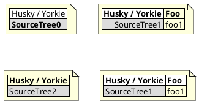

## Tree

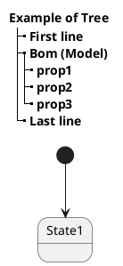

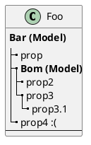

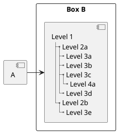

## Special characters

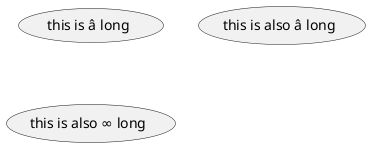

- You can use the listfonts command with a test string of your desired characters, to see which fonts may include them.
- For characters that are emoji, it's better to use the Emoji notation that doesn't depend on installed fonts, and the emoji are colored.
- The PlantUML server has the "Noto Emoji" font that has most emoji. If you want to render diagrams on your local system, you should check which fonts you have.
- Unfortunately "Noto Emoji" lacks normal chars, so you need to switch fonts, eg

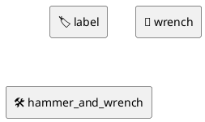

## Legacy HTML

- <b> for bold text
- <u> or <u:#AAAAAA> or <u:[[color|colorName]]> for underline
- <i> for italic
- <s> or <s:#AAAAAA> or <s:[[color|colorName]]> for strike text
- <w> or <w:#AAAAAA> or <w:[[color|colorName]]> for wave underline text
- <plain> for plain text
- <color:#AAAAAA> or <color:[[color|colorName]]>
- <back:#AAAAAA> or <back:[[color|colorName]]> for background color
- <size:nn> to change font size
-  : the file must be accessible by the filesystem
-  : the URL must be available from the Internet
- {scale:nn} to change image size, eg 

```plantuml
@startuml
:* You can change <color:red>text color</color>
* You can change <back:cadetblue>background color</back>
* You can change <size:18>size</size>
* You use <u>legacy</u> <b>HTML <i>tag</i></b>
* You use <u:red>color</u> <s:green>in HTML</s> <w:#0000FF>tag</w>
----
* Use image : 
;
@enduml
```

### Common HTML element

```plantuml
@startuml
hide footbox
note over Source
<code>
  This is <b>bold</b>
  This is <i>italics</i>
  This is <font:monospaced>monospaced</font>
  This is <s>stroked</s>
  This is <u>underlined</u>
  This is <w>waved</w>
  This is <s:green>stroked</s>
  This is <u:red>underlined</u>
  This is <w:#0000FF>waved</w>
  This is <b>a bold text containing <plain>plain text</plain> inside</b>
  -- other examples --
  This is <color:blue>Blue</color>
  This is <back:orange>Orange background</back>
  This is <size:20>big</size>
</code>
end note
/note over Output
  This is <b>bold</b>
  This is <i>italics</i>
  This is <font:monospaced>monospaced</font>
  This is <s>stroked</s>
  This is <u>underlined</u>
  This is <w>waved</w>
  This is <s:green>stroked</s>
  This is <u:red>underlined</u>
  This is <w:#0000FF>waved</w>
  This is <b>a bold text containing <plain>plain text</plain> inside</b>
  -- other examples --
  This is <color:blue>Blue</color>
  This is <back:orange>Orange background</back>
  This is <size:20>big</size>
end note
@enduml
```

### Subscript and Superscript element [sub, sup]

```plantuml
@startuml
:<code>
This is the "caffeine" molecule: C<sub>8</sub>H<sub>10</sub>N<sub>4</sub>O<sub>2</sub>
</code>
This is the "caffeine" molecule: C<sub>8</sub>H<sub>10</sub>N<sub>4</sub>O<sub>2</sub>
----
<code>
This is the Pythagorean theorem: a<sup>2</sup> + b<sup>2</sup> = c<sup>2</sup>
</code>
This is the Pythagorean theorem: a<sup>2</sup> + b<sup>2</sup> = c<sup>2</sup>;
@enduml
```

## OpenIconic

```plantuml
@startuml
title: <size:20><&heart>Use of OpenIconic<&heart></size>
class Wifi
note left
  Click on <&wifi>
end note
@enduml
```

```plantuml
@startuml
listopeniconic
@enduml
```

## Appendix: Examples of "Creole List" on all diagrams

### Activity

```plantuml
@startuml
start
:**test list 1**
* Bullet list
* Second item
** Sub item
*** Sub sub item
* Third item
----
**test list 2**
# Numbered list
# Second item
## Sub item
## Another sub item
# Third item;
stop
@enduml
```

### Class

FIXME

- Sub item
- Sub sub item

FIXME

```plantuml
@startuml

class a {
**test list 1**
* Bullet list
* Second item
** Sub item
*** Sub sub item
* Third item
----
**test list 2**
# Numbered list
# Second item
## Sub item
## Another sub item
# Third item
}

a -- b 

@enduml
```

### Component, Deployment, Use-Case

```plantuml
@startuml
node n [
**test list 1**
* Bullet list
* Second item
** Sub item
*** Sub sub item
* Third item
----
**test list 2**
# Numbered list
# Second item
## Sub item
## Another sub item
# Third item
]

file f as "
**test list 1**
* Bullet list
* Second item
** Sub item
*** Sub sub item
* Third item
----
**test list 2**
# Numbered list
# Second item
## Sub item
## Another sub item
# Third item
"
@enduml
```

DONE

### Gantt project planning

### Object

FIXME

- Sub item
- Sub sub item

FIXME

```plantuml
@startuml
object user {
**test list 1**
* Bullet list
* Second item
** Sub item
*** Sub sub item
* Third item
----	
**test list 2**
# Numbered list
# Second item
## Sub item
## Another sub item
# Third item
}

@enduml
```

### MindMap

```plantuml
@startmindmap

* root
** d1
**:**test list 1**
* Bullet list
* Second item
** Sub item
*** Sub sub item
* Third item
----
**test list 2**
# Numbered list
# Second item
## Sub item
## Another sub item
# Third item;


@endmindmap
```

### Network (nwdiag)

```plantuml
@startnwdiag
nwdiag {
  network Network {
      Server [description="**test list 1**\n* Bullet list\n* Second item\n** Sub item\n*** Sub sub item\n* Third item\n----\n**test list 2**\n# Numbered list\n# Second item\n## Sub item\n## Another sub item\n# Third item"];
}
@endnwdiag
```

### Note

```plantuml
@startuml
note as n
**test list 1**
* Bullet list
* Second item
** Sub item
*** Sub sub item
* Third item
----
**test list 2**
# Numbered list
# Second item
## Sub item
## Another sub item
# Third item
end note
@enduml
```

### Sequence

```plantuml
@startuml
<style>
participant {HorizontalAlignment left}
</style>
participant Participant [
**test list 1**
* Bullet list
* Second item
** Sub item
*** Sub sub item
* Third item
----
**test list 2**
# Numbered list
# Second item
## Sub item
## Another sub item
# Third item
]

participant B

Participant -> B
@enduml
```

### State

```plantuml
@startuml
<style>
stateDiagram {
title {HorizontalAlignment left}
}
</style>
state "**test list 1**\n* Bullet list\n* Second item\n** Sub item\n*** Sub sub item\n* Third item\n----\n**test list 2**\n# Numbered list\n# Second item\n## Sub item\n## Another sub item\n# Third item" as a {
a: **test list 1**\n* Bullet list\n* Second item\n** Sub item\n*** Sub sub item\n* Third item\n----\n**test list 2**\n# Numbered list\n# Second item\n## Sub item\n## Another sub item\n# Third item
state "**test list 1**\n* Bullet list\n* Second item\n** Sub item\n*** Sub sub item\n* Third item\n----\n**test list 2**\n# Numbered list\n# Second item\n## Sub item\n## Another sub item\n# Third item" as b
state : **test list 1**\n* Bullet list\n* Second item\n** Sub item\n*** Sub sub item\n* Third item\n----\n**test list 2**\n# Numbered list\n# Second item\n## Sub item\n## Another sub item\n# Third item
}
@enduml
```

### WBS

```plantuml
@startwbs

* root
** d1
**:**test list 1**
* Bullet list
* Second item
** Sub item
*** Sub sub item
* Third item
----
**test list 2**
# Numbered list
# Second item
## Sub item
## Another sub item
# Third item;

@endwbs
```

## Appendix: Examples of "Creole horizontal lines" on all diagrams

FIXME FIXME

```plantuml
@startuml
start
:You can have horizontal line
----
Or double line
====
Or strong line
____
Or dotted line
..My title..
Or dotted title
//and title... //
==Title==
Or double-line title
--Another title--
Or single-line title
Enjoy!;
stop
@enduml
```

```plantuml
@startuml

class a {
You can have horizontal line
----
Or double line
====
Or strong line
____
Or dotted line
..My title..
Or dotted title
//and title... //
==Title==
Or double-line title
--Another title--
Or single-line title
Enjoy!
}

a -- b 

@enduml
```

```plantuml
@startuml
node n [
You can have horizontal line
----
Or double line
====
Or strong line
____
Or dotted line
..My title..
//and title... //
==Title==
--Another title--
Enjoy!
]

file f as "
You can have horizontal line
----
Or double line
====
Or strong line
____
Or dotted line
..My title..
//and title... //
==Title==
--Another title--
Enjoy!
"

person p [

You can have horizontal line
----
Or double line
====
Or strong line
____
Or dotted line
..My title..
//and title... //
==Title==
--Another title--
Enjoy!

]
@enduml
```

```plantuml
@startuml
object user {
You can have horizontal line
----
Or double line
====
Or strong line
____
Or dotted line
..My title..
//and title... //
==Title==
--Another title--
Enjoy!
}

@enduml
```

DONE

FIXME FIXME

```plantuml
@startmindmap

* root
** d1
**:You can have horizontal line
----
Or double line
====
Or strong line
____
Or dotted line
..My title..
//and title... //
==Title==
--Another title--
Enjoy!;

@endmindmap
```

```plantuml
@startnwdiag
nwdiag {
  network Network {
      Server [description="You can have horizontal line\n----\nOr double line\n====\nOr strong line\n____\nOr dotted line\n..My title..\n//and title... //\n==Title==\n--Another title--\nEnjoy!"];
}
@endnwdiag
```

```plantuml
@startuml
note as n
You can have horizontal line
----
Or double line
====
Or strong line
____
Or dotted line
..My title..
//and title... //
==Title==
--Another title--
Enjoy!
end note
@enduml
```

```plantuml
@startuml
<style>
participant {HorizontalAlignment left}
</style>
participant Participant [
You can have horizontal line
----
Or double line
====
Or strong line
____
Or dotted line
..My title..
//and title... //
==Title==
--Another title--
Enjoy!
]

participant B

Participant -> B
@enduml
```

```plantuml
@startuml
<style>
stateDiagram {
title {HorizontalAlignment left}
}
</style>
state "You can have horizontal line\n----\nOr double line\n====\nOr strong line\n____\nOr dotted line\n..My title..\n//and title... //\n==Title==\n--Another title--\nEnjoy!" as a {
a: You can have horizontal line\n----\nOr double line\n====\nOr strong line\n____\nOr dotted line\n..My title..\n//and title... //\n==Title==\n--Another title--\nEnjoy!
state "You can have horizontal line\n----\nOr double line\n====\nOr strong line\n____\nOr dotted line\n..My title..\n//and title... //\n==Title==\n--Another title--\nEnjoy!" as b
state : You can have horizontal line\n----\nOr double line\n====\nOr strong line\n____\nOr dotted line\n..My title..\n//and title... //\n==Title==\n--Another title--\nEnjoy!
}
@enduml
```

FIXME FIXME

```plantuml
@startwbs

* root
** d1
**:You can have horizontal line
----
Or double line
====
Or strong line
____
Or dotted line
..My title..
//and title... //
==Title==
--Another title--
Enjoy!;

@endwbs
```

## Style equivalent (between Creole and HTML)

| Style | Creole | Legacy HTML like |
| bold | This is**bold** | This is<b>bold</b> |
| italics | This is//italics// | This is<i>italics</i> |
| monospaced | This is""monospaced"" | This is<font:monospaced>monospaced</font> |
| stroked | This is--stroked-- | This is<s>stroked</s> |
| underlined | This is__underlined__ | This is<u>underlined</u> |
| waved | This is~~waved~~ | This is<w>waved</w> |

```plantuml
@startmindmap
* Style equivalent\n(between Creole and HTML) 
**:**Creole**
----
<#silver>|= code|= output|
| \n This is ""~**bold**""\n | \n This is **bold** |
| \n This is ""~//italics//""\n | \n This is //italics// |
| \n This is ""~""monospaced~"" ""\n | \n This is ""monospaced"" |
| \n This is ""~--stroked--""\n | \n This is --stroked-- |
| \n This is ""~__underlined__""\n |  \n This is __underlined__ |
| \n This is ""<U+007E><U+007E>waved<U+007E><U+007E>""\n | \n This is ~~waved~~ |;
**:<b>Legacy HTML like
----
<#silver>|= code|= output|
| \n This is ""~<b>bold</b>""\n | \n This is <b>bold</b> |
| \n This is ""~<i>italics</i>""\n | \n This is <i>italics</i> |
| \n This is ""~<font:monospaced>monospaced</font>""\n | \n This is <font:monospaced>monospaced</font> |
| \n This is ""~<s>stroked</s>""\n | \n  This is <s>stroked</s> |
| \n This is ""~<u>underlined</u>""\n | \n This is <u>underlined</u> |
| \n This is ""~<w>waved</w>""\n | \n This is <w>waved</w> |

And color as a bonus...
<#silver>|= code|= output|
| \n This is ""~<s:""<color:green>""green""</color>"">stroked</s>""\n | \n  This is <s:green>stroked</s> |
| \n This is ""~<u:""<color:red>""red""</color>"">underlined</u>""\n | \n This is <u:red>underlined</u> |
| \n This is ""~<w:""<color:#0000FF>""#0000FF""</color>"">waved</w>""\n | \n This is <w:#0000FF>waved</w> |;
@endmindmap
```

## Creole on Creole

```plantuml
@startcreole
==Creole
  This is **bold**
  This is //italics//
  This is ""monospaced""
  This is --stricken-out--
  This is __underlined__
  This is ~~wave-underlined~~
test Unicode and icons
  This is <U+221E> long
  This is a <&code> icon
  Use image : 

<b>HTML Creole 
  This is <b>bold</b>
  This is <i>italics</i>
  This is <font:monospaced>monospaced</font>
  This is <s>stroked</s>
  This is <u>underlined</u>
  This is <w>waved</w>
  This is <s:green>stroked</s>
  This is <u:red>underlined</u>
  This is <w:#0000FF>waved</w>
other examples
  This is <color:blue>Blue</color>
  This is <back:orange>Orange background</back>
  This is <size:20>big</size>

Creole list item
**test list 1**
* Bullet list
* Second item
** Sub item
*** Sub sub item
* Third item

**test list 2**
# Numbered list
# Second item
## Sub item
## Another sub item
# Third item
@endcreole
```
