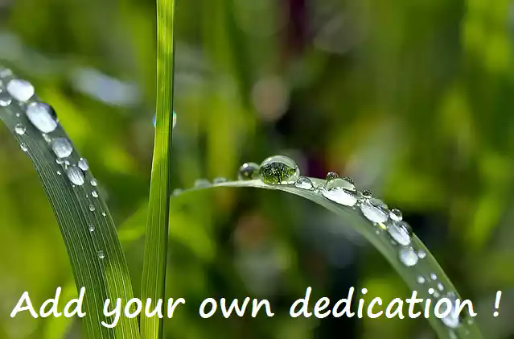

# Dedication

PlantUML News and information Dedication    Â

- Public : the special sentence is publicly written in the code of PlantUML, so someone searching into the code will be able to find it and then see your photo.
- Private : only SHA-512 signature of the special sentence is in the source code (as the encrypted photo). No one can guess your special sentence, neither see your photo, since it's encrypted using the sentence itself.

## Example

## Why?

- Because there might be some message that you want to be set in stone for eternity
- Because it's fun to be able to generate a beautiful image from a simple sentence
- Because it helps PlantUML to grow!

## How?

- Your sentence,
- Your photo or picture,
- Whether you want a public or a private dedication.

- Send it to you,
- Install it online on the PlantUML Web Server
