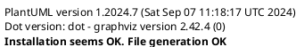

# GraphViz

PlantUML News and information Graphviz installation    Â

- Usecase diagrams
- Class diagrams
- Object diagrams
- Component diagrams
- Deployment diagram
- State diagrams
- Legacy activity diagrams

## Installation under Linux

- Fedora packages: sudo yum install graphviz
- Ubuntu packages: sudo apt install graphviz
- Debian packages: sudo apt install graphviz

- Firstly in: /usr/local/bin/dot
- Then in: /usr/bin/dot

## Installation under Mac
```
brew install libtool
brew link libtool
brew install graphviz
brew link --overwrite graphviz
```

- Firstly in: /usr/local/bin/dot
- Then in: /usr/bin/dot

## Testing
```
java -jar plantuml.jar -testdot
```



## New Java-based diagram generation engine "Smetana"

## Installation under Windows

### Starting from 1.2020.21

### Older PlantUML versions

- Install Win32 version of GraphViz 2.44 (easiest)
- Use the minimalistic graphviz dot.exe and unpack it on your c:\ drive (see below)
- Install x64 version of GraphViz 2.44 (more complex)

## Important note about version

- 2.26.3
- 2.28
- 2.30.1
- 2.34
- 2.36
- 2.38
- 2.44
