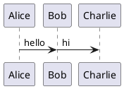
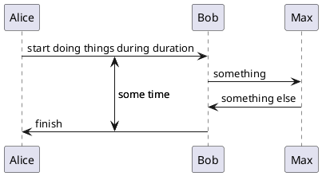
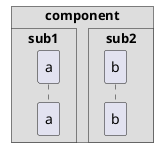
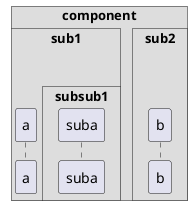

# Current "Puma" architecture

PlantUML News and information Teoz architecture    Â

## Toward "Teoz" architecture



## Anchors and Duration



## Pragma "teoz"
```
java -jar plantuml.jar -Pteoz=true
```

[Ref. GH-582 ]

## Nested boxes for sequence diagrams




