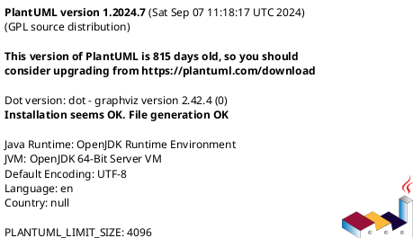

```plantuml
@startuml
title %version()
@enduml
```

# Context (of versioning)

PlantUML News and information Versioning    Â

- The PlantUML Language (that is everything that is between @startuml and @enduml for instance) : This part is very stable. We really take care about backward compatibility here . Even diagrams that have been written by earlier versions of PlantUML are still readable by latest releases.
- The Java API Integration : it has been changing since the beginning. This impacts only Java Plugins and not tools that are using PlantUML through command line.

## Official Versioning Scheme

| Number | Example | Description |
| MAJOR | 1 | This number will increase when there will be an incompatible change in the Java API.Also, if ever there is a change in the PlantUML language itself which break ascending compatibility, we will also increase this number,but we expect that this will never happen(it hasnotsince 2009!).Change inMAJORnumber will be documented: we will clearly explain what has changed between major versions. We expect less than one change per year here. |
| YEAR/MINOR | 2017 | This number will be the releasing year of the version. While this is notcompletely standard, we think that it will help people to know whether they are using a recent version of PlantUML or not. |
| RELEASE/PATCH | 12 | This number will be simply incremented for each release of the year. We expect about 20 to 30 releases per year. It will be reset to zero at each year change. |

## Knowing the exact version you are using
```
java -jar plantuml.jar -version
```




