# Salt (Wireframe)

## Basic widgets

- Button using [ and ] .
- Radio button using ( and ) .
- Checkbox using [ and ] .
- User text area using " .
- Droplist using ^ .

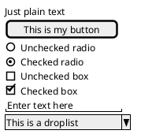

## Text area

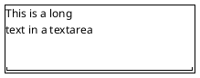

- the dot ( . ) to fill up vertical space;
- the last line of space ( "     " ) to make the area wider.

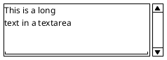

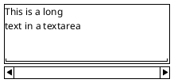

## Open, close droplist

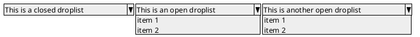

## Using grid [| and #, !, -, +]

```plantuml
@startsalt
{
  Login    | "MyName   "
  Password | "****     "
  [Cancel] | [  OK   ]
}
@endsalt
```

| Symbol | Result |
| # | To display all vertical and horizontal lines |
| ! | To display all vertical lines |
| - | To display all horizontal lines |
| + | To display external lines |

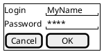

## Group box [^]

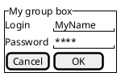

## Using separator [.., ==, ~~, --]

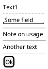

## Tree widget [T]

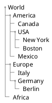

## Tree table [T]

```plantuml
@startsalt
{
{T
+Region        | Population    | Age
+ World        | 7.13 billion  | 30
++ America     | 964 million   | 30
+++ Canada     | 35 million    | 30
+++ USA        | 319 million   | 30
++++ NYC       | 8 million     | 30
++++ Boston    | 617 thousand  | 30
+++ Mexico     | 117 million   | 30
++ Europe      | 601 million   | 30
+++ Italy      | 61 million    | 30
+++ Germany    | 82 million    | 30
++++ Berlin    | 3 million     | 30
++ Africa      | 1 billion     | 30
}
}
@endsalt
```

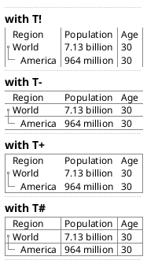

## Enclosing brackets [{, }]

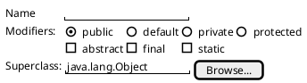

## Adding tabs [/]

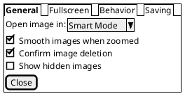

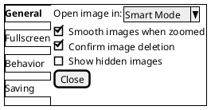

## Using menu [*]

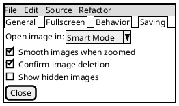

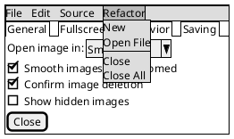

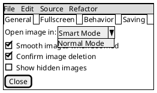

## Advanced table

- * to indicate that a cell with span with left
- . to denotate an empty cell

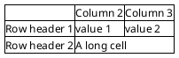

## Scroll Bars [S, SI, S-]

- {S : for horizontal and vertical scrollbars

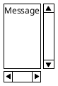

- {SI : for vertical scrollbar only

```plantuml
@startsalt
{SI
Message
.
.
.
.
}
@endsalt
```

- {S- : for horizontal scrollbar only

```plantuml
@startsalt
{S-
Message
.
.
.
.
}
@endsalt
```

## Colors

```plantuml
@startsalt
{
  <color:Blue>Just plain text
  [This is my default button]
  [<color:green>This is my green button]
  [<color:#9a9a9a>This is my disabled button]
  []  <color:red>Unchecked box
  [X] <color:green>Checked box
  "Enter text here   "
  ^This is a droplist^
  ^<color:#9a9a9a>This is a disabled droplist^
  ^<color:red>This is a red droplist^
}
@endsalt
```

## Creole on Salt

```plantuml
@startsalt
{{^==Creole
  This is **bold**
  This is //italics//
  This is ""monospaced""
  This is --stricken-out--
  This is __underlined__
  This is ~~wave-underlined~~
  --test Unicode and icons--
  This is <U+221E> long
  This is a <&code> icon
  Use image : 
}|
{^<b>HTML Creole 
 This is <b>bold</b>
  This is <i>italics</i>
  This is <font:monospaced>monospaced</font>
  This is <s>stroked</s>
  This is <u>underlined</u>
  This is <w>waved</w>
  This is <s:green>stroked</s>
  This is <u:red>underlined</u>
  This is <w:#0000FF>waved</w>
  -- other examples --
  This is <color:blue>Blue</color>
  This is <back:orange>Orange background</back>
  This is <size:20>big</size>
}|
{^Creole line
You can have horizontal line
----
Or double line
====
Or strong line
____
Or dotted line
..My title..
Or dotted title
//and title... //
==Title==
Or double-line title
--Another title--
Or single-line title
Enjoy!
}|
{^Creole list item
**test list 1**
* Bullet list
* Second item
** Sub item
*** Sub sub item
* Third item
----
**test list 2**
# Numbered list
# Second item
## Sub item
## Another sub item
# Third item
}|
{^Mix on salt
  ==<color:Blue>Just plain text
  [This is my default button]
  [<b><color:green>This is my green button]
  [ ---<color:#9a9a9a>This is my disabled button-- ]
  []  <size:20><color:red>Unchecked box
  [X] <color:green>Checked box
  "//Enter text here//   "
  ^This is a droplist^
  ^<color:#9a9a9a>This is a disabled droplist^
  ^<b><color:red>This is a red droplist^
}}
@endsalt
```

## Pseudo sprite [<<, >>]

```plantuml
@startsalt
 {
 [X] checkbox|[] checkbox
 () radio | (X) radio
 This is a text|[This is my button]|This is another text
 "A field"|"Another long Field"|[A button]
 <<folder
 ............
 .XXXXX......
 .X...X......
 .XXXXXXXXXX.
 .X........X.
 .X........X.
 .X........X.
 .X........X.
 .XXXXXXXXXX.
 ............
 >>|<color:blue>other folder|<<folder>>
^Droplist^
}
@endsalt
```

## OpenIconic

```plantuml
@startsalt
{
  Login<&person> | "MyName   "
  Password<&key> | "****     "
  [Cancel <&circle-x>] | [OK <&account-login>]
}
@endsalt
```

```plantuml
@startuml
listopeniconic
@enduml
```

## Add title, header, footer, caption or legend

```plantuml
@startsalt
title My title
header some header
footer some footer
caption This is caption
legend
The legend
end legend

{+
  Login    | "MyName   "
  Password | "****     "
  [Cancel] | [  OK   ]
}

@endsalt
```

## Zoom, DPI

### Whitout zoom (by default)

```plantuml
@startsalt
{
  <&person> Login  | "MyName   "
  <&key> Password  | "****     "
  [<&circle-x> Cancel ] | [ <&account-login> OK   ]
}
@endsalt
```

### Scale

```plantuml
@startsalt
scale 2
{
  <&person> Login  | "MyName   "
  <&key> Password  | "****     "
  [<&circle-x> Cancel ] | [ <&account-login> OK   ]
}
@endsalt
```

### DPI

```plantuml
@startsalt
skinparam dpi 200
{
  <&person> Login  | "MyName   "
  <&key> Password  | "****     "
  [<&circle-x> Cancel ] | [ <&account-login> OK   ]
}
@endsalt
```

## Include Salt "on activity diagram"

```plantuml
@startuml
(*) --> "
{{salt
{+
<b>an example
choose one option
()one
()two
[ok]
}
}}
" as choose

choose -right-> "
{{salt
{+
<b>please wait
operation in progress
<&clock>
[cancel]
}
}}
" as wait
wait -right-> "
{{salt
{+
<b>success
congratulations!
[ok]
}
}}
" as success

wait -down-> "
{{salt
{+
<b>error
failed, sorry
[ok]
}
}}
"
@enduml
```

```plantuml
@startuml
!unquoted procedure SALT($x)
"{{salt
%invoke_procedure("_"+$x)
}}" as $x
!endprocedure

!procedure _choose()
{+
<b>an example
choose one option
()one
()two
[ok]
}
!endprocedure

!procedure _wait()
{+
<b>please wait
operation in progress
<&clock>
[cancel]
}
!endprocedure

!procedure _success()
{+
<b>success
congratulations!
[ok]
}
!endprocedure

!procedure _error()
{+
<b>error
failed, sorry
[ok]
}
!endprocedure

(*) --> SALT(choose)
-right-> SALT(wait)
wait -right-> SALT(success)
wait -down-> SALT(error)
@enduml
```

## Include salt "on while condition of activity diagram"

```plantuml
@startuml
start
while (\n{{salt\n{+\nPassword | "****     "\n[Cancel] | [  OK   ]}\n}}\n) is (Incorrect)
  :log attempt;
  :attempt_count++;
  if (attempt_count > 4) then (yes)
    :increase delay timer;
    :wait for timer to expire;
  else (no)
  endif
endwhile (correct)
:log request;
:disable service;
@enduml
```

## Include salt "on repeat while condition of activity diagram"

```plantuml
@startuml
start
repeat :read data;
  :generate diagrams;
repeat while (\n{{salt\n{^"Next step"\n  Do you want to continue? \n[Yes]|[No]\n}\n}}\n)
stop
@enduml
```

## Skinparam

```plantuml
@startsalt
skinparam Backgroundcolor palegreen
{+
  Login    | "MyName   "
  Password | "****     "
  [Cancel] | [  OK   ]
}
@endsalt
```

```plantuml
@startsalt
!option handwritten true
{+
  Login    | "MyName   "
  Password | "****     "
  [Cancel] | [  OK   ]
}
@endsalt
```

FIXME

```plantuml
@startsalt
skinparam defaultFontName monospaced
{+
  Login    | "MyName   "
  Password | "****     "
  [Cancel] | [  OK   ]
}
@endsalt
```

## Style

```plantuml
@startsalt
<style>
saltDiagram {
  BackgroundColor palegreen
}
</style>
{+
  Login    | "MyName   "
  Password | "****     "
  [Cancel] | [  OK   ]
}
@endsalt
```

FIXME

```plantuml
@startsalt
<style>
saltDiagram {
  Fontname Monospaced
  FontSize 10
  FontStyle italic
  LineThickness 0.5
  LineColor red
}
</style>
{+
  Login    | "MyName   "
  Password | "****     "
  [Cancel] | [  OK   ]
}
@endsalt
```
