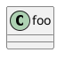

# JQuery integration

PlantUML Plugins JQuery    Â


```
<head>
<script type="text/javascript" src="jquery.js"></script>
<script type="text/javascript" src="[[jquery_plantuml.js|jquery_plantuml.js]]"></script>
<!-- rawdeflate.js is implicity used by jquery_plantuml.js -->
</head>
```

## How does it works?

- JQuery simply parses the html source file on loading,
- Then all uml descriptions are transformed into links to plantuml.com site. (like for Javascript integration .)

## Complete source example
```
<html>
<head>
<script type="text/javascript" src="jquery.js"></script>
<script type="text/javascript" src="[[jquery_plantuml.js|jquery_plantuml.js]]"></script>
<!-- rawdeflate.js is implicity used by jquery_plantuml.js -->
</head>

<body>
<p>Example</p>
<hr>

<hr>


</body>
</html>
```
